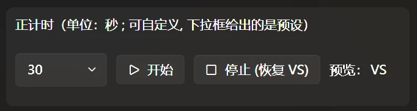

# Countdown Timer

This feature displays a timer on the [BP overlay](fronted-manager.md#前台窗口). While the timer runs, “VS” is replaced by the remaining seconds. “VS” returns when the countdown finishes or you stop the timer manually.

#### How to use it

1. Set the countdown in seconds using the drop-down or by left-clicking the control.
2. Click **Start**.
3. Click **Stop (Restore VS)** to stop it, or wait for the countdown to reach zero.

> The **Preview** on the right shows the current content of the “VS” position on the BP overlay.

Manual adjustment is usually unnecessary: the timer starts and stops automatically with [Step-by-step Guidance](game-info-and-guidance.md).
