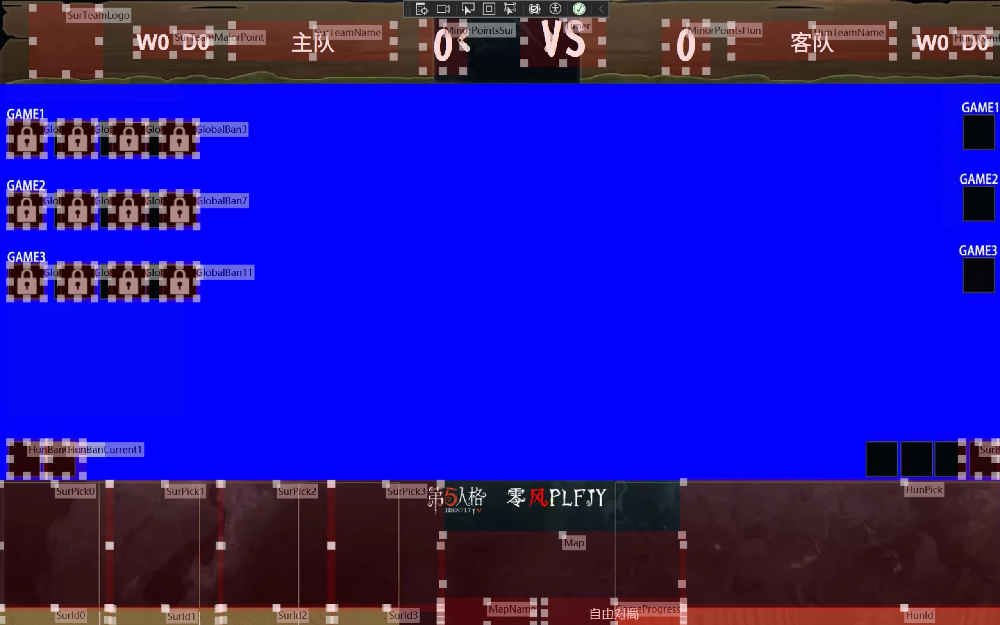

# FAQ and Troubleshooting

This document covers common problems and their solutions. Before asking in the community group or opening an issue, check whether your problem is already covered here.

## Misaligned overlay controls

1. Open Windows Settings.
2. Go to System → Display and set scaling below 200% (the default value is recommended).
3. Restart the software.
