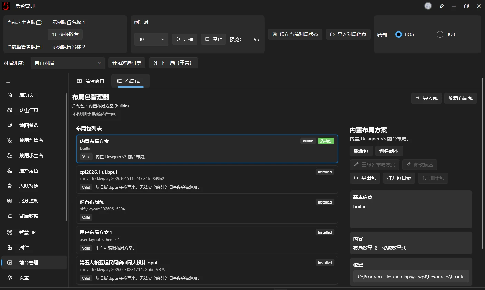

# Overlay Window Management

## Broadcast overlay windows {#前台窗口}

Open or hide broadcast overlays and manage custom overlay windows here.

**Stop All Looping Animations** is usually unnecessary. Use it when a looping animation, such as a pulsing highlight, will not stop.

Click **Open v3 Overlay Designer** to edit the overlays freely in a separate window. See [v3 Overlay Designer](advanced/v3-designer.md) for details.

## Layout Packages

Import, export, delete, or create copies of imported Overlay Layout Packages here.

When you modify a built-in Layout Package in the v3 editor, a copy is created automatically and subsequent work continues in that copy.

Older bpui packages from v2 and earlier can still be imported directly. Their format is upgraded automatically, but a completely accurate conversion is not guaranteed. Please report conversion problems to the development team.
