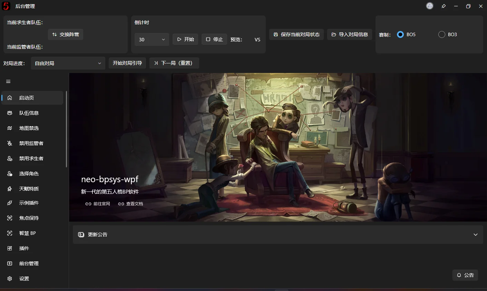

# Introduction

This software is open source under GPL-3.0 and **completely free**.

**If overlay controls appear incorrectly or disappear, go to [Overlay Window Management](fronted-manager.md) and switch to the built-in layout. This may be a bug caused by default settings left over from an earlier version.**

Official site: [https://bpsys.plfjy.top/](https://bpsys.plfjy.top/)

Project: [https://github.com/PLFJY/neo-bpsys-wpf/](https://github.com/PLFJY/neo-bpsys-wpf/)

Author's QQ: 3424127335

QQ community group: 175741665

**A friendly reminder: before opening a GitHub issue or reporting a problem in the group, please check carefully whether the problem comes from the software or from how you are using it.**

↓ Here is an example of a rather misguided issue report. ↓ (The screenshots play on Clerk's recording abilities:  +  + ) — S0 Clerk

