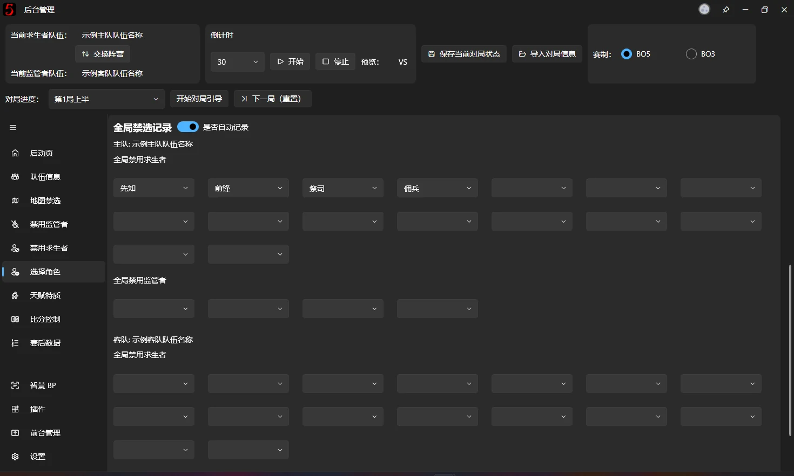

# Pick Characters

Use this page to record both sides' character picks and Global Ban Records.

## Pick characters for each faction

The page has four Survivor selectors and one Hunter selector. Each Survivor selector has a read-only field above it showing the player name for that slot, making it easier to match players with characters during character assignment.

Selection works as described under [Character selector](ban-character.md#角色选择器).

Below each Survivor selector is a character assignment switcher. It works like the player-swap buttons on the [Team Information](team-info.md#修改选手顺序) page: click a number to swap character assignments with the Survivor player in that position.

⚠️ As explained under [Character selector](ban-character.md#角色选择器), the overlay matches the preview portrait. After swapping characters, a different name remaining in the drop-down is normal. Please do not report this as a bug.

## Global Ban Records

Global Ban Records track the characters that should be globally banned **the next time a team plays that faction**. They are applied automatically when switching sides.

These fields use the simplified [character selector](ban-character.md#角色选择器), with all of its search features.

The mechanism works as follows:

- With automatic recording enabled, characters are added to the appropriate team's Global Ban Records according to the current game progress and each team's faction. For example:

    In the first half of Game 1, the **home team** plays Survivors and picks Seer, Forward, Priestess, and Mercenary. They are automatically entered into slots 1–4 of the **home team's** Global Ban Records, as shown above.

    In the second half of Game 2, the **away team** plays Survivors and picks four characters. They are automatically entered into slots 1–4 of the **away team's** Global Ban Records.
- The next time that team plays the same faction, the records are automatically copied into Global Bans on the [Ban Characters](ban-character.md#当局全局禁用) page. This filling is triggered by:
    - Switching sides.
    - Starting Guided Workflow.
    - Clicking **Next Game (Reset)** and choosing **Yes**, or choosing **Reset Only**.
