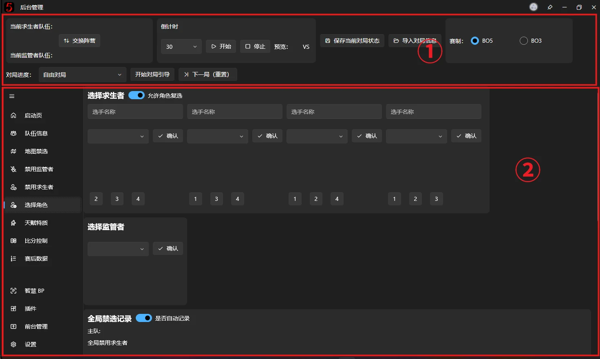
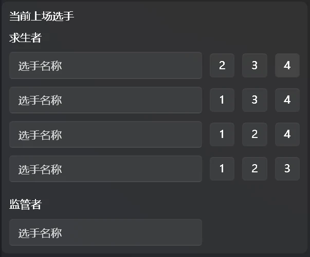
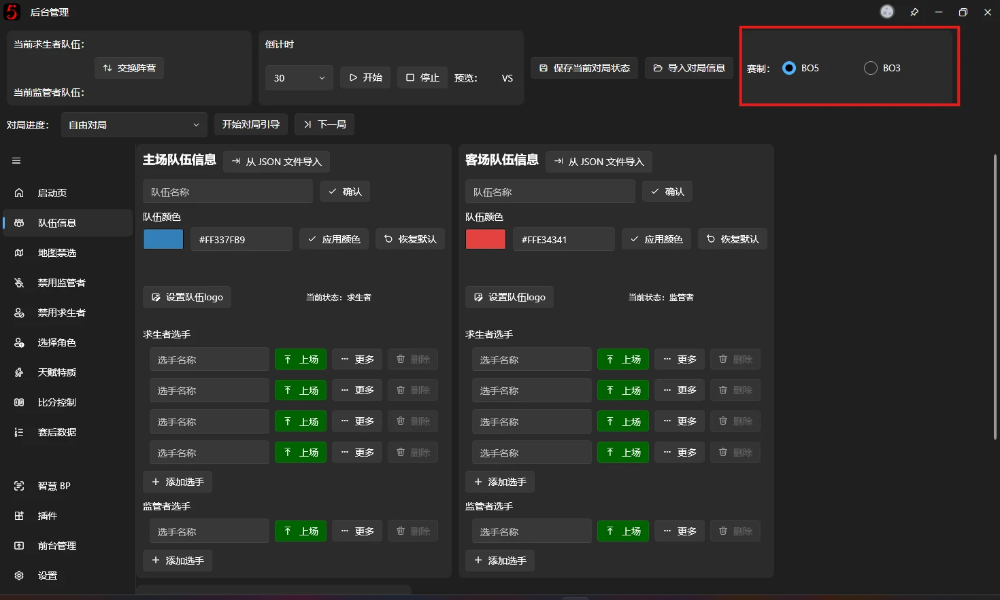
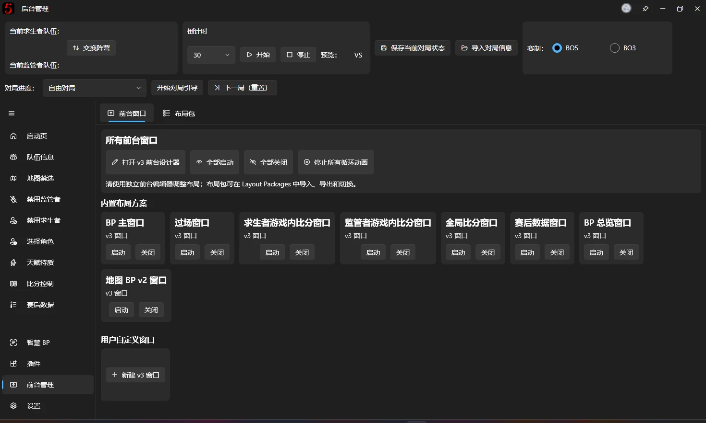
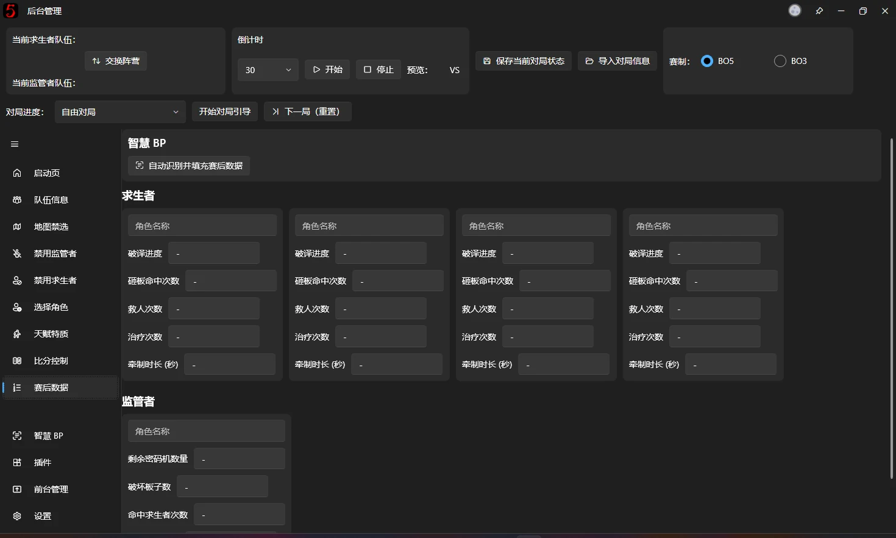

# Quick Start

## Installation

### Check the system requirements

Before using the software, make sure your device meets these recommended requirements:

- Windows 10 20H2 or later.
- Recommended: i5 13400F + RTX 3060 + 16GB RAM. Minimum: i5 8300H + GTX 1060 + 8GB RAM.*
- [.NET 10.0 Desktop Runtime](https://dotnet.microsoft.com/zh-cn/download/dotnet/10.0) installed (the installer normally handles this automatically).

> *Integrated graphics can run the software, but are not recommended for broadcast operation. 
> *On macOS, the software can theoretically run through Wine. However, macOS window management makes it unsuitable for recommended broadcast use.

---

### Download the software

The following download channels are available:

Official channels (updated as releases become available):

- [Official Download Center](/en/#download-center)
- [GitHub Releases](https://github.com/PLFJY/neo-bpsys-wpf/releases)

Third-party channels (maintained by community members; **the latest version is not guaranteed**):

- [Lanzou Cloud](https://wwsm.lanzouo.com/b009hclqvi) (no login required; password: 零风NB)
- [Baidu Netdisk](https://pan.baidu.com/s/5_8kzq0n-09o6T1LreZHisg)
- [Aliyun Drive](https://www.alipan.com/s/t8SByXpso8o) (access code: 86em)

## Basic operation

If you are new to this software, follow these steps to get started.

### 0. Understand the interface layout

The interface has two areas:

① Quick controls: settings, game switching, Guided Workflow, and other operations that apply across a game. 
② Operator area: detailed control of the live broadcast output, including team information, Map Ban/Pick, character Ban/Pick, scores, Post-game Statistics, and overlay window management.

### 1. Set up both teams

Open the software and select **Team Information** on the left. Enter the teams' basic information, then use **Set as active** for all starting players.

The bottom of the page shows the starting players. Click a number after a Survivor player's name to change their position.

For a faster way to load team information, see [Import Team Information from JSON](advanced/import-team-from-json.md).

---

### 2. Set the match format

Choose BO5 or BO3 in the main window. **This setting affects [Guided Workflow](game-info-and-guidance.md), score calculation, and other features, so choose the correct format.**

---

### 3. Open the overlay windows

Select [Overlay Window Management](fronted-manager.md) in the navigation on the left. You can open or close each broadcast overlay here. In general, open them all and manage their visibility in broadcasting software such as [OBS](https://obsproject.com/download), Bilibili Live, or Douyin Live Companion.

---

### 4. Start Guided Workflow

Guided Workflow is based on the official tournament BP rules. Select the current game progress, such as the first half of Game 1, and click **Start Guided Workflow**. Click **Next Step** to carry out each operation according to the rules. Use **Previous Step** or **Stop Guided Workflow** as needed.

Follow the guidance to perform BP. See these pages for details about individual steps:

- [Map Ban/Pick](map-bp.md)
- [Ban Characters](ban-character.md)
- [Pick Characters](pick-character.md)
- [Persona Talents and Traits](talents-and-trait.md)

---

### 5. Enter Post-game Statistics

The **Post-game statistics window** shows both sides' statistics for the current game. Enter each player's data on the Post-game Statistics page to display it in that window.

---

### 6. Manage scores

After play ends, enter and calculate the scores on the [Score System](score-system.md) page. The results are synchronized to the **Score overlay window**.

Select the game progress at the top, then select the corresponding game result in Score Control. Score controls in all overlay windows automatically display scores based on the recorded game progress.

Free Game Mode works differently; see [Score System](score-system.md).

The software awards points in the same way as official tournaments:

| **Game result** | **Survivor team points** | **Hunter team points** |
| --- | --- | --- |
| Four eliminations | 0 | 5 |
| Three eliminations | 1 | 3 |
| Draw | 2 | 2 |
| Three escapes | 3 | 1 |
| Four escapes | 5 | 0 |

---

### 7. Finish the game

After a game ends, click **Next Game (Reset)** to clear its BP information. Information carried across games, such as Map BP, Global Ban Records, and scores, is retained.
