# SmartBP

SmartBP is the software's second most complex system. It is an independent module that requires a separate manual installation.

SmartBP recognizes Identity V game footage to help broadcast operators with character bans, character picks, Guided Workflow, and Post-game Statistics entry.

With SmartBP, you do not have to operate the control panel manually for every character ban or pick. It continuously reads the game footage in a specified window and synchronizes valid recognition results to the operator interface.

SmartBP currently supports:

- **Automatic Character BP Recognition**: recognizes Survivor and Hunter bans and picks and fills them into the operator interface.
- **Guided Workflow Synchronization**: helps synchronize [Guided Workflow](game-info-and-guidance.md) with the recognized BP phase.
- **Survivor character assignment**: identifies which player is using each character on the character selection screen.
- **Post-game Statistics Recognition**: reads post-game results and fills the [Post-game Statistics](match-statistics.md) page.

**SmartBP cannot completely replace a broadcast operator.** It currently does not recognize Map BP, Persona talents, or Traits automatically, and does not switch scenes in OBS or other broadcasting software. An operator should still check recognition results during a live broadcast.

## 1. Install the SmartBP Module

SmartBP is separate from the main program and must be downloaded and installed separately.

The first time you open **SmartBP**, an installation prompt appears if the module is not installed.

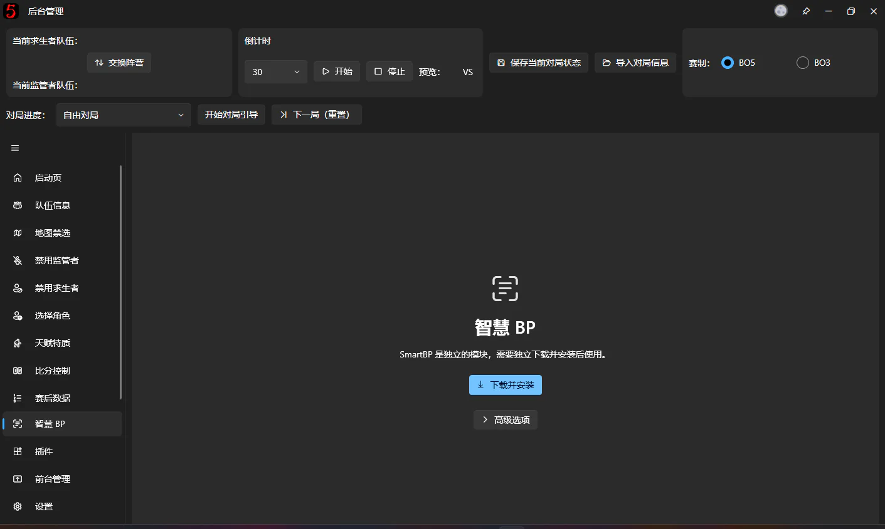

Click **Download and Install**. The software downloads a SmartBP Module matching the current software version and installs it automatically.

You can monitor progress and pause, resume, or cancel the download.

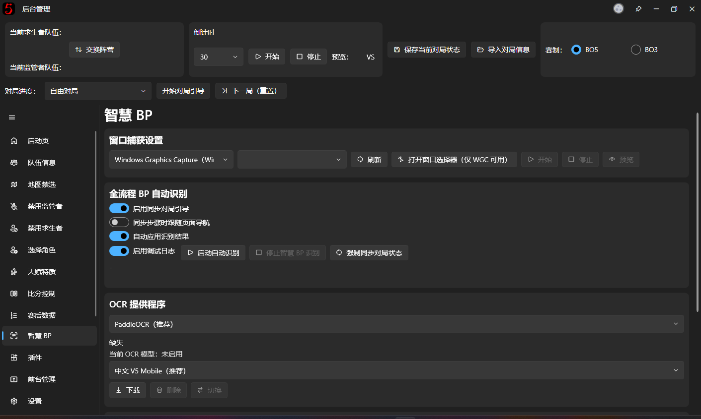

After installation, the software loads the module and opens its feature page.

If prompted, restart the program before continuing.

Normally, you do not need to download DLL files yourself or configure the module directory manually.

## 2. Prepare an OCR Model

SmartBP uses OCR (Optical Character Recognition) to read text in game footage, including character names, BP phase prompts, and post-game statistics.

**After installing the SmartBP Module for the first time, you usually also need to download an OCR Model before recognition can start.**

Find the **OCR Provider** area on the SmartBP page.

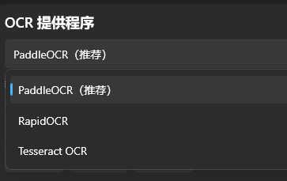

PaddleOCR is recommended. The developer has not tested the other two providers: they should work in theory, but recognition accuracy is not guaranteed and GPU acceleration is not supported for them.

### Choose a model

Several OCR Models are available. For Chinese game footage, the recommended first choice is:

**Chinese V5 Mobile (Recommended)**

This model balances recognition speed and accuracy well for general use.

Other choices include Chinese V4, Chinese V3 Slim, English V4 Mobile, and Japanese V4 Mobile.

If you use the Chinese game client, you generally do not need to switch to an English or Japanese model.

### Download and enable the model

Select a model from the list, then:

1. Click **Download** and wait for it to finish.
2. Click **Switch** to make it the current OCR Model.
3. Check the current model name shown on the page to confirm it is enabled.

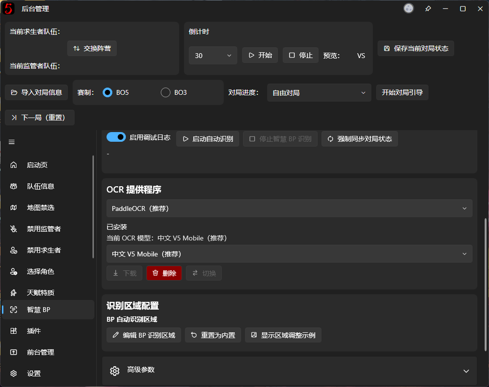

**Downloading a model and enabling it are separate operations.** If you download a model without switching to it, SmartBP may still report that OCR is not ready.

For normal use, select one model suitable for the game's language; you do not need to download them all.

## 3. Select the game window to recognize

Once the OCR Model is ready, tell SmartBP which window to read.

Find **Window Capture Settings** at the top of the page.

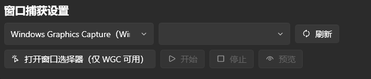

### Choose a capture method

The default **Windows Graphics Capture (WGC)** is usually recommended.

This Windows capture method is suitable for reading game windows.

The software also provides Bitblt capture for cases where WGC does not work. Normally, keep the default setting.

### Select the game window

Open the Identity V client, then return to SmartBP.

Choose the game window from the drop-down. If it is missing, click **Refresh** to reload the list.

Click **Start** to begin capturing the selected window.

Alternatively, use **Open Window Picker (WGC only)** to select a window and start capture through the Windows window picker.

### Check the captured frame

After capture starts, click **Preview** to see exactly what SmartBP is reading.

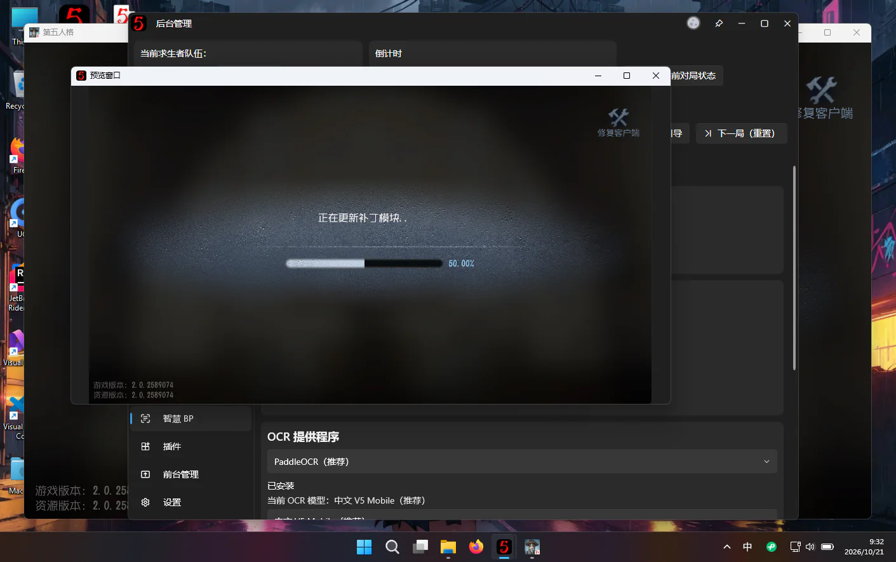

**SmartBP recognizes the footage in this preview, rather than arbitrary content visible on your monitor.**

If the preview is wrong, does not show the game, or crops too much of the game screen, subsequent recognition results may also be wrong.

Test capture before the tournament starts.

## 4. Start automatic BP recognition

Once window capture and the OCR Model are ready, you can start automatic recognition.

Find **Full BP Workflow Recognition** on the SmartBP page.

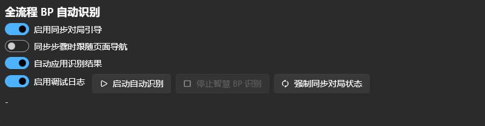

### Before starting

Confirm the following:

1. Both teams are configured correctly in the operator interface.
2. The BO3 or BO5 match format is correct.
3. The current game progress and half are correct, for example, the first half of Game 1.
4. The capture preview shows the game's BP screen correctly.

See [Quick Start](quick-start.md) for these preparations.

**Game progress is especially important.** If the half is wrong, recognition results may be applied to the wrong game entry.

### Automatic recognition switches

The recognition area offers the following options.

**Sync Guided Workflow**

Synchronizes the operator interface's Guided Workflow progress using phase information recognized from the game screen.

For example, when the game moves from bans to picks, the software attempts to advance the guidance to match the actual progress.

Automatic synchronization follows the existing workflow; it does not skip unfinished BP steps unconditionally just to catch up with the screen.

**Follow Page Navigation During Step Sync**

Makes the operator interface navigate between pages as guidance steps synchronize.

It only affects navigation inside the software. **It does not automatically switch the live broadcast output in OBS.**

Leave it off if you prefer to navigate the operator interface manually.

**Apply Recognition Results Automatically**

Writes recognized character bans and picks into the operator interface when they meet the conditions for automatic application.

Turn this off if you only want to observe results without allowing SmartBP to change operator data automatically.

### Start recognition

After checking the settings, click **Start Automatic Recognition**.

A confirmation prompt reminds you to check the game progress and half again.

Once confirmed, SmartBP continuously recognizes game footage from the selected window.

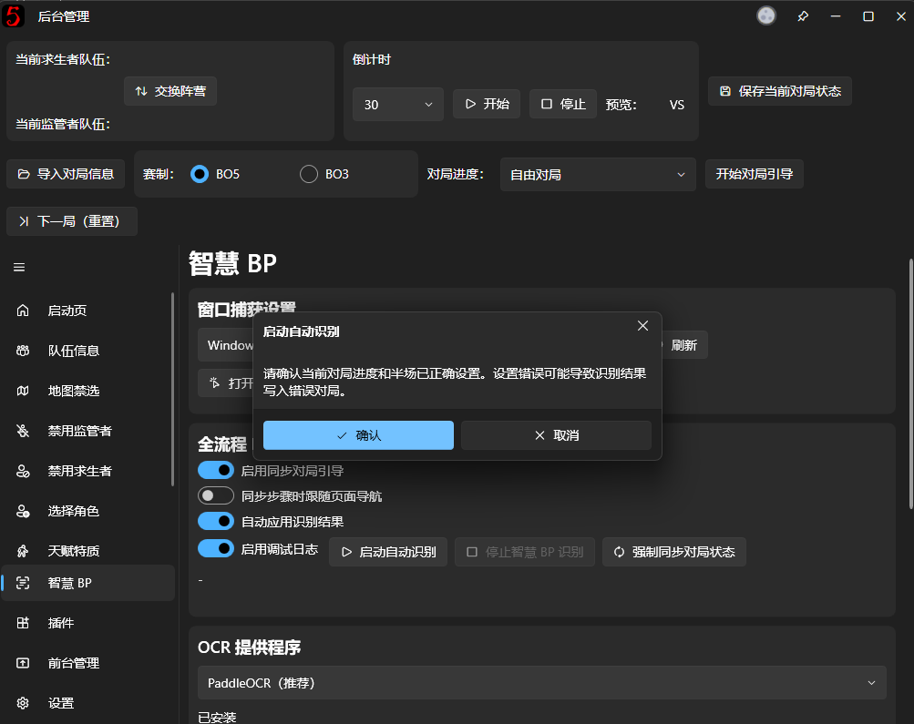

Proceed with character BP in the game and watch the [Ban Characters](ban-character.md) and [Pick Characters](pick-character.md) pages in the operator interface.

When valid character information is recognized, the software attempts to update the corresponding records automatically.

During **character assignment**, it automatically swaps character assignments based on recognized player names. If your tournament uses **special player IDs**, you can set a separate **In-game ID** for recognition.

To do this:

1. Open Team Information.
2. Click **More** next to the player.
3. Enter the player's In-game ID.

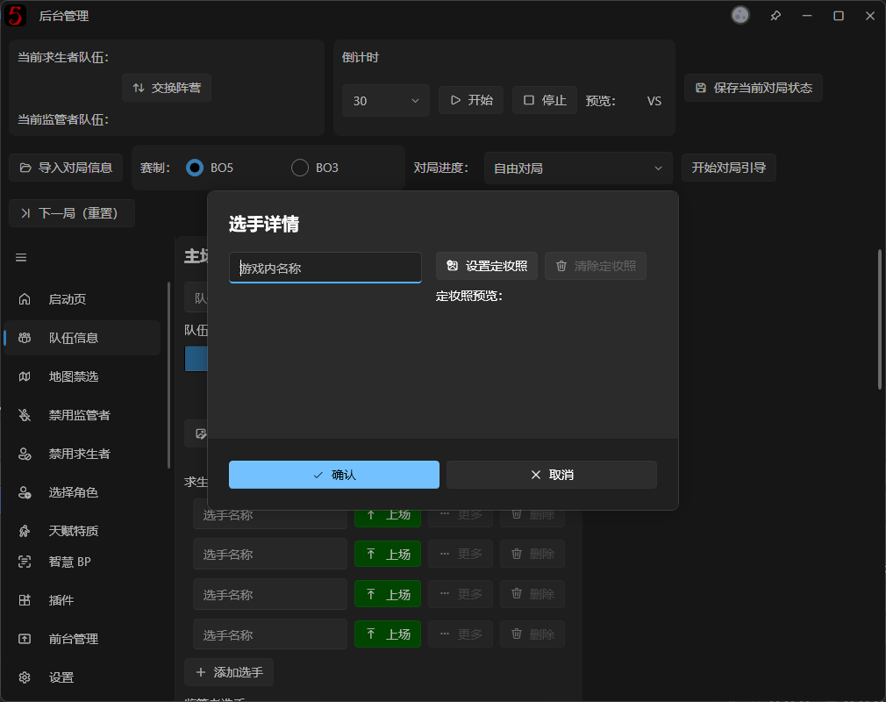

SmartBP matches players during character assignment in this priority order:

In-game ID → Player name → No action

Recognition depends on image clarity, how character names are displayed, and the current BP phase. If recognition fails or a character cannot be identified reliably, not every slot is guaranteed to fill automatically.

### Stop automatic recognition

Click **Stop SmartBP Recognition** to stop recognition midway.

**Stopping automatic recognition and stopping window capture are separate operations.**

The software should keep capturing while automatic recognition is running. To stop capture completely, stop recognition first, then click **Stop** in **Window Capture Settings**.

Automatic recognition can stop on its own when the game enters area selection or another screen where character BP recognition no longer applies.

## 5. Recognize Post-game Statistics with SmartBP

SmartBP also recognizes post-game statistics automatically.

This feature is independent of automatic character BP recognition. **You do not need to run the full BP recognition loop.**

### Prepare the post-game screen

After play ends, open the post-game results screen containing both sides' player statistics.

Make sure SmartBP is still capturing the correct game window and can read the current frame.

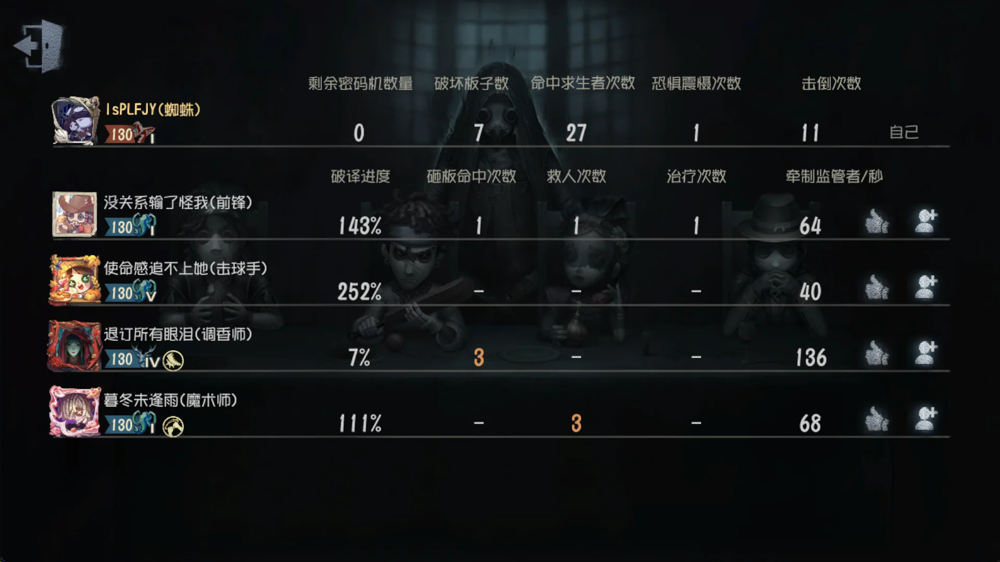

### Fill Post-game Statistics automatically

Return to **Post-game Statistics** in this software.

If the SmartBP Module is loaded, the page shows SmartBP controls.

Click **Recognize and Fill Post-game Statistics**. The software reads the current captured frame and attempts to recognize the player data.

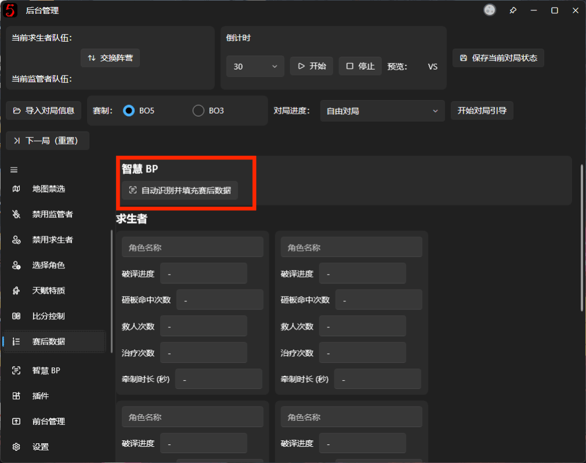

Progress and the current processing stage are shown during recognition.

When complete, successfully parsed Survivor and Hunter statistics are written into the current game.

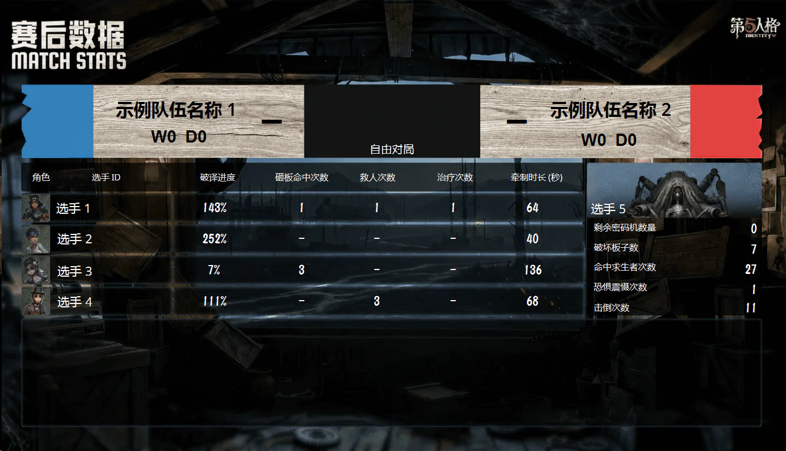

Check the results, especially player-to-character assignments and numeric values.

Although SmartBP tries to handle missing OCR characters and misread digits, omissions and incorrect results can still occur. Correct errors directly on the Post-game Statistics page.

Confirm the data before proceeding to the next game.

## 6. FAQ

### Recognition will not start: OCR Not Ready

Check that you have downloaded and switched to an available OCR Model.

If you just downloaded one, check **Current OCR Model** to confirm it is enabled.

### Cannot capture game footage

Check that window capture has started, then inspect the current frame with **Preview**.

If the captured window was closed or became invalid after restarting the game, refresh the window list and select the game window again.

### The wrong character was recognized

Check the captured frame, especially whether character names are clear and the screen matches the expected BP phase.

SmartBP relies on text in the footage. Obstructions, incomplete text, or unusual interface layouts may prevent correct parsing.

If recognition remains incorrect, disable **Apply Recognition Results Automatically** to stop incorrect data being written, and operate manually instead.

### Does SmartBP control the live broadcast output automatically?

Not currently.

SmartBP primarily updates the software's BP data from game footage. Continue switching scenes in OBS, Bilibili Live, and similar software through your usual broadcast controls.

OBS control through Guided Workflow is planned for a future update.

## Advanced 1. Force Sync Game State manually

Normally, SmartBP updates the operator interface step by step from successive recognized frames.

If recognition starts halfway through BP, or earlier steps were missed, operator data may lag behind the game.

Try **Force Sync Game State** in that situation.

It performs an independent, full BP recognition pass on the **current captured frame**, attempting to synchronize game progress, bans, picks, and Survivor character assignments to the operator interface.

Unlike normal automatic recognition, it synchronizes directly from the current frame rather than waiting for successive passes to catch up.

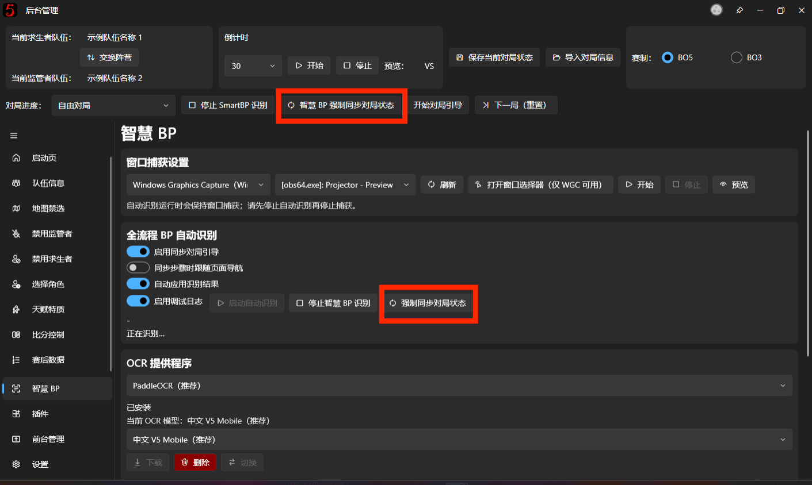

Keep the following in mind:

- Confirm that the captured frame shows the character BP phase you want to synchronize.
- Force sync may directly change character records and the current guidance step.
- Character synchronization does not play each selection animation individually as normal BP operations do.
- If the frame does not contain enough information to determine the full BP state, synchronization may fail.

**A full-screen recognition pass takes longer. Use this feature to recover missed information or take over partway through BP; avoid clicking it repeatedly as a routine BP control.**

## Advanced 2. Adjust BP Recognition Regions

SmartBP extracts BP information from predefined regions in the full game frame.

The defaults are designed for common BP layouts and normally need no changes.

Unusual resolutions, aspect ratios, or cropped footage may keep OCR from reading the correct text. Adjust the regions manually in that case.

### Open the Region Editor

Start window capture and confirm that the current game footage is available.

Find **Recognition Region Configuration** on the SmartBP page and click **Edit BP Recognition Regions**.

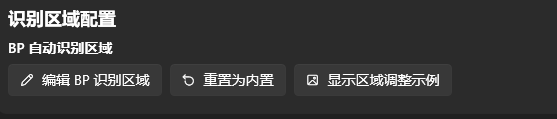

The Region Editor uses the current captured frame as a reference and displays recognition boxes.

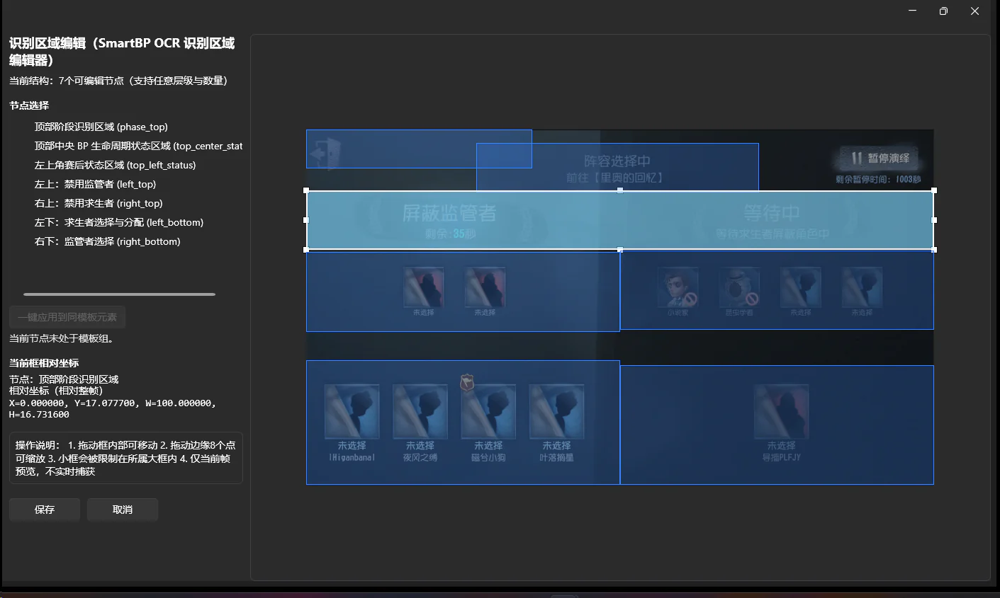

### Adjust regions

The main BP Recognition Regions are:

- **Top Phase Recognition Region**: identifies the current BP phase, such as bans or picks.
- **Upper-left Region**: reads Hunter bans.
- **Upper-right Region**: reads Survivor bans.
- **Lower-left Region**: reads Survivor picks and assignments.
- **Lower-right Region**: reads Hunter picks.
- **BP Completion Region**: helps determine whether character BP has ended and whether the game is waiting or entering area selection. Place it over the upper-left location where the area selection text appears.

Drag a box to move it, or drag its edge handles to resize it. Avoid including unnecessary areas.

Save the configuration when finished.

The editor shows the reference frame captured when it opened, rather than a continuously updating live preview.

If changes worsen recognition, click **Reset to Built-in** to restore the default regions.

## Advanced 3. Switch OCR Providers

Besides the default PaddleOCR, SmartBP supports other OCR Providers.

The main options are:

| Provider | Features |
| --- | --- |
| PaddleOCR | Default; offers models in several languages and sizes |
| RapidOCR | Optional local OCR engine with Chinese model management |
| Tesseract | Optional engine requiring the corresponding language data |

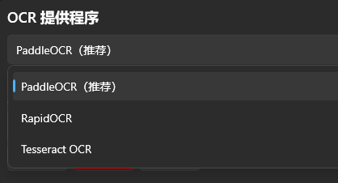

Each provider uses its own models or language files. Downloading a PaddleOCR model does not prepare the other engines.

For example, Tesseract lets you choose Simplified Chinese, English, or Japanese data and install it with **Download Selected Language Data**.

For RapidOCR, download the corresponding model in its model management area.

SmartBP **does not automatically switch to another provider if the current one fails**. After switching, confirm that the new engine's required models or language files are ready.

For general use, start with PaddleOCR. Try alternatives only if it struggles with a particular screen; in the developer's experience, the alternatives tend to perform worse rather than better.

## Advanced 4. Recognition speed and advanced parameters

SmartBP lets you adjust the automatic recognition interval and some OCR processing options.

Find these under **Advanced Parameters**.

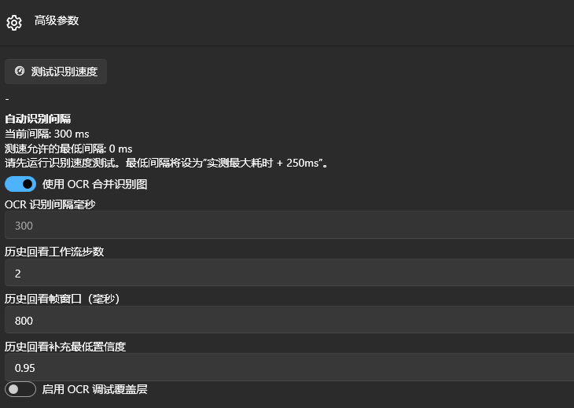

### Test Recognition Speed

Click **Test Recognition Speed** to run OCR on a test image and measure processing time with the current configuration.

The software then calculates the minimum allowed recognition interval.

The current calculation is:

**Maximum measured recognition time + 250 milliseconds**

After changing OCR engines or related settings, test again before adjusting the interval.

### Recognition Interval

The interval controls how often the automatic recognition loop runs.

A shorter interval checks changes more frequently, but increases CPU or GPU workload.

An interval that is too short does not necessarily improve responsiveness. If OCR takes longer than the interval, tasks may accumulate, results may lag, or the interface may stutter.

Most users should keep the default settings.

### Merged OCR Image

**Use Merged OCR Image** combines several recognition regions into one image to reduce repeated OCR calls.

Keeping this enabled is usually recommended.

If text from one region is being attributed to another, temporarily disable it for troubleshooting.

### Historical Frame Lookback

SmartBP can use recently cached frames to recover results missed by some recognition steps.

Related options include Lookback Workflow Steps, Lookback Frame Time Window, and Minimum Confidence.

These parameters mainly address fast BP phase changes and occasional OCR omissions. Most users do not need to change them.

## Advanced 5. CUDA hardware acceleration

Some devices can accelerate PaddleOCR recognition with CUDA.

If compatible hardware is detected, SmartBP shows CUDA acceleration settings and status.

<!-- TODO: Add a CUDA hardware acceleration screenshot. -->

CUDA is NVIDIA's GPU computing technology, so not every graphics card supports it.

If required runtime components are missing, the software may offer to download dependencies. A program restart may also be required after installation.

**CUDA is not required to use SmartBP.** Computers without CUDA support can run OCR on the CPU.

If your computer has no usable NVIDIA CUDA environment, keep the default CPU mode; there is normally no need to install CUDA separately.

## Advanced 6. View Recognition Logs and debug results

Use SmartBP's debugging tools to investigate inaccurate recognition, failed character matching, or abnormal synchronization.

**Debug Options** contains tools for inspecting results.

For example, you can:

- Recognize the built-in test image.
- Run a single recognition pass on the current captured frame.
- Inspect the current BP phase, Candidate Operations, and Recognition Results.
- Inspect players, characters, and numbers from the latest Post-game Statistics recognition.
- Open a separate Recognition Log window.

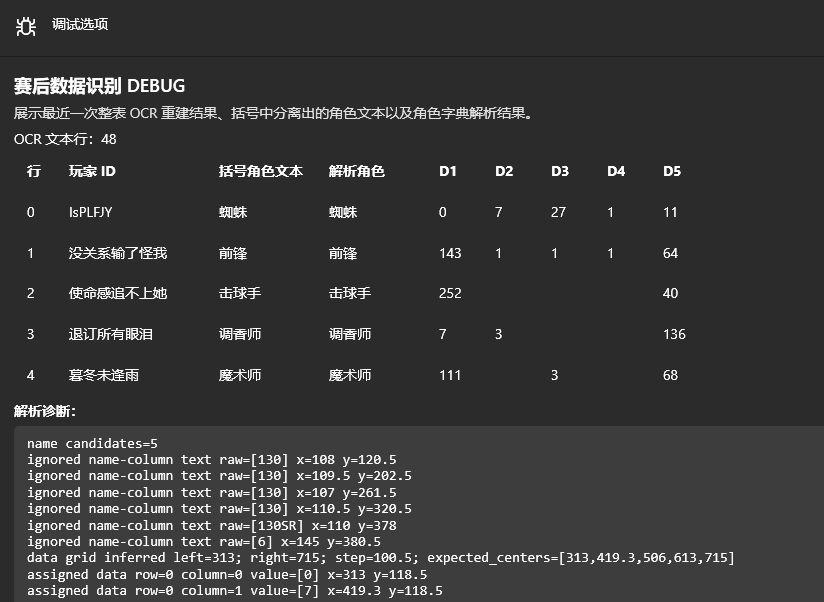

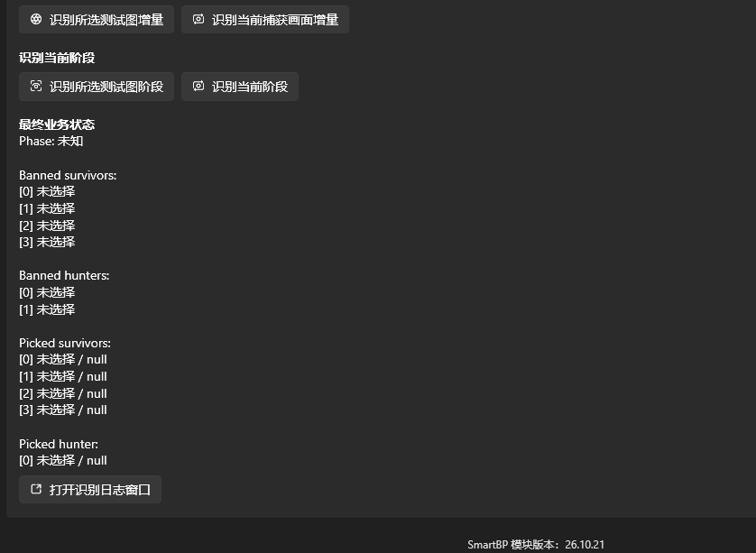

When reporting recognition problems, provide the game footage from that moment, a capture preview screenshot, and the corresponding Recognition Log.

You can also temporarily enable **OCR Debug Overlay** in Advanced Parameters to check whether text detection boxes miss their intended targets.

These tools add processing or disk-write overhead, so enable them only while troubleshooting.

## Advanced 7. Manage the SmartBP Module manually

Normally, the module is installed and managed through **Download and Install**.

If downloading fails or you already have all module files, expand **Advanced Options** while the module is not loaded to manage it manually.

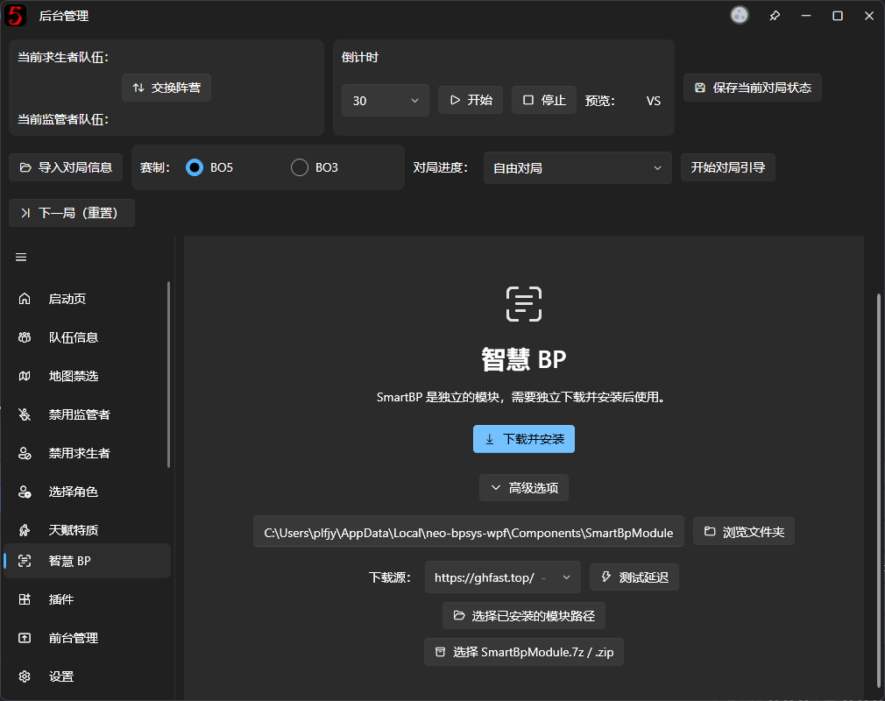

Change the module directory, select an installed module, or import a local Module Archive here.

**SmartBP Module Archives and the designer's `.bpui` Layout Packages are different file types** and cannot be used interchangeably.

The module must be compatible with the current main program version and runtime environment. Arbitrary DLL replacements or incomplete module directories may prevent it from loading.

If files are missing or damaged, try **Re-download and Repair** first.

Most users should keep the default installation location and manage the module through the built-in download, repair, and update controls.
