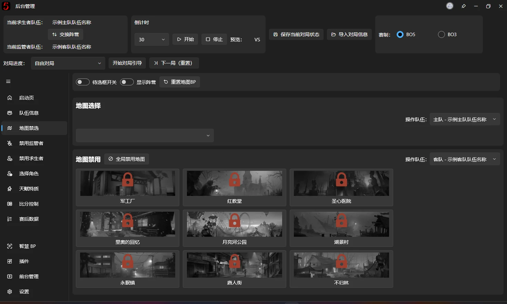
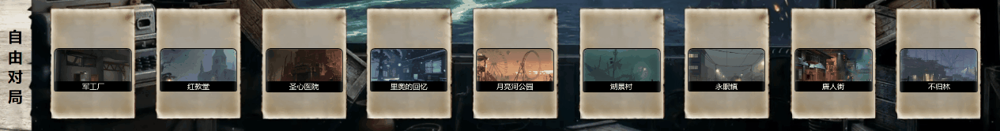
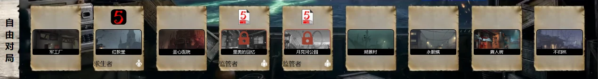
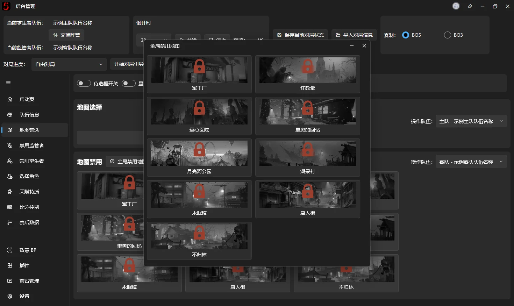

# マップBAN/PICK

## 基本的なBAN/PICK

マップBP表示ウィンドウに表示するPICK済み・BAN済みマップを設定します。

すべてのランク戦マップのPICK/BANに対応しています。対象のマップをクリックして操作します。（~~複数BANは今後対応予定~~[v1.1.0.9483](https://github.com/PLFJY/neo-bpsys-wpf/releases/tag/v1.1.0.9483)から複数BANに対応しています。）

マップBP表示ウィンドウの開き方と管理方法は、[配信用ウィンドウ管理](fronted-manager.md#前台窗口)を参照してください。

旧v1の単一マップBAN/PICK画面は完全に削除されました。

マップBP v2では以下の機能を使用できます。

## 選択可能なマップ枠の呼吸アニメーション

BANされていないマップに呼吸アニメーションを追加します。効果はv3エディターでカスタマイズできます。

## 陣営選択結果の表示 {#阵营选择结果展示}

各マップをBAN/PICKしたチーム名と陣営を表示します。

> ### 追加機能
>
> チームロゴが設定されている場合は、[陣営選択結果の表示](#阵营选择结果展示)の図のようにロゴでBAN/PICK側を示します。ロゴがない場合はチーム名を表示します。

## マップのグローバルBAN

【マップのグローバルBAN】をクリックし、開いたウィンドウで対象のマップをクリックします。通常はすでにPICKされたマップや、リーグ採用前にソフトウェアに追加されたマップなどを指定します。

