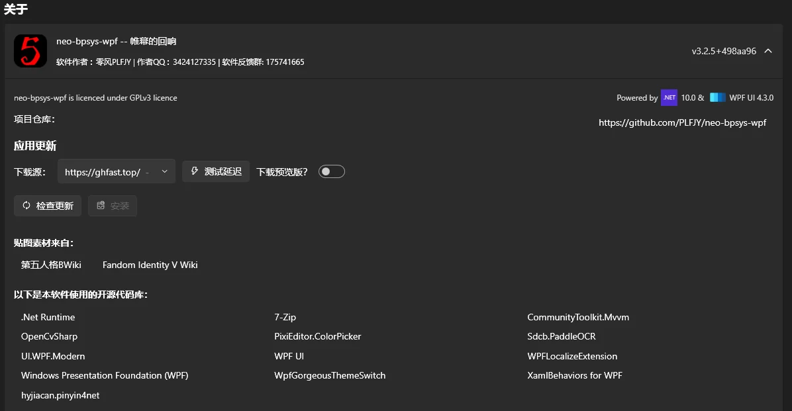
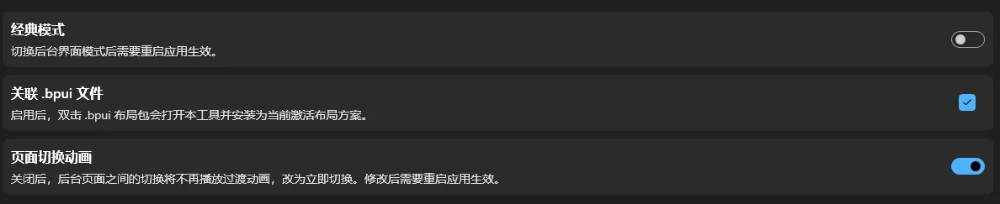
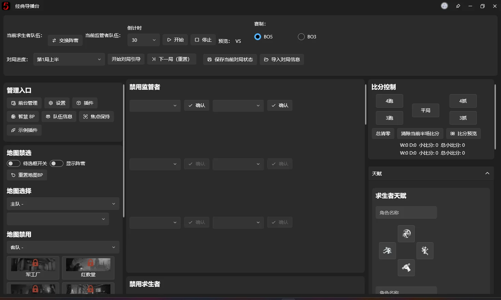
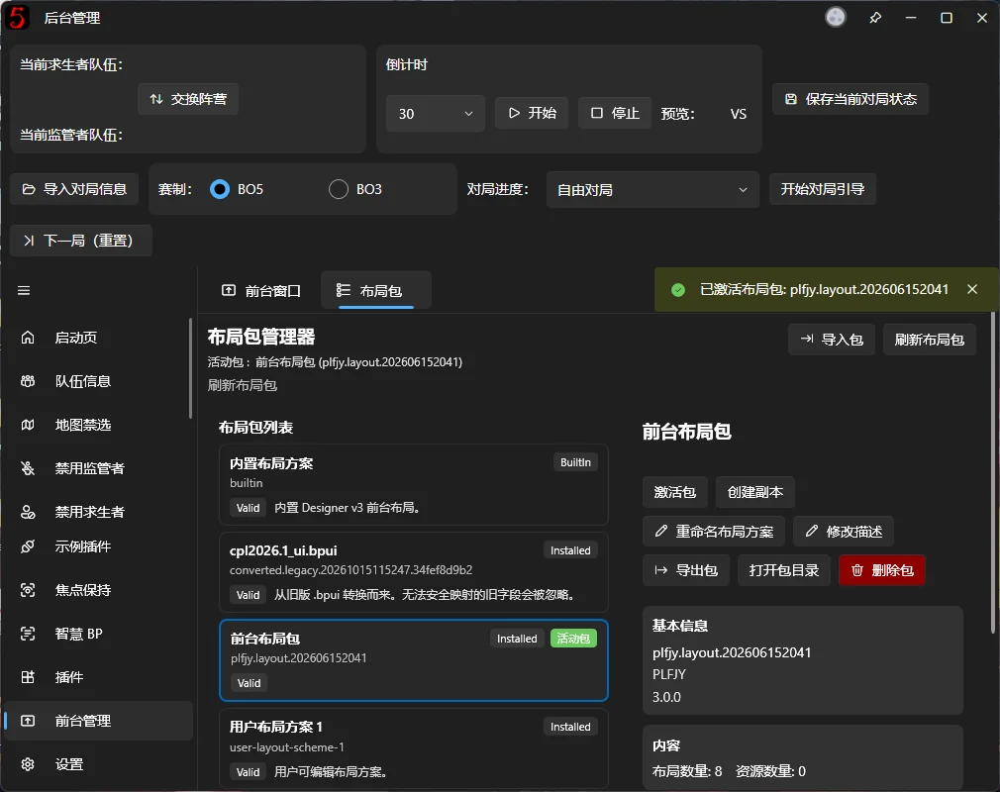
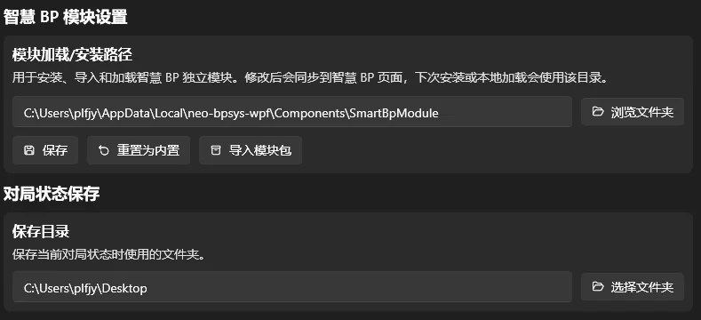
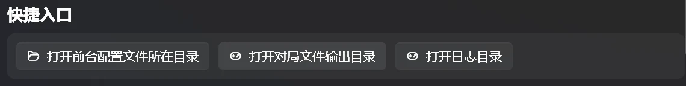

# 設定

ソフトウェアのカスタマイズや、作者、連絡先、バージョン、オープンソースライセンス、支援方法、更新情報などの確認を行います。

## ソフトウェアの基本情報

バージョンや使用しているオープンソースライブラリの確認、ソフトウェアの更新ができます。

現在、更新には中国本土から利用できる可能性のある11種類のダウンロード元があります。12番目の空欄はGitHubからの直接ダウンロードです。横にはプレビュー版のダウンロードを有効にするスイッチがあります。テスト期間中は既定でオンですが、正式版公開後は既定でオフになります。

## 切り替えスイッチ

### クラシックモード

有効にすると、bp-sys-wpf ≤ 2.6のようにすべての操作を並べた画面になります。別の操作方法として利用できますが、対戦進行ガイドの効果は十分に発揮されない場合があります。開発チームはこの画面のサポートを大きく拡充する予定はありません。問題があれば報告してください。

### .bpuiファイルの関連付け

有効にすると、.bpuiファイルをダブルクリックで開けるようになり、レイアウトパッケージが自動インポートされます。

### ページ切り替えアニメーションを無効にする

切り替えアニメーションが遅く感じる場合は、ここで無効にできます。

## パス設定

SmartBPのインストール先と対戦データの出力先フォルダーを変更し、Cドライブの使用容量を抑えられます。

## クイックアクセス

【配信画面設定ファイルのフォルダーを開く】は、レイアウトを手動編集する際に使用します。

【対戦データの出力先フォルダーを開く】は、保存済みの対戦情報を確認する際に使用します。

【ログフォルダーを開く】は、不具合報告時に開発者へログを提供する際に使用します。現在はデバッグオプションのカードへ移動しています。

支援用QRコードから開発をご支援いただけます。ご協力ありがとうございます！
