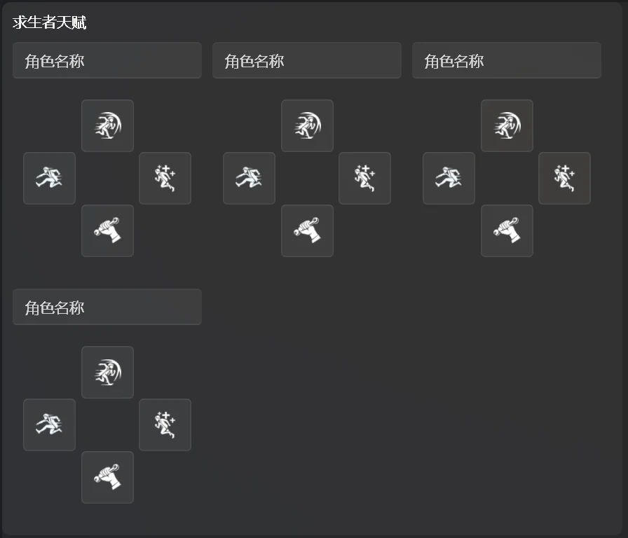
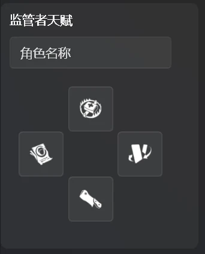
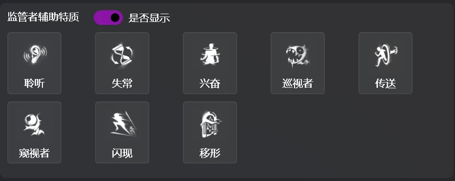

# 内在人格と補助特質

トランジション画面に表示する両陣営の内在人格と、ハンターの補助特質を設定します。

## 内在人格の選択欄

4つのToggleButtonで構成されたカスタムコントロールです。クリックして選択状態を切り替えます。配置はゲーム内と同じなので、慣れた位置をそのままクリックできます。

## 内在人格の選択

## 補助特質の選択

ゲーム内の大会モードでは、観戦席からハンターの補助特質を確認できません。そのため、開始前に補助特質を把握できる場合に対応できるよう、表示するかどうかを選択できます。

ハンター側の選手が選んだ補助特質をクリックしてください。

