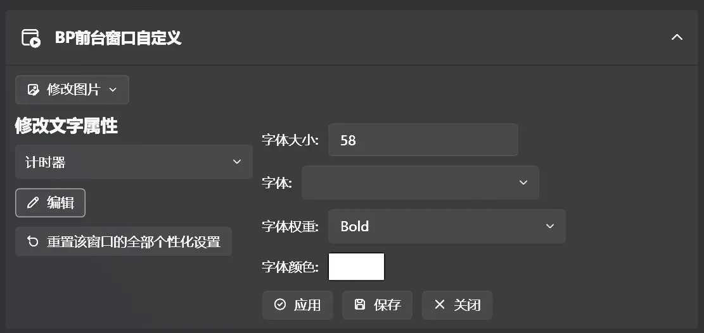
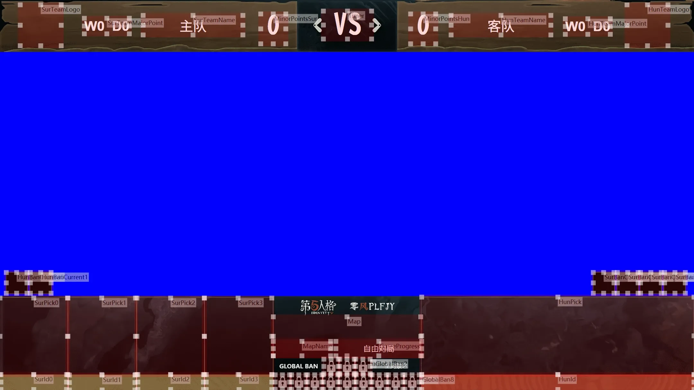
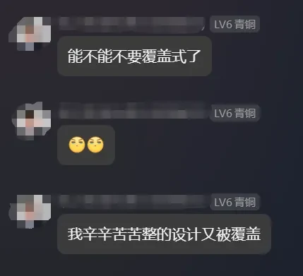
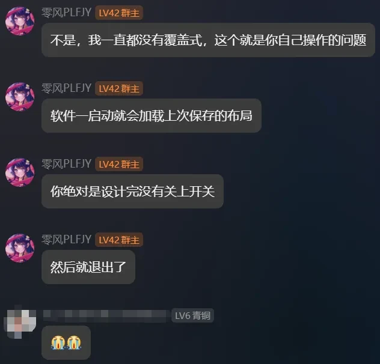

# 前台自定义
## 修改背景及文字属性

在[设置](../settings.md)页面中，用户可以修改各个前台窗口的背景和文字属性。

---

## 修改组件大小及位置

用户可以在[前台管理](../fronted-manager.md)页面打开设计模式。在设计模式中，用户可以自定义每一个组件的大小和位置。

---

## 如果您希望辛苦劳作了不知道多久弄出来的UI没有保存的话，请不要读下去

温馨提醒：自定义完后需要先关闭设计者模式再退出软件，**否则您的更改将不会被保存！**

#### ↓血和泪的教训↓（++)——S0记录员

‍