# 插件系统

本文介绍了软件的插件系统。如果你的软件无法使用插件系统，请将软件[更新](https://bpsys.plfjy.top/)至2.0.0或更新版本。

本软件支持通过插件来扩展功能。除了软件自带的 BP、比分、队伍信息等功能，插件还可以为软件增加新的后台页面、前台窗口、设计器控件及其他功能。

例如，软件中的部分内置插件就提供了队伍 JSON 文件制作、比赛秒表等功能。

你可以在软件的【插件】页面查看已经安装的插件，也可以通过【插件市场】下载其他开发者制作的插件。

需要注意，**插件属于可以执行程序代码的扩展，而不只是普通的配置文件**。第三方插件的功能和兼容性由对应开发者负责，请尽量通过可信的来源获取插件。

## 一、认识插件管理页面

在软件左侧导航栏中点击【插件】，即可打开插件管理页面。

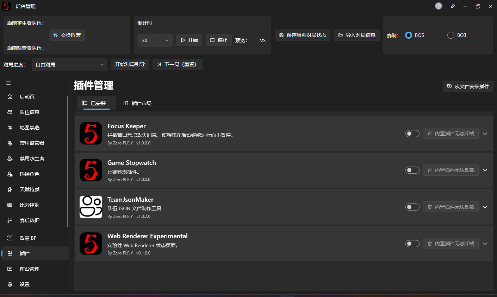

> **截图备注（待删除）：** 截取插件管理页面的完整界面，展示顶部标题、【从文件安装插件】按钮，以及【已安装】和【插件市场】两个页面入口。

页面顶部提供两个主要区域：

- **已安装**：查看和管理当前电脑上已经安装的插件。
- **插件市场**：浏览、安装和更新其他开发者提供的插件。

另外，页面右上角还有【从文件安装插件】按钮，可以直接使用电脑上已有的插件压缩包进行安装。

对于普通用户，建议优先通过插件市场安装插件，不需要自己寻找和管理插件文件。

## 二、通过插件市场安装插件

打开插件管理页面后，切换到【插件市场】。

插件市场会从在线插件源获取可用插件的信息，并显示插件的名称、简介、作者、版本和安装状态。

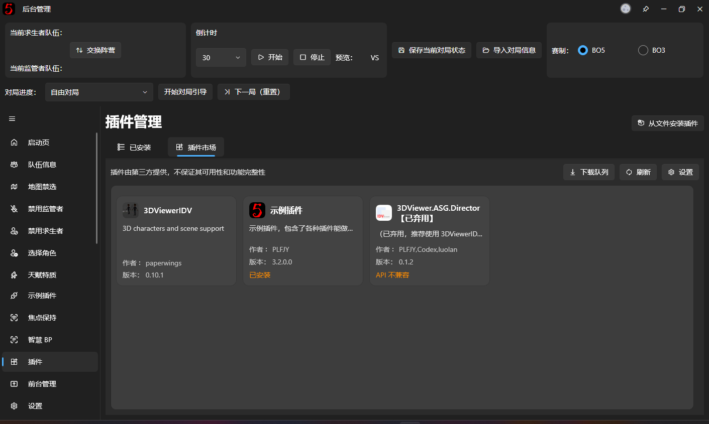

### 1. 查看插件详情

在插件市场中，点击感兴趣的插件条目，即可打开详细信息。

详情页面会展示插件的基本信息。如果开发者提供了 README 说明文档，软件还会在这里显示对应的使用说明。

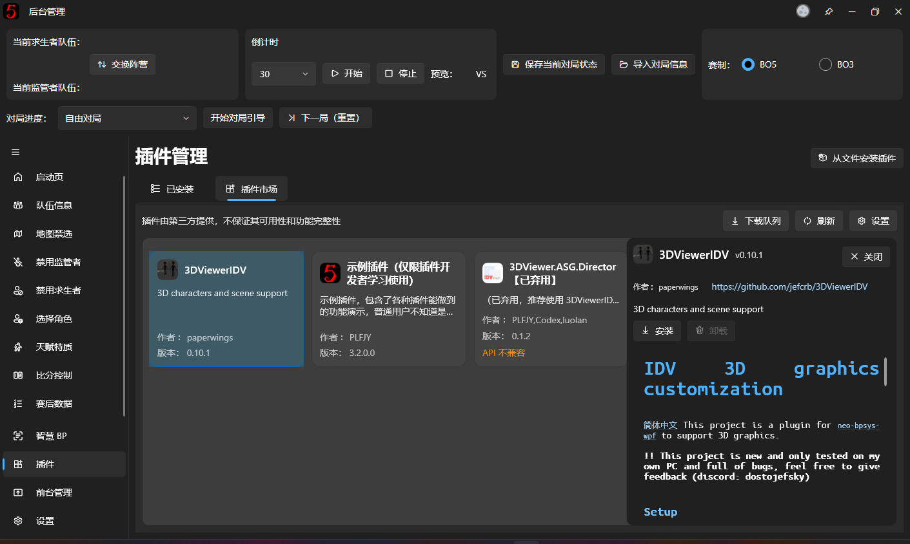

在安装之前，建议先阅读插件介绍，了解它提供了什么功能，以及是否有额外的使用要求。

不同插件提供的功能可能完全不同。例如：

- 有些插件会在后台新增一个页面。
- 有些插件会提供新的前台窗口，可以在 OBS 中捕获使用。
- 有些插件会向 [v3 前台设计器](v3-designer.md)提供新的控件。
- 还有一些插件只提供辅助功能，不一定会出现新的页面或窗口。

因此，**安装插件后没有看到新的后台页面，并不一定代表插件没有正常工作**，应以插件自身的功能说明为准。

### 2. 安装插件

找到需要的插件后，点击详情页面中的【安装】。

软件会将该插件加入下载队列，并自动下载插件包。

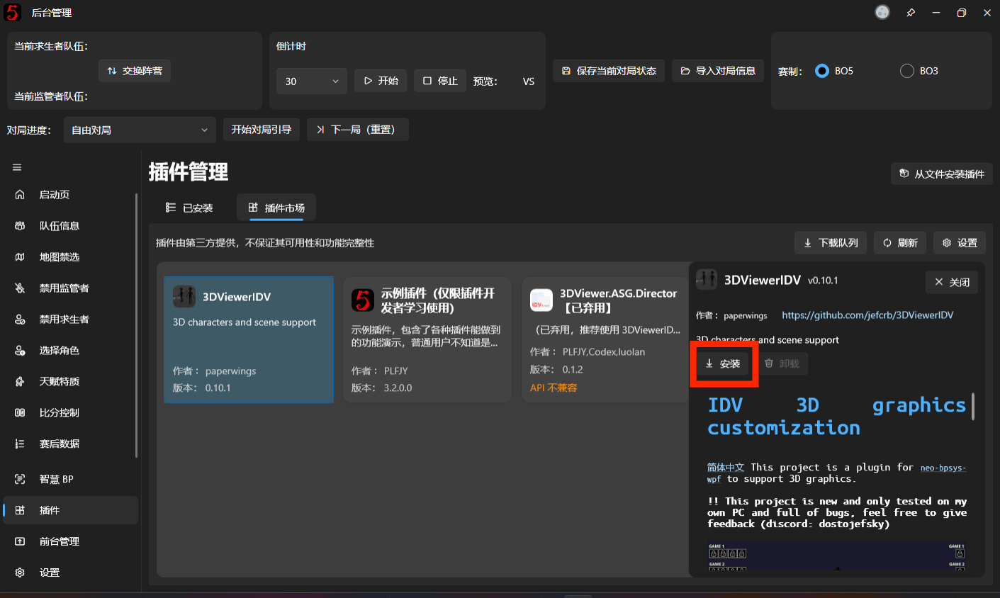

下载完成后，软件会检查插件包并进行安装。如果插件市场为安装包提供了 SHA-256 校验值，软件还会验证下载文件是否与市场提供的信息一致。

安装成功后，插件会出现在已安装插件列表中。

**注意：安装新插件后，需要重新启动主程序才能使用。**

这是因为插件需要在软件启动时加载。安装文件已经下载完成，不代表插件已经在当前运行的软件中生效。

### 3. 查看下载进度

在插件市场页面顶部点击【下载队列】，可以查看当前正在下载或者排队等待的插件。

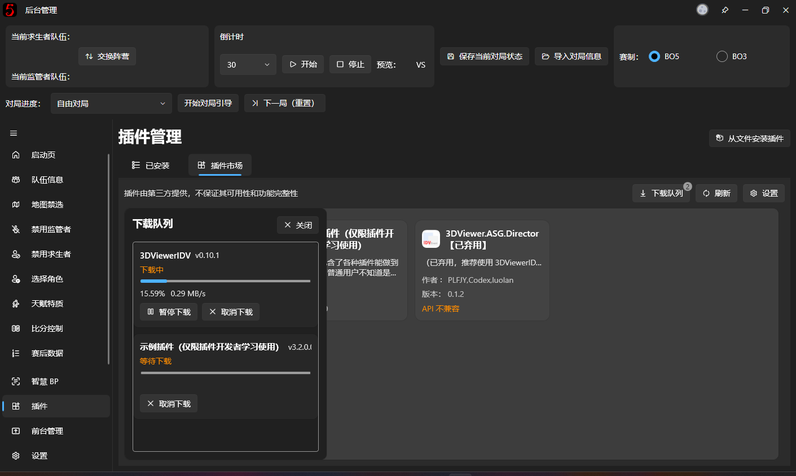

插件市场支持同时添加多个下载任务，但实际下载会按照队列依次进行，以避免多个插件同时下载造成资源占用过高。

下载过程中可以暂停、继续或者取消任务。

当下载出现临时网络错误时，软件也支持利用已有的下载数据继续下载，通常不需要重新下载整个插件包。

### 4. 重启软件

插件安装成功后，页面中可能显示【重启以应用更改】。

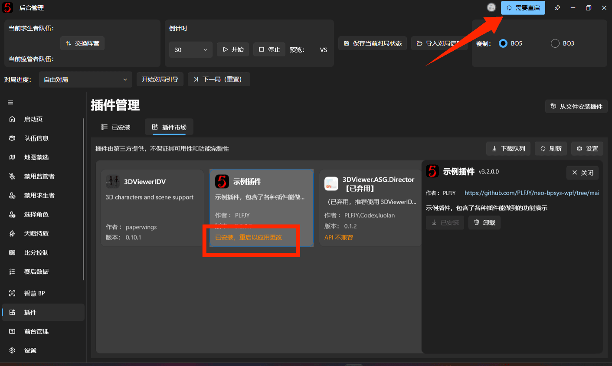

此时请正常关闭并重新打开软件，或者使用软件提供的重启入口。

重新启动后，插件才会被正式加载，其提供的后台页面、前台窗口或者其他功能才会出现在相应位置。

## 三、管理已经安装的插件

切换到【已安装】页面，可以查看当前电脑中已经安装的所有插件。

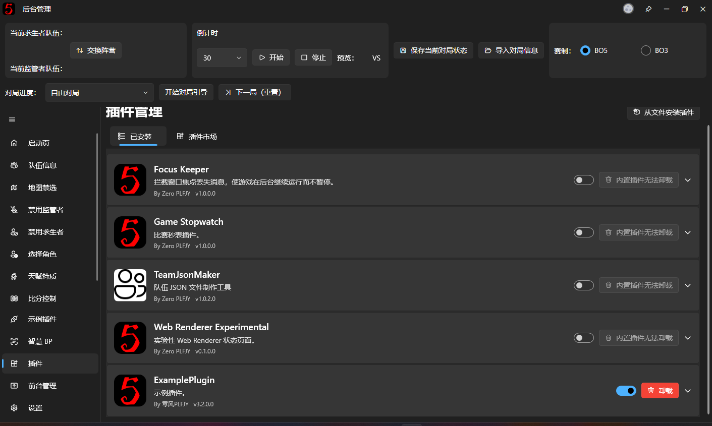

每个插件都会显示名称、简介、作者和版本号。

点击插件卡片，还可以展开查看项目地址及插件状态等信息。

### 1. 启用和禁用插件

每个插件卡片右侧都有一个启用开关，可以控制该插件是否在软件中使用。

如果你暂时不需要某个插件，可以将其关闭，而不必直接卸载。

**启用或禁用插件后，需要重启软件才能真正生效。**

例如，如果某个插件提供了额外的前台窗口，将其禁用后重新启动软件，对应窗口就不会再由该插件注册到程序中。

如果之后还需要使用，只需重新启用并重启软件即可。

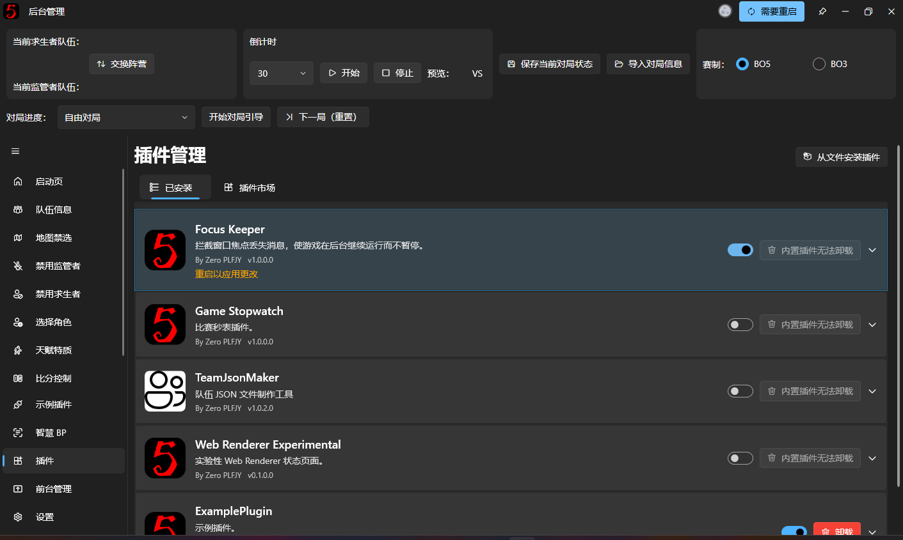

> **截图备注（待删除）：** 展示插件卡片右侧的启用开关，并尽量包含修改后出现的重启提示。

### 2. 卸载插件

如果不再需要某个插件，可以点击其右侧的【卸载】按钮。

需要注意，这个操作并不会立即删除当前正在运行的插件，而是将其标记为待卸载。

在软件重新启动时，对应插件才会被移除。

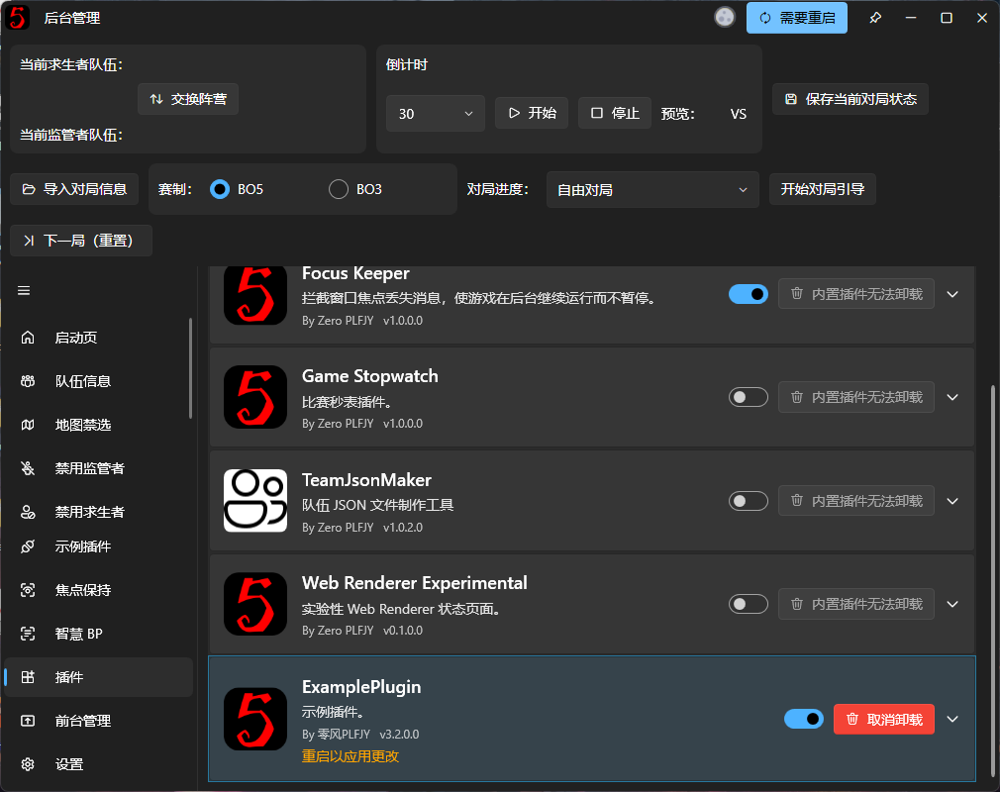

如果只是误点了卸载，在重新启动软件之前，可以点击【取消卸载】撤销操作。

### 3. 内置插件

软件本身也会附带一些插件，这些插件属于软件发行包的一部分。

例如，用于制作队伍 JSON 文件、显示比赛秒表等功能的组件，就可以通过内置插件提供。

内置插件同样可以出现在插件管理列表中，但与用户自行安装的插件不同，**内置插件不能通过普通的插件卸载按钮删除**。

如果不希望使用其中某个插件，可以根据实际情况将其禁用，然后重新启动软件。

## 四、更新插件

插件市场除了安装新插件，也可以检查已安装插件是否存在新版本。

当插件市场中的版本高于本地已安装版本时，插件详情中会显示【更新】按钮。

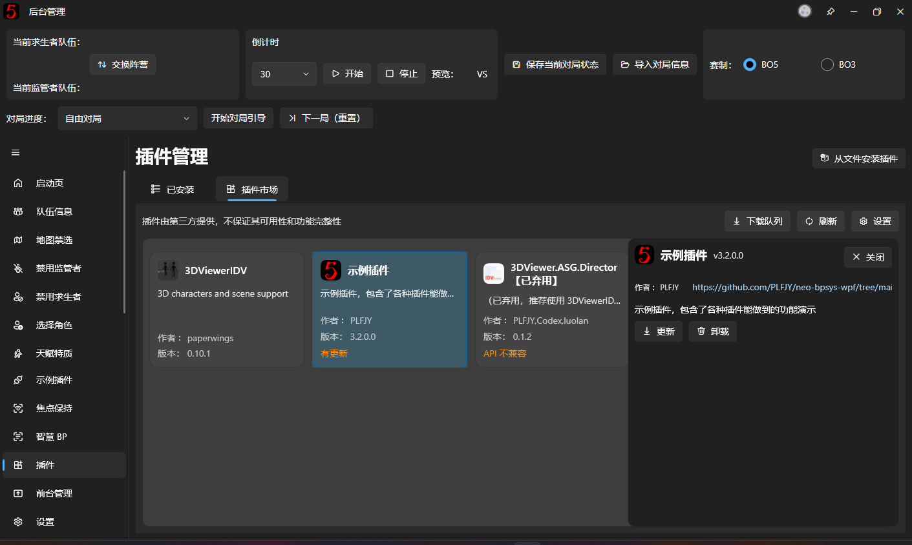

点击【更新】后，软件会下载新版本并准备更新文件。

由于旧版本插件可能仍在当前程序中运行，更新不会直接替换当前正在使用的插件文件，而是会在下一次启动时应用。

在【已安装】列表中，可以看到当前插件版本以及待更新的新版本，并显示重启提示。


重新启动软件后，新版本插件才会正式加载。

如果更新后出现兼容性问题，可以联系插件作者，或者暂时禁用对应插件，避免影响正式比赛。

## 五、从本地文件安装插件

除了插件市场，本软件也支持安装从其他渠道获取的插件包。

在插件管理页面右上角点击【从文件安装插件】，选择本地插件压缩包即可。

目前文件选择器支持以下格式：

- `.zip`
- `.7z`

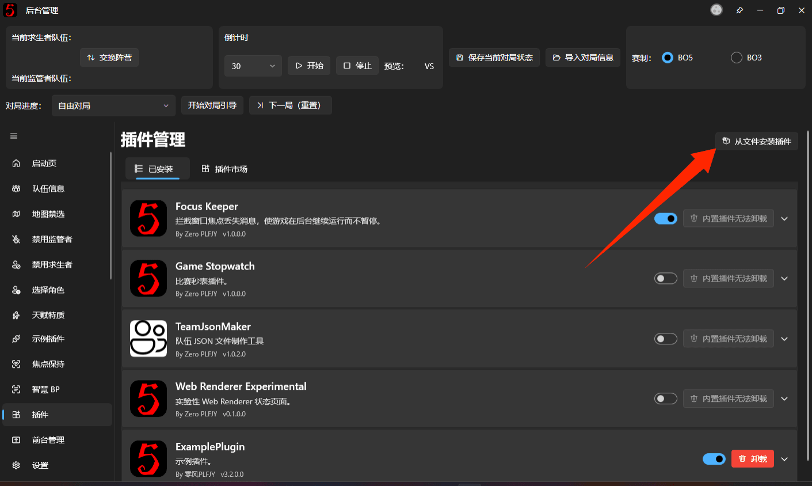

选择文件后，软件会尝试读取插件信息、检查兼容性并完成安装。

**插件压缩包必须是符合本软件插件格式要求的安装包。** 普通的 ZIP 压缩文件、源码压缩包或前台布局包不能直接当作插件安装。

安装完成后仍然需要重启软件。

对于不在插件市场中提供的插件，请先确认下载来源可信，并查看插件作者提供的安装说明。

## 六、插件与前台布局包的关系

部分插件会向 v3 前台设计器提供自定义控件、前台窗口或者动画触发器。

如果你导入了其他人制作的 `.bpui` 布局包，而布局中使用了这些插件，软件可能会提示缺少相关插件。

**这是正常的插件依赖机制，不代表布局包已经损坏。**

### 导入时发现缺少插件

在【前台管理】中导入 `.bpui` 布局包时，如果软件发现其中的内容依赖未安装的插件，或者当前插件版本过低，会显示相应的提示。

提示内容可能包含插件名称、要求的最低版本、当前已安装版本，以及受到影响的控件或窗口。

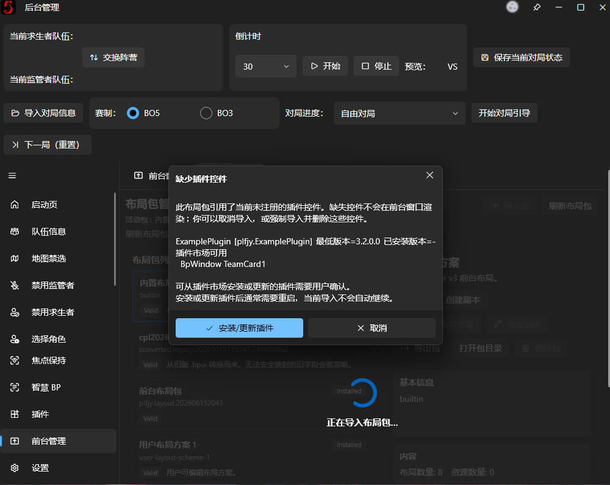

如果插件市场中存在符合要求的版本，可以按照提示选择【安装/更新插件】，由软件下载并安装对应插件。

这一步需要用户确认，**导入布局包不会在未经确认的情况下自行安装或更新插件**。

插件安装完成后，通常还需要重启主程序。

### 没有安装依赖插件会怎么样？

如果暂时没有安装依赖插件，布局包中的其他内容仍可能正常导入。

但由缺失插件提供的控件或窗口，在插件安装并加载之前可能无法正常显示。

设计器可以保留相关的插件控件配置，并在编辑时提示缺失插件。等对应插件安装完成且软件重新启动后，这些内容才有机会恢复正常工作。

因此，如果收到别人分享的布局包，建议同时查看对方有没有说明需要安装哪些插件。

### 插件和 BPUI 不同

这里需要特别区分两种文件：

| 文件 | 用途 |
| --- | --- |
| 插件包（`.zip` / `.7z`） | 安装额外的程序功能、控件或窗口 |
| 前台布局包（`.bpui`） | 保存前台布局、图片资源、动画行为及插件依赖信息 |

`.bpui` 布局包不会把插件的 DLL 程序文件一起打包。

如果一个布局依赖第三方插件，接收者需要另外安装对应插件。

关于布局包的使用方式，请参阅 [v3 前台设计器](v3-designer.md)。

## 七、常见问题

### 安装了插件，但是找不到新功能

首先检查插件是否已经安装成功，并重新启动软件。

如果仍然找不到新功能，可以回到【已安装】页面，确认插件已经启用，并查看其插件状态。

另外，不是所有插件都会新增后台页面。某些插件只提供前台窗口、设计器控件或其他内部功能，因此建议阅读对应插件的 README。

### 插件显示版本不兼容

如果插件市场显示【当前软件版本过低】或者【API 不兼容】，说明插件声明的 API 版本与当前主程序支持的版本不匹配。

这时软件可能禁止直接安装对应的市场版本。

建议先检查主程序是否有更新。如果已经使用最新版本，但插件仍然不兼容，则需要等待插件作者发布适配版本。

**不能仅通过修改插件文件中的版本号来保证兼容性**，因为不同版本的插件 API 可能存在实际的代码差异。

### 插件市场无法加载

可以先点击插件市场顶部的【刷新】重试。

如果仍然无法获取插件列表，可能是网络连接或当前插件源暂时不可用。

你可以在插件市场的【设置】中切换插件源，具体说明见后面的进阶部分。

插件市场无法访问时，已经安装并且正常加载的本地插件通常仍可继续使用。

### 插件下载失败

可以先通过【下载队列】查看具体错误提示，然后重新尝试下载。

如果使用的插件资源来自 GitHub，也可以尝试在插件市场设置中选择其他下载镜像。

### 为什么某些插件不能卸载？

如果插件卡片显示【内置插件无法卸载】，说明它属于随软件一起提供的内置插件。

这类插件不能直接使用普通卸载功能删除，但可以按需禁用。

### 安装第三方插件安全吗？

插件市场会展示插件作者和项目等信息，下载过程中也可能使用文件完整性校验。

但是，**插件并不是在独立安全沙箱中运行的**，它们可以调用软件提供的接口，并且拥有较强的扩展能力。

因此，不建议安装来源不明、缺乏说明或者明显不可信的插件。

对于正式比赛使用的电脑，也建议在赛前提前测试插件，避免在直播进行过程中才首次安装或更新。

---

## 【进阶】一、修改插件市场源和下载源

如果插件市场无法加载，或者 GitHub 下载速度较慢，可以尝试调整插件市场的相关设置。

进入【插件市场】，点击顶部【设置】。

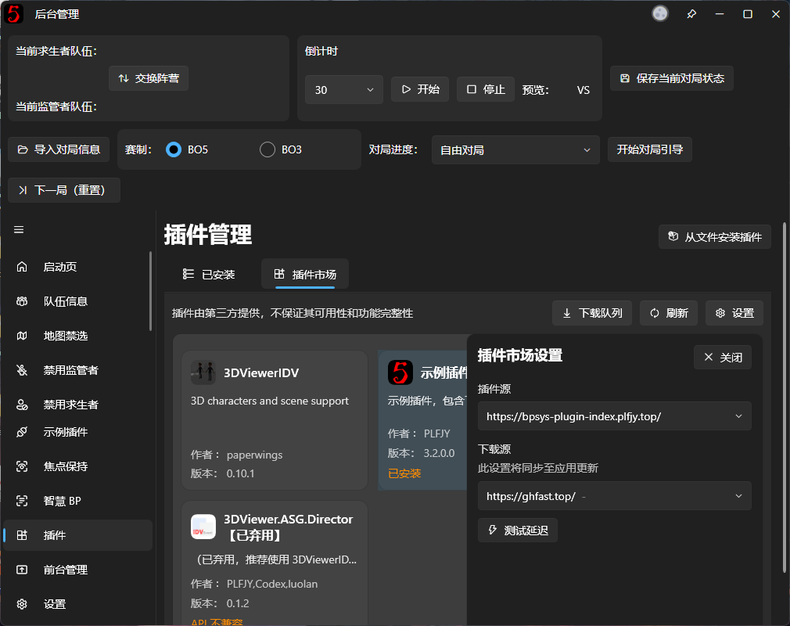

这里有两个容易混淆的选项：

### 插件源

【插件源】用于指定软件从哪里获取插件市场的列表和插件信息。

目前软件提供两个预设地址：

**默认插件源**

`https://bpsys-plugin-index.plfjy.top/`

**GitHub Raw 插件源**

`https://raw.githubusercontent.com/PLFJY/neo-bpsys.PluginMarket/refs/heads/main/PluginIndex.json`

通常建议保持默认插件源即可。

如果默认源无法正常加载，可以尝试切换到 GitHub Raw 源。

切换后，软件会保存设置并重新加载插件市场列表。

### 下载源

【下载源】主要用于处理 GitHub 相关资源的下载。

例如，当某个插件的安装包放在 GitHub 上时，软件可以尝试使用设置的 GitHub 下载镜像获取资源。

这个设置与【插件源】不同：

- **插件源**决定插件列表从哪里获取。
- **下载源**影响相关 GitHub 资源的下载地址。

下载源选择功能目前主要在中文界面中提供。

另外，**这里的 GitHub 下载镜像设置会同步到软件更新等其他使用同一下载设置的功能中**，并不是只影响插件市场。

## 【进阶】二、插件目录与手动排障

正常情况下，用户不需要手动修改插件文件。

但如果插件加载失败，或者需要备份、排查插件问题，可以了解插件的主要存储位置。

### 插件文件保存在哪里？

用户安装的插件通常保存在：

```text
%APPDATA%\neo-bpsys-wpf\Plugins
```

每个插件拥有自己的目录，内部包含插件清单及运行所需文件。

部分内置插件则位于程序安装目录下的 `Plugins` 文件夹。

插件的独立配置通常保存在：

```text
%APPDATA%\neo-bpsys-wpf\PluginConfigs
```

如果某个插件有自己的设置文件，通常会在这里建立对应目录。

### 插件更新为什么需要重启？

软件会在启动阶段加载插件的代码、注册后台页面、前台窗口及相关服务。

由于这些组件已经参与当前程序的运行，无法像普通图片或配置文件一样安全地直接替换。

因此，插件更新时会先准备新版本文件，再在下一次启动时应用更新。

对于普通用户来说，只需要根据提示重新启动软件即可。

### 插件加载失败怎么办？

如果某个插件无法正常工作，建议依次检查：

1. 插件是否处于启用状态。
2. 安装或更新后是否已经重新启动软件。
3. 插件状态是否显示错误。
4. 当前主程序与插件 API 版本是否兼容。
5. 插件是否缺少自身依赖的文件。

如果仍然无法解决，可以通过[设置页面](../settings.md)中的【打开日志目录】获取日志，提交给插件作者进行排查。

不要在软件正在运行时随意删除或替换插件 DLL 文件，以免出现加载异常或文件占用问题。

## 【进阶】三、插件开发与自定义扩展

如果你希望自己开发插件，可以使用本软件提供的插件开发接口。

目前插件系统允许开发者扩展多种功能，例如：

- 新的后台管理页面。
- 独立的前台窗口。
- v3 前台设计器中的自定义控件。
- 自定义动画触发事件。
- 其他需要与主程序交互的服务和功能。

其中，支持 v3 设计器的插件控件可以在安装插件后出现在设计器的【添加控件】菜单中。

插件也可以提供自定义的动画触发事件，在设计器中供用户为控件配置动画行为。

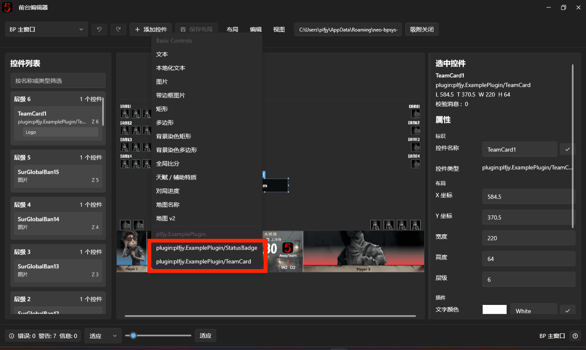

需要注意，3.x 插件接口与部分旧版本相比已经发生变化。使用旧版 API 开发的插件，不一定能在当前版本中正常加载。

本章节不展开插件代码的具体编写方式。如果需要开发插件，请参考 GitHub 仓库中的 [Plugin SDK 开发文档](../../dev/plugin/plugin-development.md)。

对于仅仅需要安装、使用和管理插件的普通用户，不需要了解这些开发接口。