# v3 前台设计器

这是本软件的第一大复杂的系统，在前台管理页面点击了【打开 v3 前台设计器】之后将会打开本界面

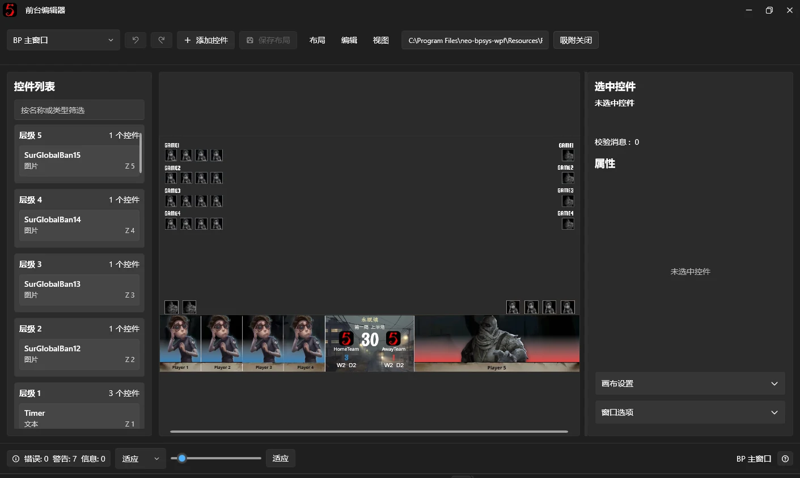

v3 前台设计器是本软件用于自定义前台界面的工具。你可以在这里修改前台窗口的背景、控件位置、大小、样式、数据绑定以及动画效果，也可以自由添加或删除控件，制作属于自己的 BPUI。

与旧版设计者模式不同，v3 设计器使用独立的编辑窗口，不需要在实际输出的前台窗口上进行编辑，也不会直接干扰 OBS 正在捕获的画面。

## 一、打开设计器

在软件左侧导航栏进入[前台管理](../fronted-manager.md)，点击【打开 v3 前台设计器】。

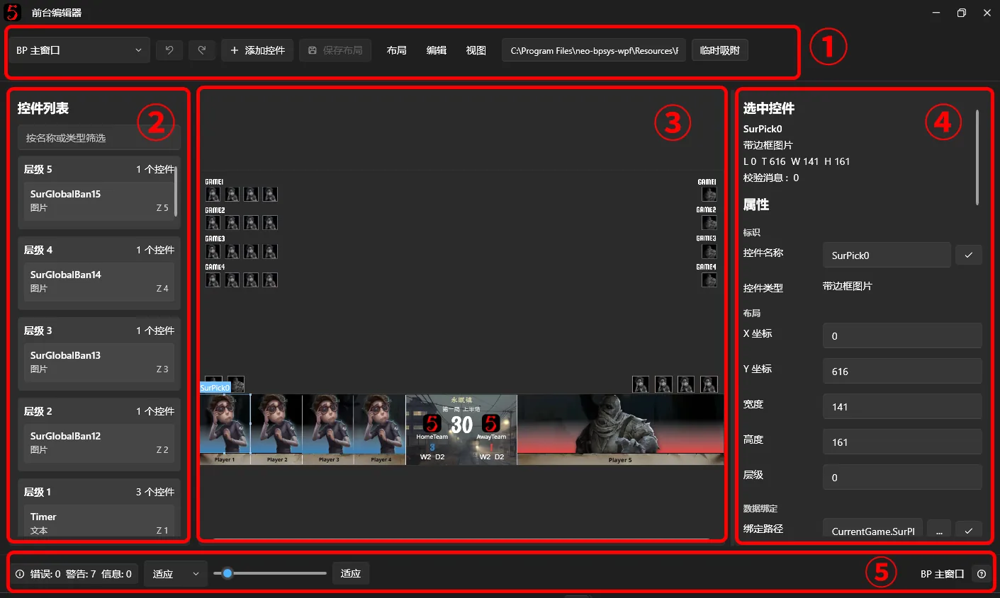

设计器主要分为以下几个区域：

1. **顶部工具栏**：用于切换编辑的前台窗口、添加控件、保存布局、撤销及重做操作。
2. **左侧图层面板**：列出当前窗口中的所有控件，可以快速选择控件并调整它们的显示层级。
3. **中央预览画布**：显示当前前台窗口的模拟画面，支持直接使用鼠标移动、调整控件大小。
4. **右侧属性面板**：编辑选中控件的各项属性，包括大小、位置、文字、图片、数据绑定和动画行为。
5. **底部状态栏**：显示布局校验状态，提供画布缩放和适应窗口等功能。

### 选择需要编辑的前台窗口

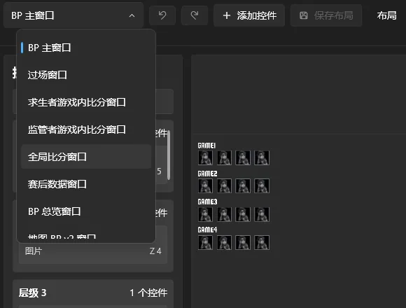

点击工具栏左侧的窗口选择框，选择需要修改的前台窗口，例如【BP 主窗口】【过场窗口】【全局比分窗口】等。

设计器一次只编辑一个前台窗口，不同前台窗口拥有独立的布局和控件。

如果切换窗口时当前布局还有未保存的修改，软件会询问是否保存。

### 调整画布视图

编辑大型布局时，可以通过以下操作调整视图：

| 操作 | 功能 |
| --- | --- |
| Ctrl + 鼠标滚轮 | 放大或缩小画布 |
| 鼠标右键拖拽 / <br>Space + 鼠标左键拖拽 | 平移画布 |
| 底部缩放滑块 | 调整画布缩放比例 |
| 【适应】按钮 | 将画布缩放到适合当前编辑区域的大小 |

这里的缩放仅影响设计器中的预览比例，不会修改前台窗口的实际大小，也不会改变控件保存的位置。

## 二、设置窗口和画布

在开始编辑控件之前，建议先确认窗口尺寸、画布尺寸和背景图片是否正确。

设计器中的**窗口、画布和控件是三个不同的概念**：

- **窗口 (Windows)**：真正用于前台输出、可被 OBS 捕获的独立窗口。
- **画布 (Canvas)**：窗口内部用于放置控件的设计区域，所有的坐标都是画布的相对坐标。
- **控件 (Control)**：画布中的具体元素，例如文字、图片、角色立绘和比分。

### 1. 窗口选项

在设计器右侧展开【窗口选项】。

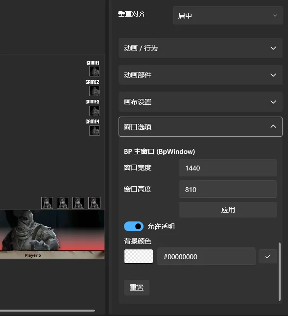

在这里可以设置：

- **窗口宽度 / 窗口高度**：前台窗口的尺寸。
- **允许透明**：控制窗口是否使用透明背景。
- **背景颜色**：设置窗口本身的背景颜色，点击左侧的颜色预览可以打开颜色选择器，画布本身是透明的，如果要抠绿幕，提供颜色的是窗口而非画布。也可使用带透明度的颜色，配合“允许透明“使用

修改窗口宽高后，点击【应用】。

需要注意，窗口尺寸与画布尺寸相互独立。窗口大小变化时，内部画布及其控件会根据窗口的缩放方式显示，而不是直接修改每个控件的坐标。

部分窗口选项会独立保存并立即应用，不需要等到整个布局保存。其中，【允许透明】改变后，软件可能需要自动重建对应的前台窗口。

### 2. 画布设置

在右侧展开【画布设置】。

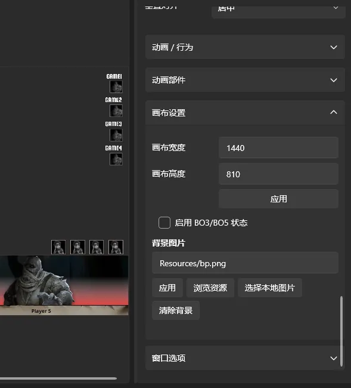

这里的画布宽高决定编辑控件时使用的坐标范围。

例如，画布设置为 1920 × 1080 时，控件位置会按照这一设计尺寸进行计算。

修改画布宽高后点击【应用】。

### 3. 修改背景图片

界面的所谓“UI 图片“由画布提供

在【画布设置】中，找到【背景图片】，可以通过以下方式设置：

- 点击【浏览资源】，选择软件已有的图片资源。
- 点击【选择本地图片】，从电脑中选择图片文件。
- 手动输入已有的资源路径。
- 点击【清除背景】，移除当前背景图片。

选择本地背景图片时，软件会将其交给布局资源管理系统处理，以便在导出布局包时一并携带。

用户导入的图片将会被编码为如 `bpui://local/resources/images/xxx.png` 的 URi 字符串，作为图片的标识符，也可以在资源浏览器里查找内置资源进行使用。

内置资源的 URi 字符串通常形如 `Resources/xxx.png`

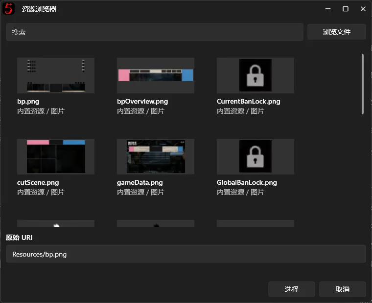

建议使用 PNG、JPG 等常见图片格式，并尽量让背景图片尺寸与画布尺寸一致。

> **注意：** 画布背景图片与窗口背景颜色并不是同一项设置。通常情况下，制作完整 BPUI 时可以使用一张背景图片作为底图，再将队名、角色立绘、比分等内容作为独立控件叠加上去。

## 三、添加和编辑控件

设置好画布后，就可以开始修改前台界面中的具体内容。

### 1. 添加控件

点击顶部工具栏中的【添加控件】，选择要添加的控件类型。

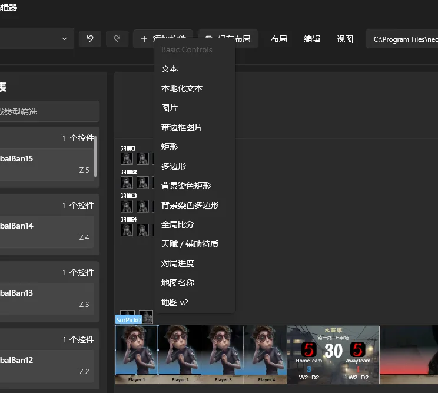

设计器提供了多种内置控件：

| 控件 | 用途 |
| --- | --- |
| 文本 | 显示普通文字、队名、选手名、比分等内容 |
| 本地化文本 | 显示可随软件语言切换的文字，通常需要去翻一下软件代码才知道有哪些语言键可以使用 |
| 图片 | 显示队伍 LOGO、角色图片等 |
| 带边框图片 | 显示带有边框、裁剪和圆角等效果的图片，通常在需要自适应的场景中，效果优于普通图片 |
| 矩形 / 多边形 | 绘制形状、纯色或渐变装饰 |
| 染色矩形 / 染色多边形 | 绘制形状、对控件后方的纹理进行染色，现用于实现队伍主题色的功能 |
| 对局进度 | 显示当前局数、半场等比赛进度 |
| 地图名称 | 显示当前地图名称 |
| 天赋 / 辅助特质 | 显示选手的天赋和辅助特质 |
| 全局比分 | 显示全局比赛比分行，是一个复合的高级控件 |
| 地图 v2 | 显示地图 BP v2 的地图卡片 |

部分控件还包含专门的内部编辑功能。

如果安装的插件提供了支持 v3 设计器的自定义控件，也会出现在添加菜单中。

添加完成后，新控件会出现在画布和左侧图层面板中，并自动进入选中状态。

### 2. 移动和调整控件大小

在中央画布中，点击需要修改的控件。

选中后，控件周围会出现选择框和调整手柄。

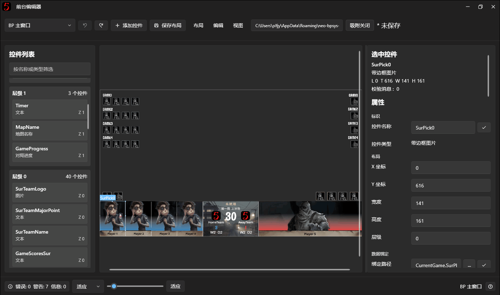

可以进行以下操作：

- **移动**：按住选中的控件并拖拽。
- **缩放**：拖动控件周围的调整手柄。
- **微调位置**：使用键盘方向键。
- **精确设置**：在右侧属性面板中直接输入 X 坐标、Y 坐标、宽度和高度。

如果控件被其他图片遮挡、处于隐藏状态，或者本身完全透明，可以通过左侧图层面板直接选择。

#### 吸附与对齐

顶部工具栏提供【吸附】开关。

开启后，拖动或调整控件大小时，设计器会尝试将控件对齐到画布边缘、中心线或其他控件。

当满足对齐条件时，画布中会出现辅助线。

也可以在拖动时按住 Shift 临时启用吸附，无需手动切换开关。

### 3. 修改控件属性

选中控件后，右侧会显示对应的属性列表。

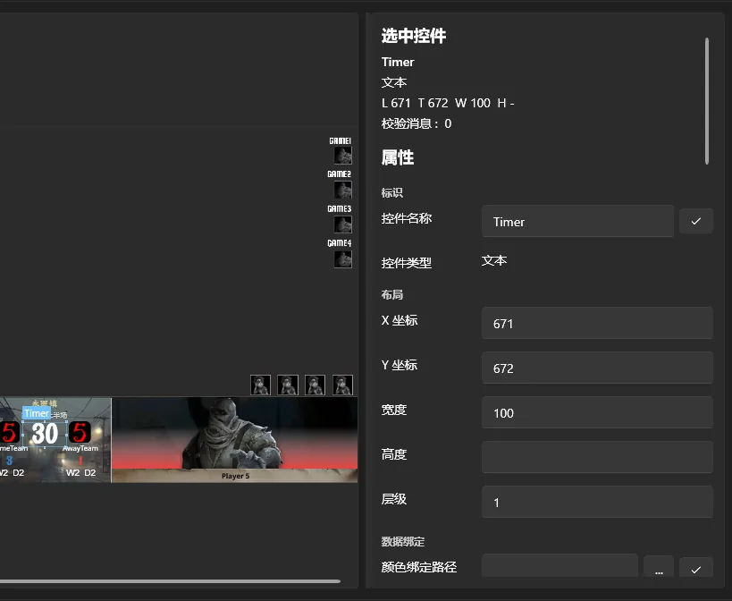

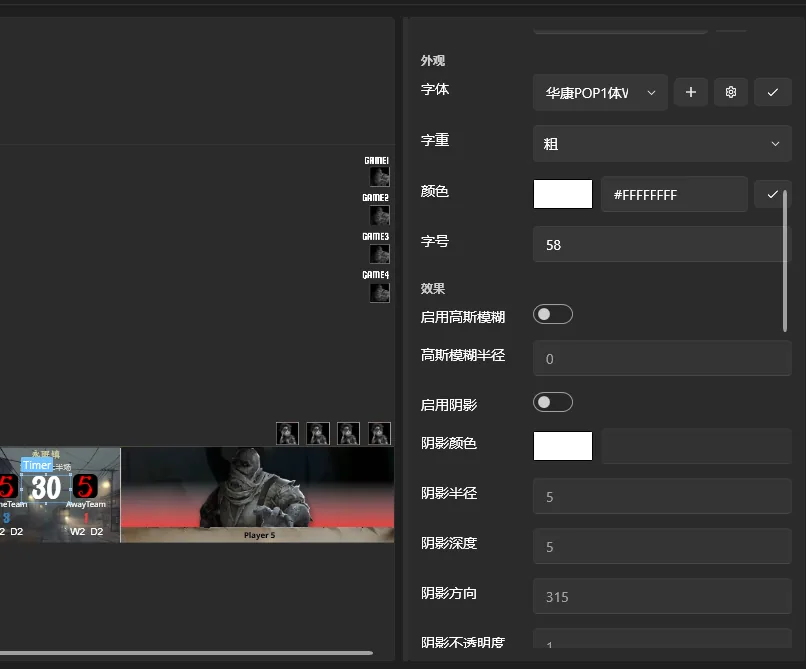

不同类型的控件拥有不同的属性。例如：

- **布局**：X/Y 坐标、宽高、显示层级。
- **内容**：静态文字、图片路径、本地化键。
- **外观**：字体、字号、颜色、图片缩放、透明度。
- **效果**：阴影、发光、高斯模糊等。
- **数据绑定**：让控件内容随比赛数据自动变化。

部分属性还支持应用到同类型控件、子控件或使用预设布局模板，以减少重复操作。

大部分常规属性修改并点击别处后会自动更新预览，但一些可能影响其他内容的属性需要手动确认，例如控件名称、数据绑定路径和资源路径。

这类属性编辑完成后，需要按 Enter 或点击旁边的应用按钮。

通过以下手势可以多选控件

- 左键拖动框选
- 按住 Ctrl 并左键依次在画布上点击控件

此时右侧属性面板显示的是选中控件的共有属性，如果有属性值不一致则会显示为空，此时只要进行编辑，就能批量对多个控件同时进行属性修改的操作

### 4. 复制和删除控件

选中控件后，可以使用以下快捷键：

| 快捷键 | 功能 |
| --- | --- |
| Ctrl + C | 复制控件 |
| Ctrl + V | 粘贴控件 |
| Delete | 删除控件 |
| Ctrl + Z | 撤销 |
| Ctrl + Y / Ctrl + Shift + Z | 重做 |

粘贴的控件会自动获得一个新的名称，并稍微偏移位置，避免完全重叠。

部分系统关键控件或复合控件内部的固定元素不支持直接删除和复制。

可以跨窗口编辑界面复制和粘贴控件

### 5. 调整控件图层

左侧的图层面板按层级列出当前窗口中的控件。

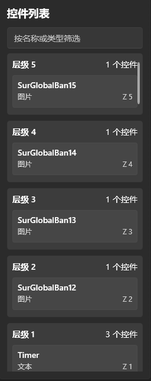

这里的层级即 `ZIndex`。

一般情况下，层级数值越大，控件越靠近画面上方。

例如，背景装饰通常放在较低层级，角色立绘、文字和动态选择框放在更高层级。

你可以直接在图层面板中拖拽控件来调整顺序，也可以将控件移动到其他层级。

如果希望把控件移动到所有控件的上方或下方，可以拖拽到图层面板顶部或底部的对应投放区域。

需要注意，使用左侧搜索框筛选控件时，会暂时禁止图层拖拽排序。清除筛选后即可恢复。

## 四、使用数据绑定

**数据绑定是制作 BPUI 时最重要的功能之一。**

普通的静态文字或图片不会自动变化，而使用数据绑定后，控件可以跟随软件后台的比赛数据实时更新。

例如，在前台显示双方队伍的名称时，不需要每次比赛都重新打开设计器修改文字，只需要将文本控件绑定到队伍名称字段即可。

### 1. 为文字绑定比赛数据

下面以显示求生者队伍名称为例。

1. 在画布中添加或选择一个【文本】控件。
2. 在右侧属性面板中找到【文本绑定】。
3. 点击编辑绑定源按钮。
4. 在弹出的编辑器中添加一个数据来源。
5. 点击浏览绑定，找到【当前对局】→【求生者方队伍】→【队伍名称】。
6. 选择后确认绑定，并提交修改。

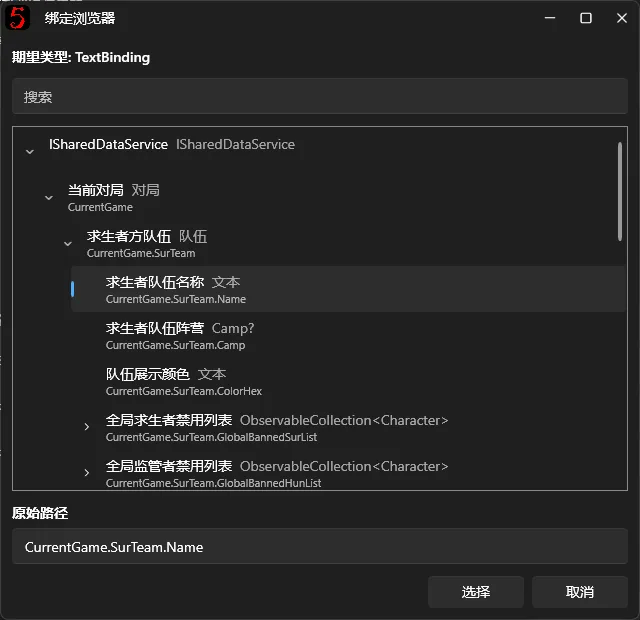

这个字段对应的路径是：

```text
CurrentGame.SurTeam.Name
```

绑定成功后，前台会根据后台当前的求生者队伍名称自动更新文字。

同理，监管者队伍名称对应：

```text
CurrentGame.HunTeam.Name
```

#### 组合多个数据来源

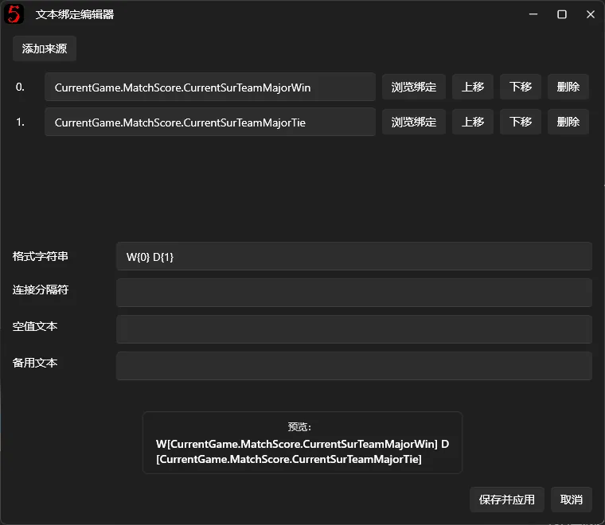

文本绑定还支持添加多个来源，并通过格式化字符串将它们组合。

例如，添加两个数据来源后，可以在"格式化字符串"`StringFormat` 中使用 `{0}` 和 `{1}` 引用它们。

`{0}` 代表第一个数据来源，`{1}` 代表第二个数据来源，以此类推。

如果不需要自定义格式，也可以直接使用连接分隔符将多个来源拼接起来。

> **注意：** 对于文本控件，有效的【文本绑定】会优先于静态【文本】内容。没有设置有效绑定来源时，才使用静态文本。

更多的 StringFormat 进阶内容可参考微软的官方文档：[String.Format 方法](https://learn.microsoft.com/zh-cn/dotnet/api/system.string.format?view=net-10.0)

#### 【进阶】动态索引绑定

除了普通的数据绑定，v3 设计器还支持**动态索引绑定**，允许使用其他数据字段作为集合的索引，并在对应字段发生变化时自动更新显示内容。

例如，普通的绑定路径使用固定索引：

`CurrentGame.SurPlayerList[0].Member.Name`

这里的 `[0]` 表示始终读取第一位求生者选手的名称。

而动态索引允许在方括号内填写另一条绑定路径，由软件自动获取对应的索引值。

##### 示例：自动显示当前半场比分

假设我们希望一个文本控件始终显示当前正在进行的半场比分，而不需要每次切换对局后手动调整绑定。

可以在【文本绑定】编辑器中添加以下两个数据来源：

**来源 1：求生者方当前半场小比分**

`CurrentGame.MatchScore.HalfByProgress[CurrentGame.GameProgress].SurMinorScore`

**来源 2：监管者方当前半场小比分**

`CurrentGame.MatchScore.HalfByProgress[CurrentGame.GameProgress].HunMinorScore`

然后在【文本格式】（StringFormat）中填写：

`{0} : {1}`

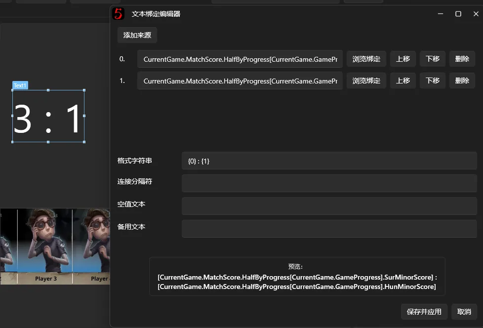

这里的 `[CurrentGame.GameProgress]` 会动态读取当前对局进度，并通过 `HalfByProgress` 找到对应的半场比分。

当后台的对局进度发生变化时，绑定会自动重新计算，文本控件也会随之更新。

`HalfByProgress` 还会处理 BO3/BO5 的对局进度差异，因此建议使用这种方式获取当前半场比分，而不是直接将对局进度当作普通数组下标。

##### 动态索引的使用规则

动态索引使用方括号 `[]`，支持固定索引、动态字段及多重索引。

例如：

- `Players[0].Name`：读取固定索引。
- `Players[CurrentGame.SelectedPlayerIndex].Name`：使用另一个字段作为索引（示意路径，实际使用时需确保字段存在）。
- `Foo[Bar.Index].Items[Baz.SelectedIndex].Name`：在同一绑定路径中使用多个动态索引。

需要注意，**方括号内只能填写固定索引或有效的绑定路径，不能直接执行数学运算或条件表达式**。

例如，`Players[CurrentGame.Index + 1].Name` 不受支持。

另外，动态索引属于 **BindingPath** 的功能，与前面介绍的 **StringFormat** 不同：

- `BindingPath` 用于指定数据从哪里读取，可以使用 `[CurrentGame.GameProgress]` 这样的动态索引。
- `StringFormat` 用于组合和格式化已经读取的数据，通过 `{0}`、`{1}` 等占位符引用绑定来源，也支持 `{0:F2}` 等标准数值格式。

如果希望在文字中显示某个动态字段，应先将该字段添加为数据来源，再通过 `{0}` 等占位符使用，而不是直接把绑定路径写进格式化字符串。

对于普通的队伍名称、角色图片等内容，通常使用普通绑定即可。**动态索引更适合需要根据当前对局进度或其他动态状态选择不同数据项的场景。**

### 2. 为图片绑定比赛数据

图片控件除了显示固定图片，也可以绑定软件后台的动态图片数据。

例如，队伍 LOGO、选手定妆照、角色立绘等都可以通过绑定实现自动变化。

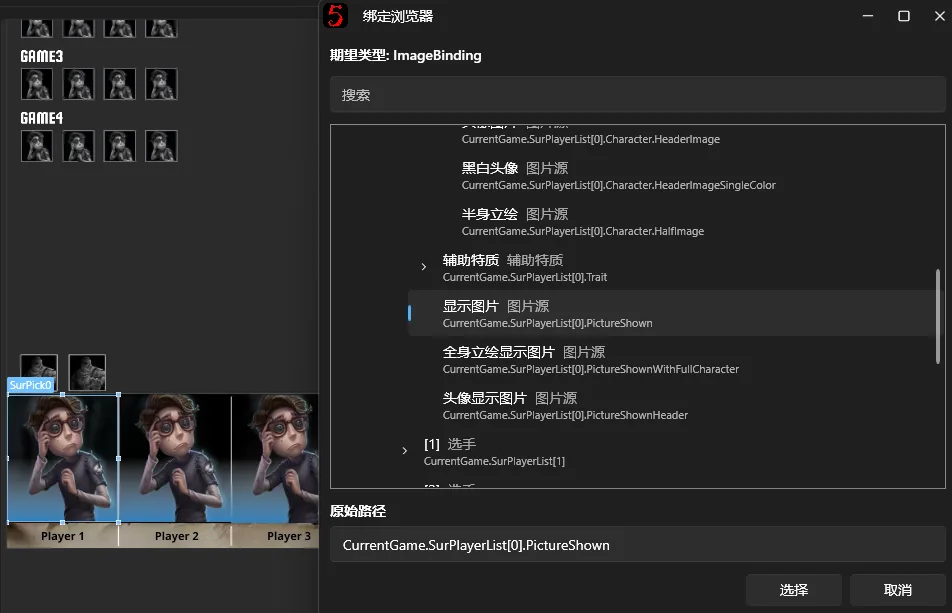

操作方式与文本类似：

1. 选中一个【图片】或【带边框图片】控件。
2. 找到【绑定路径】。
3. 点击【浏览绑定】。
4. 选择需要展示的图片数据。
5. 确认并应用修改。

需要区分以下两个属性：

- **静态图片路径（ImagePath）**：显示用户指定的固定图片。
- **绑定路径（BindingPath）**：根据后台比赛数据动态取得图片。

当两个属性同时存在时，有效的数据绑定会优先使用 `BindingPath`。

### 3. 修改图片素材

如果只想显示一张固定的图片，不需要进行数据绑定。

在【静态图片路径】中点击【浏览资源】，选择软件已有的资源，也可以选择电脑上的图片文件，图片将会转交给 neo-bpsys-wpf 进行处理，并随着 BPUI 文件进行到处。

### 4. 比分字段的区别

v3 设计器提供了多个不同的比分字段。特别是小比分，它们可能看起来相似，但统计范围并不相同。

例如，BP 主界面、赛后数据和全局比分所需要的数字不一定是同一个字段。

如果绑定比分后发现显示的数值与预期不一致，请先检查所选字段的含义。

详细说明请参阅[《比分系统》](../score-system.md#标准对局模式)。

## 五、编辑特殊控件

某些控件不只是单独的一张图片或一行文字，而是由多个内部元素组合而成。

设计器为这些控件提供了专门的编辑能力。

### 1. 全局比分控件

【全局比分】可以显示多个半场比分格，并自动读取软件的比赛比分。

选中整个比分行时，可以调整整体的位置、大小和样式。

如果需要修改其中某一个比分格，可以在属性面板的比分格列表中选择对应的内部元素，再单独调整其位置和样式。

### 2. 地图 v2 控件

【地图 v2】控件内部包含地图名称、地图卡片、队伍名称以及选图边框等元素。

选中该控件后，可以进入内部样式编辑，修改其中某个部件的位置、尺寸和样式。

设计器还提供将样式应用到其他地图卡片的功能，方便统一所有地图卡片的外观，而不会把每张卡片自己的地图身份和数据绑定直接替换掉。

部分复合控件的内部元素不能作为独立的顶层控件删除或拖出，它们属于父控件的一部分。

## 六、分别制作 BO3 和 BO5 布局

如果需要让 BO3 和 BO5 比赛使用不同的前台布局，可以启用设计器内置的 BO 模式状态功能。

例如，BO3 和 BO5 的比分格数量、位置或背景可能不同，此时不需要分别制作两套完整布局包。

### 设置方法

1. 在右侧打开【画布设置】。
2. 勾选【启用 BO3/BO5 状态】。
3. 在【当前编辑状态】中选择 BO5 或 BO3。
4. 分别编辑两种状态下的背景和控件。
5. 保存布局。

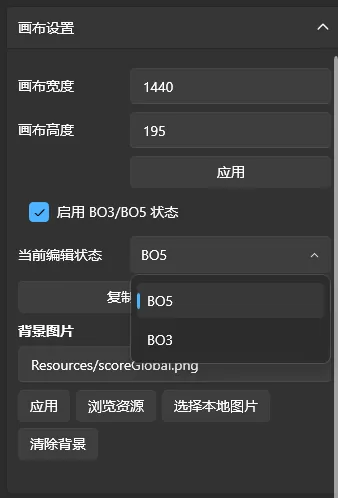

通常建议先完成 BO5 布局，然后点击【复制 BO5 布局到 BO3】，再根据 BO3 的需要调整比分格、背景和其他控件。

复制后，两种状态可以分别编辑。

**实际直播时，软件会根据后台当前选择的 BO3 或 BO5 模式使用对应的布局状态**，不需要手动打开设计器进行切换。

> **注意：** 【复制 BO5 布局到 BO3】会覆盖 BO3 状态中已有的布局内容，操作前请确认。

## 七、制作动画和行为

除了修改静态布局，v3 设计器还支持使用动画行为系统，让控件根据比赛中的操作自动播放动画。

例如：

- 选择角色后，让角色立绘渐入。
- 切换对局进度时，播放文字或图片动画。
- 在 Ban/Pick 过程中，让指定控件显示呼吸动画。
- 根据比分、地图或队伍信息变化触发动画。

动画系统主要由**行为、触发器和节点图**组成。

### 1. 创建行为

首先选中需要添加动画的控件，然后在右侧打开【动画 / 行为】。

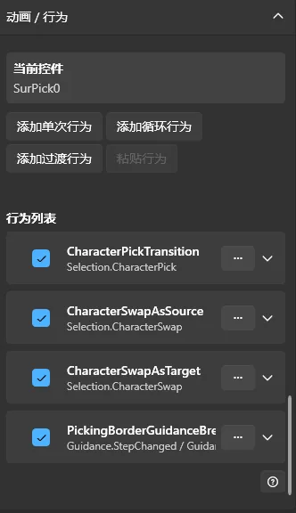

点击对应按钮，可以创建三种行为：

| 行为类型 | 说明 |
| --- | --- |
| 单次行为 | 满足条件后执行一次动画 |
| 循环行为 | 满足条件后开始循环，直到符合停止条件 |
| 过渡行为 | 在特定比赛数据变更前后执行退出与进入动画 |

对于简单的显示动画，通常使用【单次行为】即可。

循环行为适合呼吸灯、持续闪烁等效果。

过渡行为则适合角色选择、角色交换等需要在数据更新前后分别播放动画的场景。

### 2. 设置触发器

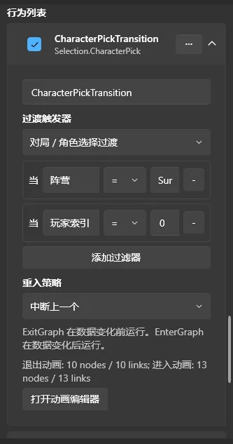

每条行为都可以设置触发器，决定动画何时执行。

例如：

- 窗口显示。
- 控件加载。
- 角色选择。
- 角色禁用。
- 比分改变。
- 地图改变。
- 对局进度改变。

创建行为后，在【触发器】中选择对应的事件类型。

如果只需要特定条件下触发，还可以使用【过滤器】进一步限制。

例如，某个角色选择动画只应在求生者的某个位置发生变化时执行，可以通过对应事件中的阵营、索引等字段进行过滤。

过滤器支持等于、不等于、大于、小于、包含等比较方式。实际可选字段和运算符会根据事件类型进行调整。

### 3. 编辑动画节点图

设置完行为和触发器后，点击【打开动画编辑器】，进入节点图编辑界面。

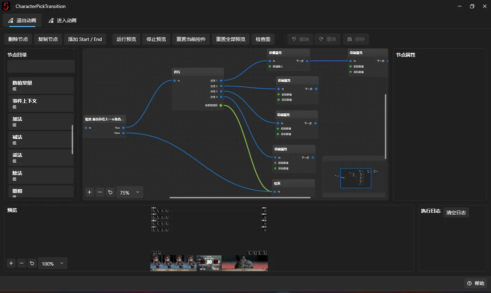

节点图使用可视化方式编排动画。

左侧为节点目录，中间为节点编辑画布，右侧用于修改选中节点的属性。

常用节点包括：

| 节点 | 功能 |
| --- | --- |
| 开始 Start | 动画执行入口 |
| 结束 End | 动画执行结束 |
| 延迟 Delay | 等待指定时间 |
| 并行 Parallel | 并行执行多个分支 |
| 条件判断 If | 根据条件决定执行路线 |
| 设置属性SetProperty | 直接设置控件属性 |
| 重置属性 ResetProperty | 重置控件属性 |
| 动画属性 AnimateProperty | 在两个属性值之间播放动画 |

你可以从左侧节点目录拖拽节点到中央画布，再从一个节点的输出端口连接到另一个节点的输入端口。

#### 示例：制作一个渐入动画

下面以一个简单的透明度渐入动画为例。

1. 创建一条【单次行为】。
2. 为行为选择一个合适的触发器，例如【控件加载】。
3. 打开动画编辑器。
4. 添加“开始“、“动画属性“和“结束“节点。
5. 按顺序连接三个节点。
6. 选中动画属性，设置目标和动画属性。

可以参考以下参数：

| 属性 | 值 |
| --- | --- |
| 作用层 Target |  自身内容 Self |
| 属性名称 PropertyName | 不透明度 Opacity |
| 起始值 From | 0 |
| 结束值 To | 1 |
| 持续时间 DurationMs | 300 |
| 缓动 Easing | 线性 Linear |
| 等待动画完成 Wait for completion | 真  True |

这里的 `自身内容 Self` 代表当前行为所属的控件。

`不透明度 Opacity`，取值为 0 时完全透明，为 1 时完全不透明。

`持续时间 DurationMs` 单位为毫秒，因此 300 表示动画持续 0.3 秒。

这样，行为被触发时，控件就会从完全透明逐渐变成不透明。

### 4. 预览动画

节点图制作完成后，点击顶部的【运行预览】。

动画会在设计器的预览环境中执行，无需直接操作直播画面。

如果动画没有正确运行，可以检查：

- Start 节点是否正确连接到后续节点。
- 动画目标和属性是否正确。
- 节点参数是否存在错误。
- 当前动画是否依赖尚未提供的事件数据。

可以在底部执行日志查看结果。

预览完成后，点击【重置当前目标】或【重置所有预览】，将被动画修改的属性恢复到正常状态。

对于循环行为，还可以分别预览开始图、循环图和停止图，检查开始、循环和停止时的效果。

编辑完成后，记得保存动画节点图及设计器中的修改。

### 5. 自定义动画部件

对于需要额外视觉元素的动画，可以使用【动画部件】功能。

动画部件附着在当前控件内部，不会作为普通独立控件出现在左侧图层面板中。

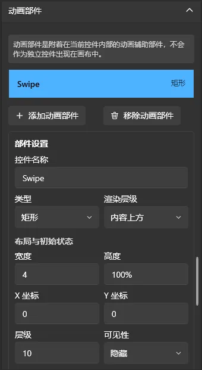

目前支持的动画部件类型包括：

- 矩形
- 边框
- 图片

每个部件可以设置位置、尺寸、颜色、透明度、渲染层级等属性。

例如，可以制作一条覆盖在角色图片上方的扫描线，通过行为节点控制其位置和透明度，实现图片扫描效果。

动画部件也可以放在控件内容的下方，用于制作背景或衬托效果。

完成设置后点击【应用动画部件修改】。

## 八、保存和检查布局

完成编辑后，点击顶部的【保存布局】，或者按 Ctrl + S。

保存时，设计器会对布局进行校验。如果存在会影响保存的错误，会阻止保存并显示对应的错误信息。

一般情况下只要你是正常通过 v3 设计器调整，都不会有问题

### 1. 查看校验消息

点击底部的状态信息按钮，可以打开验证详情。

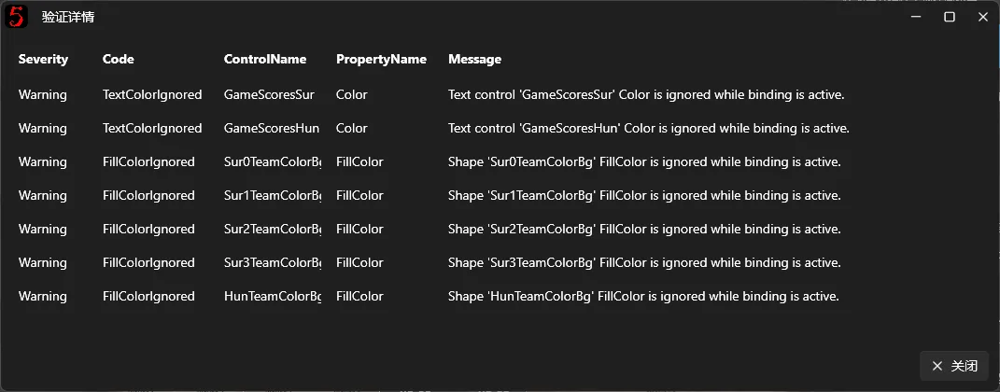

通常情况下 Warning 都不用管，只用管 Error，验证消息是英文的，如果看不懂可以截图问 AI 要一下翻译

常见问题包括：

- 控件名称重复或不合法。
- 控件属性值无效。
- 绑定路径或资源路径不正确。
- 引用了缺失的图片资源。
- 插件控件或插件事件缺失。

### 2. 内置布局与用户布局

软件自带的布局属于【内置布局方案】，默认不可直接覆盖。

如果当前正在使用内置布局，并且第一次在设计器中保存修改，软件会自动创建一个新的可编辑布局方案。

之后的修改会保存在这个用户布局方案中，不会覆盖软件内置资源。

这也意味着，即使修改了大量控件，仍然可以通过布局包管理重新使用内置布局。

### 3. 重新加载与重置

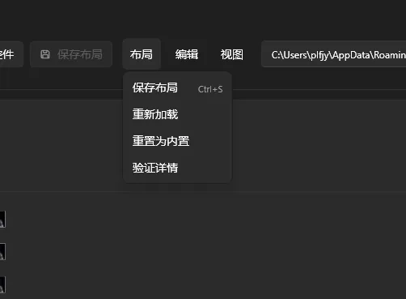

顶部【布局】菜单还提供：

- **重新加载**：重新读取当前布局。
- **重置为内置**：将当前窗口的布局恢复到内置版本。
- **验证详情**：检查当前布局的问题。

使用重新加载或重置前，建议先保存需要保留的修改，或者在布局包管理中创建副本。

### 4. 检查实际前台窗口

布局保存成功后，软件会尝试重新加载对应的前台窗口布局。

可以返回[前台管理](../fronted-manager.md)，打开对应的前台窗口，检查真实输出效果。

设计器中的预览数据并不等同于正式比赛数据，因此建议使用后台实际修改队伍名称、角色、地图或比分，确认绑定和动画是否正常工作。

对于 OBS 中正在使用的前台窗口，也建议在正式比赛前检查透明背景、窗口尺寸、内容位置和捕获效果。

## 九、导入和导出布局包

v3 设计器的布局通过 `.bpui` 文件进行打包和分享。

在[前台管理](../fronted-manager.md)页面切换到【布局包】标签页，即可管理所有已安装的前台布局包。


### 1. 激活布局包

选择需要使用的布局包并激活。

激活后，软件将使用该布局包中的前台布局和动画行为。

切换布局包时，已经创建的 v3 前台窗口也会重新加载对应的布局。

建议在正式直播前完成切换。

### 2. 创建布局副本

如果希望基于现有布局修改，又不想影响原来的布局，可以先在布局包管理中创建副本，再激活副本进行编辑。

这样可以保留原布局，同时制作多个不同赛事风格的 BPUI。

### 3. 导出布局包

选择需要分享的布局方案，点击【导出】。

在导出窗口填写布局名称、作者、描述等信息，选择保存位置，即可生成 `.bpui` 文件。

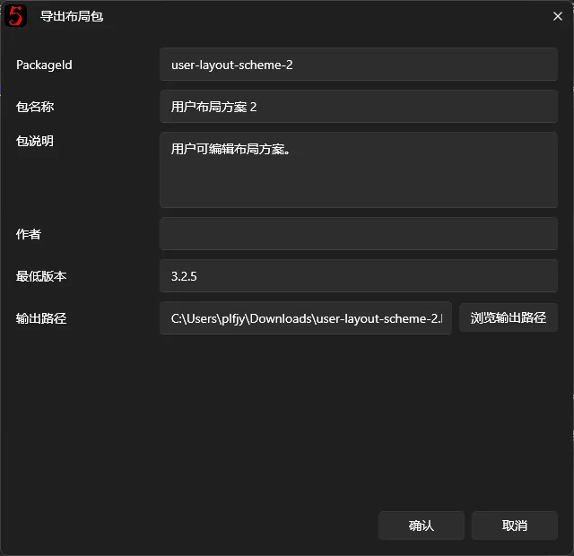

v3 布局包可以携带：

- 前台窗口的布局。
- 控件设置及动画行为。
- 布局引用的图片、字体等资源。
- 布局包名称、作者和版本等信息。

布局包不会包含软件的全部配置，也不会包含插件程序本身。对于依赖插件的布局包，在将布局包导入之后会出现插件控件的兼容性提醒，但是不影响使用

### 4. 导入布局包

在【布局包】页面点击【导入】，选择 `.bpui` 文件即可。

软件会检查布局包的格式及内容，并将其安装到布局包列表中。

如果布局使用了当前电脑没有安装的插件，可能会出现插件依赖相关的提示。

对于缺失的插件控件，建议安装或启用对应插件后再使用，以免前台出现缺失内容。

v2 及更早版本的旧 `.bpui` 布局包也支持通过导入流程转换为 v3 格式，但无法保证所有内容都能完全还原。

对于旧版布局，建议导入后逐个检查控件、图片、比分和其他动态内容。

## 十、创建自定义前台窗口

除了修改内置窗口，v3 还支持创建新的前台窗口。

如果你想制作一个软件内原本没有的独立展示窗口，可以使用此功能。

在【前台管理】的前台窗口页面点击【创建自定义窗口】。

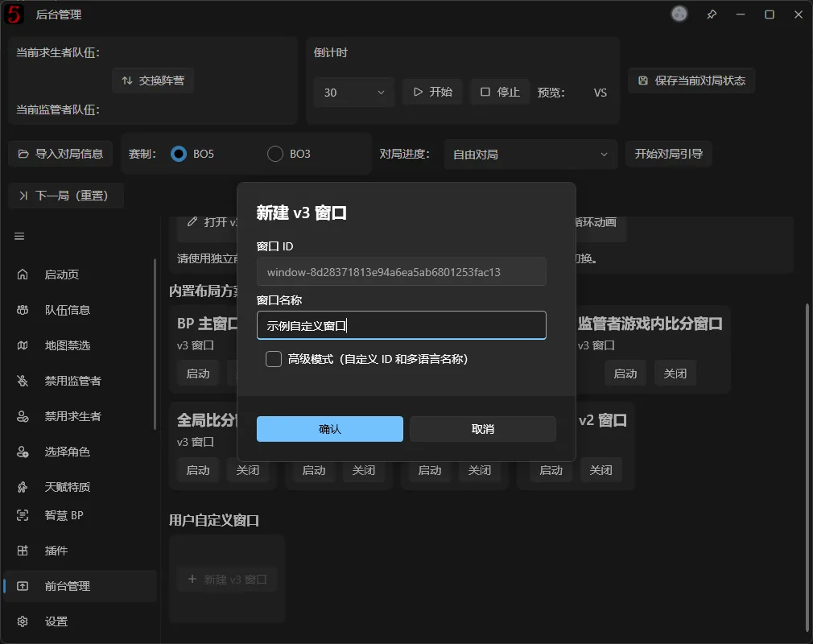

输入窗口名称并确认后，软件会创建一个新的空白前台窗口，并进入 v3 设计器。

可以像编辑普通前台窗口一样添加背景、控件、绑定和动画行为。

创建后，这个窗口也会显示在前台管理页面中，可以单独打开或关闭，并用于 OBS 捕获。

自定义窗口与当前布局包关联。切换到其他布局包时，原布局包中的自定义窗口不会继续作为当前布局包的窗口显示。

## 十一、其他注意事项

1. **请经常保存布局**：设计器不是所有操作都会实时保存到文件。尤其是修改控件、动画和数据绑定后，建议及时按 Ctrl + S。
2. **优先使用数据绑定**：对于队伍名称、选手图片、地图、角色和比分等动态数据，不建议使用固定文字或固定图片代替绑定。
3. **不要随意删除系统关键控件。** 部分内置布局包含与比赛业务相关的特殊控件，删除或错误修改后可能导致前台内容无法正常更新。同时恢复可能会消耗你的大量精力。
4. **动画不要过度使用**：大量同时运行的动画、图片效果可能增加前台渲染负担。制作完成后建议在实际导播环境中测试。
5. **正式直播前进行检查**：尤其是经过大量修改的 BPUI，建议完整测试角色选择、角色禁用、换边、比分更新以及 BO3/BO5 模式切换等流程。

如果在使用中遇到其他问题，可以点击设计器右下角的【帮助】按钮查看内置操作说明，也可以通过 GitHub Issues 和 QQ 群向开发团队反馈。
