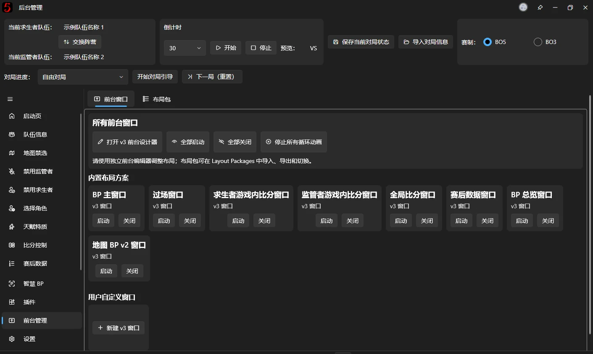

# 前台管理

## 前台窗口

在这里可以管理前台界面的开启和隐藏，管理用户自定义的前台窗口

上方的停止所有循环动画一般情况下不需要点击，主要是应对无法停止呼吸灯动画一类的循环动画锁使用

点击【打开 v3 前台设计器】后会打开一个新的窗口，在这里面可以自由的编辑前台的界面，详细请阅读[《v3 前台设计器》](backend-v3-designer.md)

## 布局包

在这里可以对导入的前台布局包进行管理，在这里可以对布局包进行导入、导出、删除、创建副本

在 v3 编辑器内修改内置布局包之后会自动创建一个副本，之后的工作将会在副本当中继续

v2 版本及以前的旧版的 bpui 包依旧可以直接导入，会自动触发格式升级，不保证能 100% 准确还原，如果出现了转换异常，请及时向开发团队上报问题