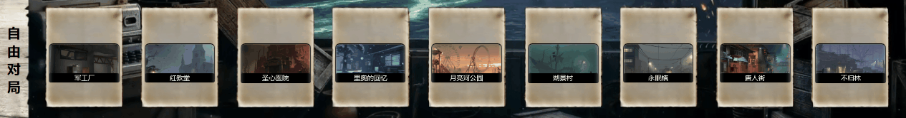
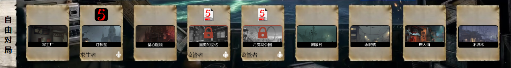
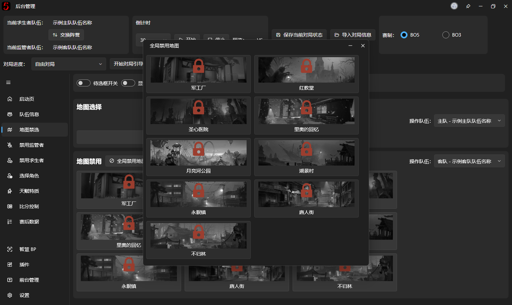

# 地图禁选

## 基础禁用选择

本页面的功能是设置在地图BP窗口上显示的选择的和被禁用的地图。

本软件支持选择/禁用全部排位地图，使用方法为点击需要选择/禁用的地图（~~未来将支持多选~~已于[v1.1.0.9483版本](https://github.com/PLFJY/neo-bpsys-wpf/releases/tag/v1.1.0.9483)开始支持多选禁用）。

‍目前，我们同时支持新旧版地图BP规则并制作了相关的前台画面，详见[地图BP](../fronted/fronted-map-bp.md)。

旧版 v1 单地图禁选界面已经彻底删除

在地图BP v2 中的规则下，软件支持以下功能：

## 待选框呼吸灯
本功能的作用是为未被禁用的地图添加呼吸灯效果，呼吸灯的效果可以在 v3 编辑器内进行自定义编辑

## 阵营选择结果展示
本功能的作用是展示禁用/选择各个地图的战队名和阵营

## 全局地图禁用

点击【全局禁用地图】按钮之后将会弹出一个窗口，请在窗口内点击选择需要被全局禁用的地图（一般是已经选择的地图或者是还没进联赛已经被作者加进软件里的地图）

## 额外特性

如果队伍设置了 LOGO 则会如“[阵营选择结果展示](#阵营选择结果展示)“部分的插图所示，使用队伍 LOGO 来表示禁用/选择方，若未设置队伍 LOGO，则会展示队伍名称，如下图所示

