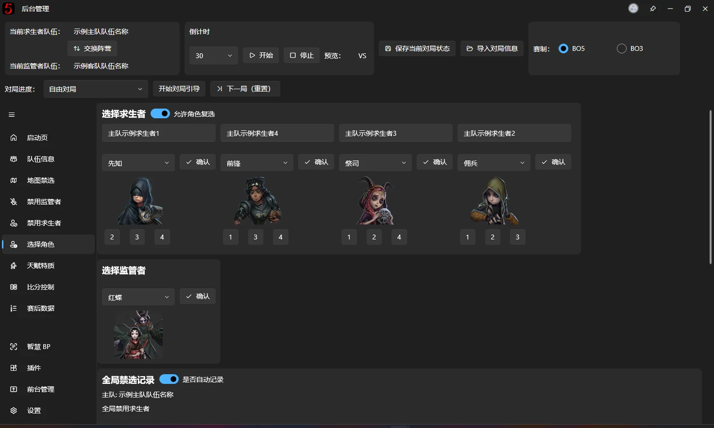

# 选择角色

本页面的功能是记录双方选择的角色以及全局禁选记录

## 选择各阵营上场角色

可以看到，页面中有四个求生者选择器和一个监管者选择器，且每一个求生者选择器上方都有一个只读的文本框，展示的是对应槽位选手的名字，为了方便在角色分配阶段中将选手对应角色时对照

选择方法与[禁用角色](backend-ban-character.md#角色选择器)中介绍的【角色选择器】使用方法一致

同时在每一个求生者角色角色选择器下方都能看到一个【角色切换器】，这与在[队伍管理](backend-team-info.md#修改选手顺序)页面看到的交换选手的按钮作用相同，点击数字即可和对应位置的求生者选手更换使用角色

⚠️ 注意：之前介绍[角色选择器](backend-ban-character.md#角色选择器)的时候有提过，前台界面的显示和预览图片一致，所以交换角色后，下拉选择框内显示的角色名称不一致完全是正常现象！请不要报告此为 BUG

## 全局禁选记录

全局禁选记录的功能是记录各队伍**下次扮演该阵营时**应该进入全局禁选的角色，并会在换边时自动应用到全局禁选中。

这里就是[角色选择器](backend-ban-character.md#角色选择器)的简易版变种，角色选择器当中的所有特性对其完全有效

具体机制为：

- 在开启自动记录的情况下，会根据当前的对局进度和各队伍所扮演的阵营，自动将对应队伍选择的对应阵营角色，记录到该队伍的全局禁选记录当中，具体示例如下：

    在第一局上半场当中，**主队**扮演求生者，选择了先知、前锋、祭司、佣兵，那么则会如上图所示，自动填入到了【**主队**全局禁选记录】当中的 1、2、3、4 号位置

    在第二局下半场当中，**客队**扮演求生者，选择了四名求生者角色，自动填入到【**客队**全局禁选记录】当中的 1、2、3、4 号位置
- 当下次该队伍再次扮演该阵营的时候，就会自动填入到[禁用角色](backend-ban-character.md#当局全局禁用)的全局禁用当中，触发自动填充的条件有如下触发器：
    - 换边
    - 开始对局引导
    - 点击【下一局（重置）】并点击“是“或点击“仅重置“

