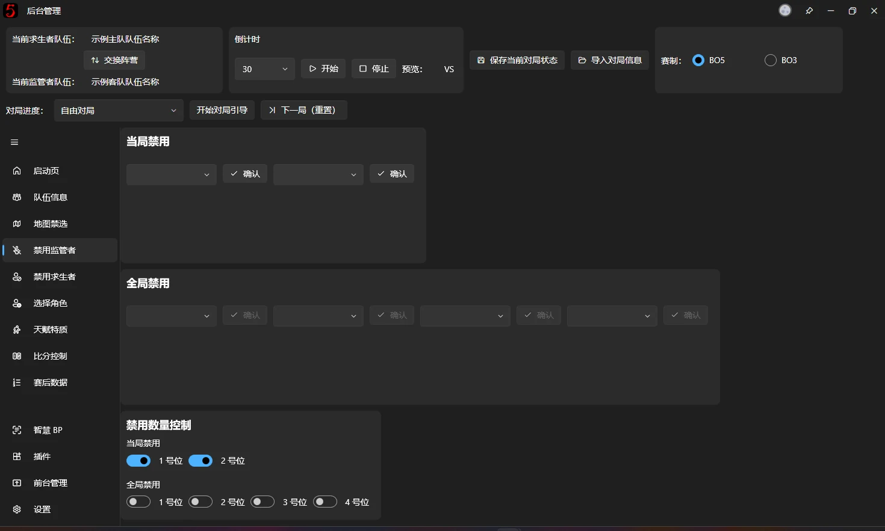
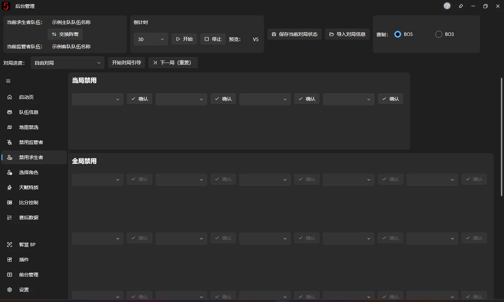
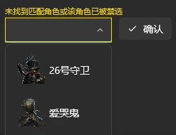

# 禁用角色

本页面的功能是设置显示在[BP画面](fronted-bp.md)上的被禁用的角色。

禁用求生者和禁用监管者的相关的功能都在本篇中进行介绍

本软件内置了 2 个监管者当局 ban 位和 4 个全局 ban 位。4 个求生者当局 ban 位和 16 个全局 ban 位。

## 角色选择器
这里需要引入一个概念—角色选择器，由如下部件组成：

- 可输入的下拉选择框（又名组合框）
- 确认按钮
- 预览图片框

下拉选择框用于检索和选择角色，搜索关键字支持角色全称、拼音全拼、拼音首拼，输入查询关键字后，点击空格键检索，若检索失败，则会出现如下图所示的提示

角色被正确检索之后点击【Tab 或回车键】进行确认 （推荐使用 Tab，因为回车要按两次），当预览图片框内展示了对应的头像之后，即选择成功，前台界面的禁用框状态会与预览头像完全一致，在触发确认之前，下拉选择框当中的选择是不会同步至前台界面的，这点请务必知悉，可以通过判断预览头像来知道前台显示的是什么角色

例：如果想搜索“宿伞之魂”，支持以下关键字：

- 宿伞之魂
- 宿伞
- sszh
- ss

同时，这个控价存在一个变种—只保留下拉选择框的形式，你会在“[选择角色](pick-character.md)”页面见到它，用于全局禁选记录

> 26号守卫支持输入 bb 来检索（不支持输入邦邦，我相信不会有人有 bb 放着不用搁那里输入两个汉字的）
‍
## 当局/全局禁用

在【当局禁用】区域禁用当局当中被禁用的监管者，被选中的角色会同步至前台界面

## 禁用数量控制

支持自定义 ban 位数量，被禁用的 Ban 位会在前台显示位一个锁头，或可以在 v3 编辑器内自定义锁定时的样式，稍后会在 v3 编辑器的说明当中介绍