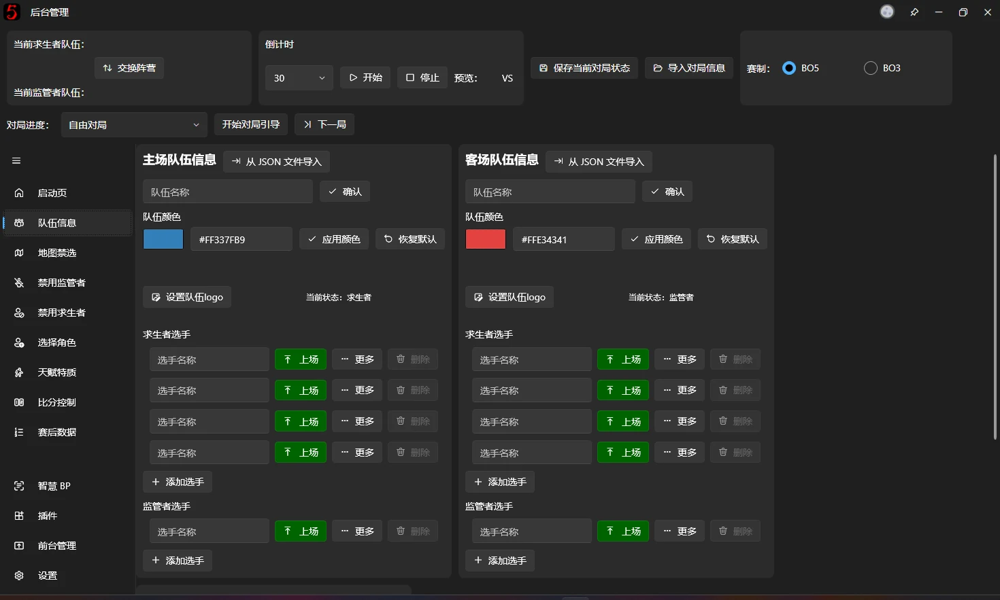

# 快速开始

## 安装

### 检查系统需求
在开始使用软件之前，请确保您的设备符合以下推荐配置：

+ Windows 10 20H2 及以上版本的系统
+ 推荐配置为i5 13400F + RTX 3060 +16GB 运行内存（最低配置为 i5 8300H + GTX 1060 + 8GB 运行内存）*
+ 已安装 [.NET 10.0 桌面运行时 ](https://dotnet.microsoft.com/zh-cn/download/dotnet/10.0) (一般会由安装包自动处理好)

> *核显能正常使用软件但不建议做导播 
> *macOS 理论上可以使用 Wine 正常启动软件，不过也不建议用作导播，因为 macOS 的窗口管理比较令人诟病
---

### 下载软件
目前有以下渠道下载本软件：

官方渠道（实时更新）
+ [官网下载中心](../../#download-center)
+ [GitHub Releases](https://github.com/PLFJY/neo-bpsys-wpf/releases)

第三方渠道（网友维护，**不保证为最新版**）
+ [蓝奏云](https://wwsm.lanzouo.com/b009hclqvi)（无需登录即可下载，密码：零风NB）
+ [百度网盘](https://pan.baidu.com/s/5_8kzq0n-09o6T1LreZHisg)
+ [阿里云盘](https://www.alipan.com/s/t8SByXpso8o)（提取码：86em）

## 基础操作

如果你是使用本软件的新手，请跟随本文指引来了解如何使用本软件。

### 〇、界面布局基础

如图所示，整个界面被分别两个区域：

① 快捷功能区，负责对局设定、对局切换、对局引导等横跨整个对局的操作  
② 操作区，负责对直播画面的详细控制，其中包含队伍信息编辑、地图禁选、Ban/Pick 操作、比分控制、赛后数据、前台画面管理等详细的控制操作

### 一、设置双方队伍的信息。
打开软件后点击窗口左侧的【队伍信息】。输入队伍基本信息后，将所有上场的队员设为【上场】。

在该页面的最下面显示了当前上场的选手。对于每个求生者选手，可以点击名称后面的数字以切换其位置。

如果需要了解如何更快速的导入队伍信息，请参阅[从Json导入队伍信息](advanced/import-team-from-json.md)。

---

### 二、设置赛制
在软件窗口上可以设置赛制为 BO5 或 BO3，**该设置将影响[对局引导](backend/backend-game-info-and-guidance.md)、比分计算等功能，请如实选择**。

---

### 三、启动前台
在软件窗口左侧的页面选择区域点击[前台管理](backend/backend-fronted-manager.md)。在这里可以打开或关闭各个前台展示画面（一般建议全打开然后在[OBS](https://obsproject.com/download)、直播姬、直播伴侣等直播软件中管理前台画面的显示与隐藏）。

---

### 四、开启对局引导
本软件根据官方比赛BP规则设计了对局引导功能，请选择当前对局进度（例如第一局上半场）后点击【开始对局引导】，然后点击【下一步】来根据比赛规则进行每一步操作。同时，你可以点击【上一步】和【结束对局引导】来进行对应操作。

开启对局引导后即可根据引导来进行BP，关于BP过程中各个步骤的详细介绍，详见：

+ [地图禁选](backend/backend-map-bp.md)
+ [禁用角色](backend/backend-ban-character.md)
+ [选择角色](backend/backend-pick-character.md)
+ [天赋特质](backend/backend-talents-and-trait.md)

---

### 五、赛后数据
在前台的【赛后数据窗口】可以显示当局双方数据。具体使用方法是在赛后数据页面输入各选手的数据。此时，输入的数据将会在【赛后数据窗口】内显示。

---

### 六、比分控制
进行完一个对局后，可以在[比分系统](backend/backend-score-system.md)页面来输入和计算比分，比分将同步到【比分窗口】中。

在选择上方的对局进度后就可以在比分控制处选择当局的对局结果，所有前台界面的比分组件会自动根据对局进度的记录显示比分

注：在自由对局中会有所不同，具体看[比分系统](backend/backend-score-system.md)中的说明

本软件内对局结果的加分与官方比赛一致，关于官方比赛加分详见下表。

| **对局结果** | **求生者队伍加分** | **监管者队伍加分** |
| --- | --- | --- |
| 四抓 | 0 | 5 |
| 三抓 | 1 | 3 |
| 平局 | 2 | 2 |
| 三跑 | 3 | 1 |
| 四跑 | 5 | 0 |

---

### 七、结束对局
在一局游戏结束后，点击【下一局（重置）】以清空当局BP信息（地图BP、全局禁选记录、比分等跨局信息将被保留）。
