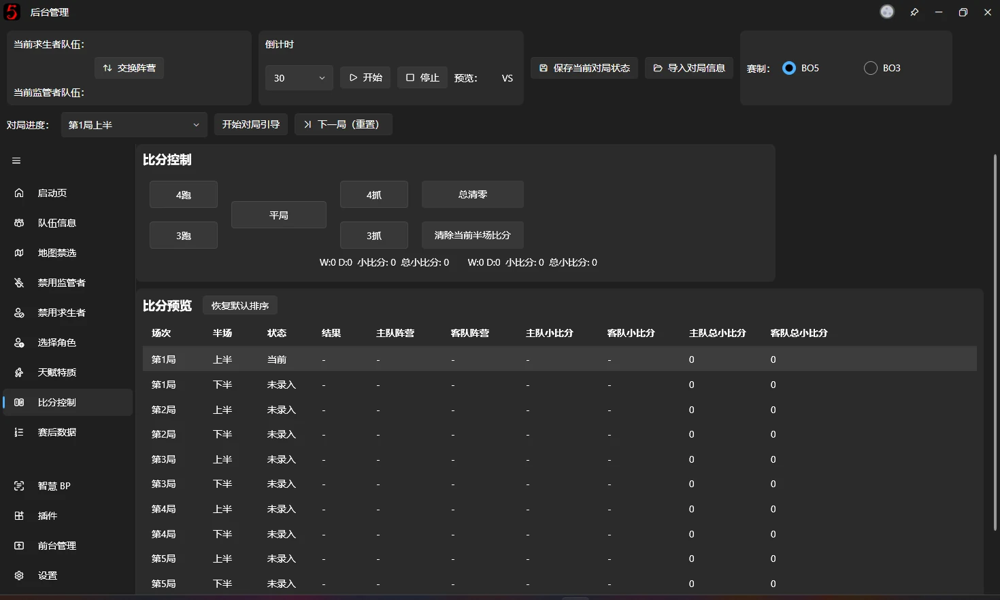
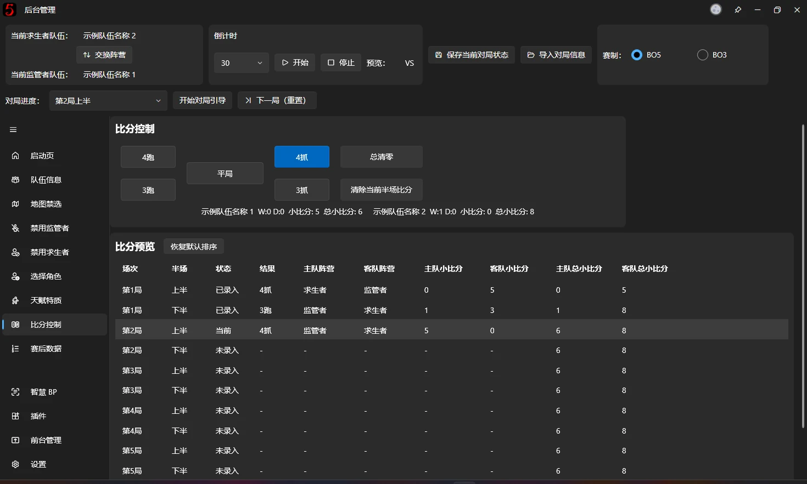
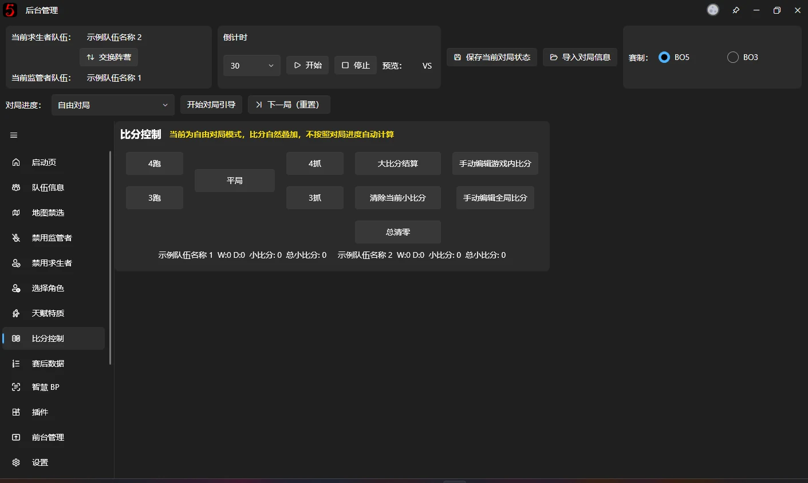
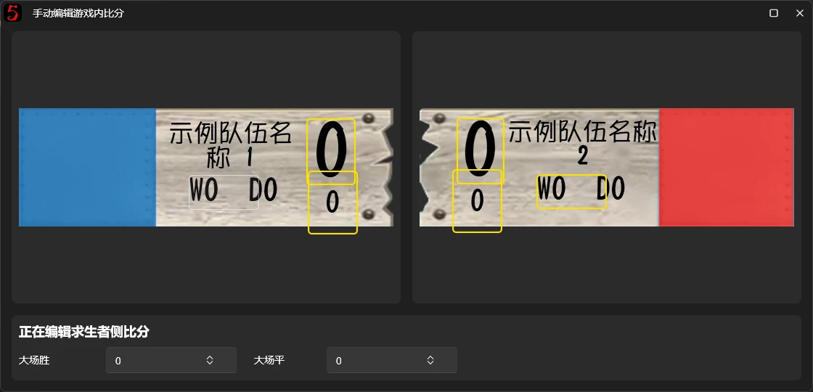
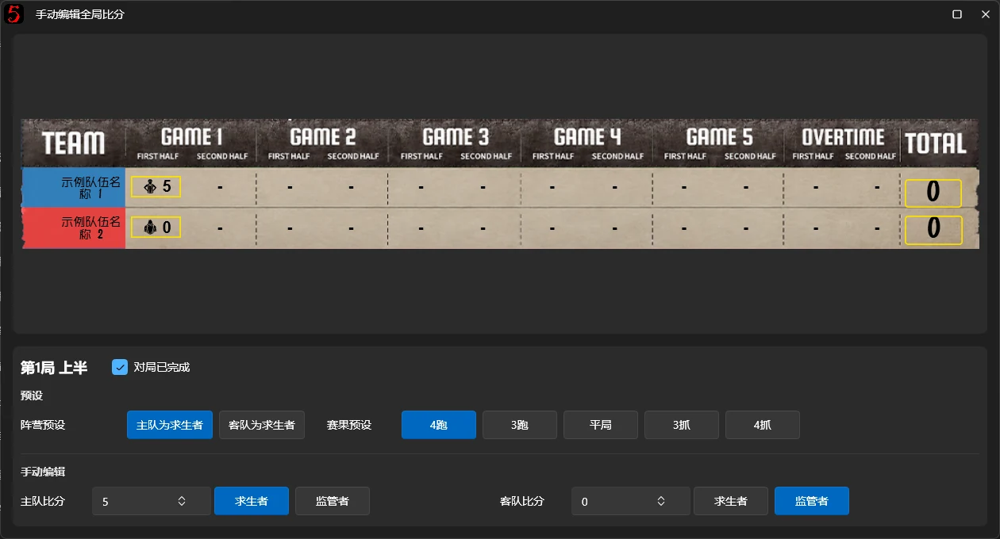

# 比分系统

本页面的功能是设置双方的比赛比分，比分将会展示在所有的窗口当中

比分系统分为“自由对局“和“标准对局“两种模式，进入时默认为“自由对局“模式，需要在上方切换对局进度才会启用“标准对局“模式

## 标准对局模式

每局游戏结束后点击对应的游戏结果，

当前对局状态会随着你按下按钮的那一刻被记录到表格当中

当前台的比分展示会随着对局进度自动计算应该展示的比分

此时，前台界面展示的小比分有三种情况（三种字段），并分别展示在如下的界面中：
- 当前回合累计小比分 MinorHalfScore
    - BP 主界面
    - 游戏内比分
- 当前半场小比分 CurrentMinorScore
    - 赛后数据
    - BP 总览
- 总小比分 TotalMinorScore
    - 游戏内比分的总小比分
    - 全局比分

这个英文的名称及其重要，涉及到 v3 设计器当中的字段绑定，正确区分这三种小比分有助于你在自行制作 BPUI 界面

## 自由对局模式

自由对局模式的比分系统与 v2 及之前的版本使用逻辑完全相同，为累加 + 手动管理制，这里不区分上述的 3 中小比分类型，现在已不再推荐这种方式

点击对局结果后，会根据如下规则对双方进行加分：

| **对局结果** | **求生者队伍加分** | **监管者队伍加分** |
| --- | --- | --- |
| 四抓 | 0 | 5 |
| 三抓 | 1 | 3 |
| 平局 | 2 | 2 |
| 三跑 | 3 | 1 |
| 四跑 | 5 | 0 |

一个回合结束之后，手动按下【大比分结算】，就能自动进行大比分的计算，根据双方队伍的小比分大小对比进行大比分的叠加

### 手动编辑游戏内比分

在弹窗内点击要编辑的比分之后，在下方操作区域对比分的详情进行编辑

这里编辑的字段将会同步到全部的比分显示界面当中

### 手动编辑全局比分

点击对应的比分位置，在下方的操作区当中，可以进行手动编辑，推荐点击预设并点击结果，下方的手动编辑是完全的手动编辑模式，通常不需要手动操作

