# 智慧 BP

这是本软件的第二大复杂的系统，为软件内的一个独立模块，需要额外手动安装

智慧 BP（SmartBP）是本软件提供的智能识别功能，可以通过识别《第五人格》的游戏画面，辅助导播完成角色禁选、角色选择、对局引导以及赛后数据录入等操作。

使用智慧 BP 后，你不再需要在每次角色禁用或选择时都手动操作后台。软件会持续读取指定窗口中的游戏画面，在识别到有效信息后，将对应结果同步到后台。

目前智慧 BP 主要支持以下功能：

- **角色 BP 自动识别**：识别游戏画面中的求生者、监管者禁用和选择信息，并自动填入后台。
- **对局引导同步**：根据识别到的 BP 阶段，辅助同步后台的[对局引导](game-info-and-guidance.md)。
- **求生者角色分配**：识别角色选择画面中选手与角色的对应关系。
- **赛后数据识别**：读取赛后结算画面中的数据，并自动填写到[赛后数据](match-statistics.md)页面。

需要注意，**智慧 BP 并不能完全代替导播**。目前它尚不支持地图 BP、天赋及辅助特质的自动识别，也不会自动切换 OBS 等直播软件中的画面。实际直播过程中，仍然建议安排导播检查识别结果。

## 一、安装智慧 BP 模块

智慧 BP 是独立于主程序的功能模块，需要单独下载安装。

首次打开软件中的【智慧 BP】页面时，如果尚未安装模块，会显示安装提示。

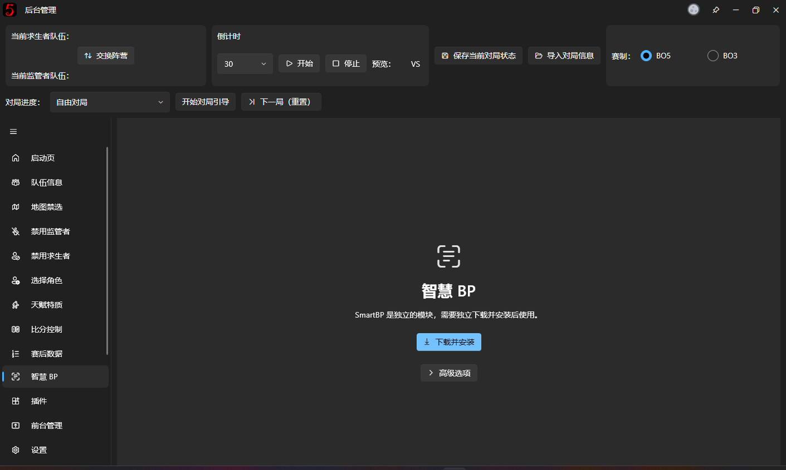

点击【下载并安装】，软件便会下载与当前软件版本匹配的智慧 BP 模块，并自动完成安装。

下载过程中可以查看进度，也可以暂停、继续或取消下载。

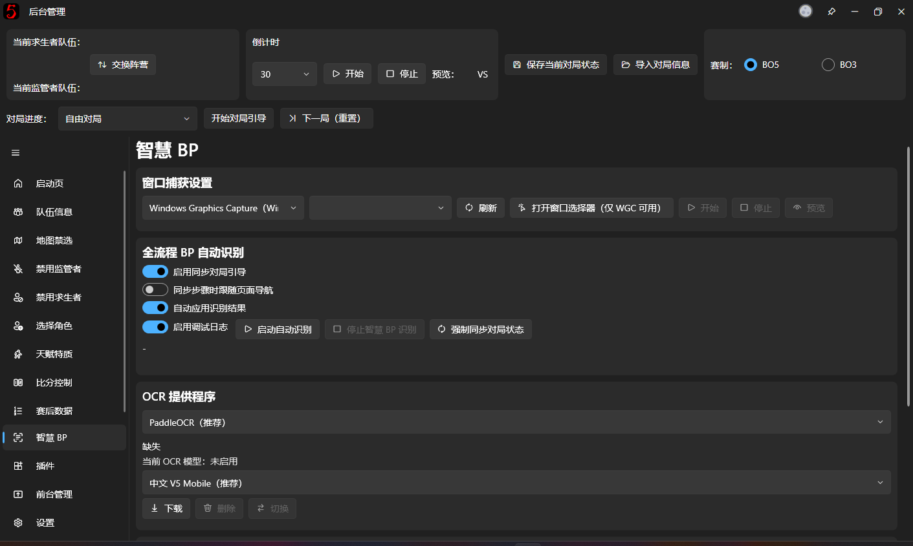

安装完成后，软件会加载智慧 BP 模块，进入功能页面。

如果软件提示需要重新启动，请根据提示重启程序后继续使用。

正常情况下，不需要自行下载 DLL 文件或手动配置模块目录。

## 二、准备 OCR 识别模型

智慧 BP 通过 OCR（光学字符识别）读取游戏画面中的文字，例如角色名称、BP 阶段提示以及赛后统计数据。

**首次安装智慧 BP 模块后，通常还需要下载一个 OCR 模型才能开始识别。**

在智慧 BP 页面中找到【OCR 提供程序】区域。

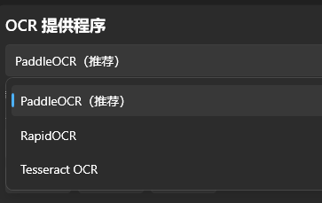

建议使用 PaddleOCR，因为开发者没有测另外两个，只能说理论上应该可用，不保证识别准确性，并且没有支持显卡加速

### 选择模型

软件提供多种 OCR 模型。对于中文游戏画面，建议优先选择：

**中文 V5 Mobile（推荐）**

这个模型在识别速度和准确率之间取得了较好的平衡，适合一般用户使用。

其他可选模型包括中文 V4、中文 V3 Slim、英文 V4 Mobile 和日文 V4 Mobile 等。

如果你使用的是中文游戏客户端，一般不需要专门切换到英文或日文模型。

### 下载并启用模型

在模型列表中选择需要的模型，然后：

1. 点击【下载】，等待模型下载完成。
2. 下载完成后，点击【切换】，将其设为当前使用的 OCR 模型。
3. 检查页面中显示的当前模型名称，确认模型已正确启用。

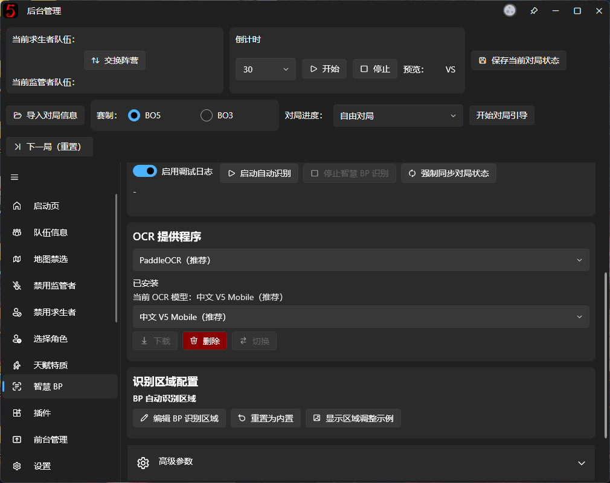

注意：**下载模型和启用模型是两个不同的操作。** 如果只完成了下载但没有切换到对应模型，智慧 BP 仍可能提示 OCR 功能尚未就绪。

正常使用时，选择一个适合当前游戏语言的模型即可，不需要把所有模型全部下载下来。

## 三、选择需要识别的游戏窗口

OCR 模型准备完成后，还需要告诉智慧 BP 从哪个窗口读取画面。

在页面顶部找到【窗口捕获设置】。

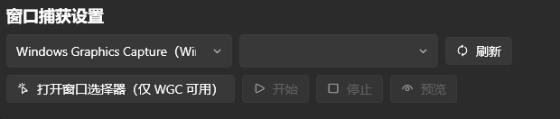

### 选择捕获方式

通常建议使用默认的 **Windows Graphics Capture（WGC）**。

这是 Windows 提供的窗口捕获方式，适合读取游戏窗口的画面。

软件同时提供 Bitblt 捕获方式，供部分无法正常使用 WGC 的场景选择。一般情况下，可以保持默认设置即可。

### 选择游戏窗口

首先打开《第五人格》游戏客户端，然后返回智慧 BP 页面。

可以在窗口下拉框中选择需要捕获的游戏窗口。如果没有看到目标窗口，可以点击【刷新】重新获取列表。

选择完成后，点击【开始】启动窗口捕获。

你也可以使用【打开窗口选择器（仅 WGC 可用）】，通过 Windows 的窗口选择界面直接选择并开始捕获。

### 检查捕获画面

捕获启动后，点击【预览】，确认智慧 BP 实际读取到了什么内容。

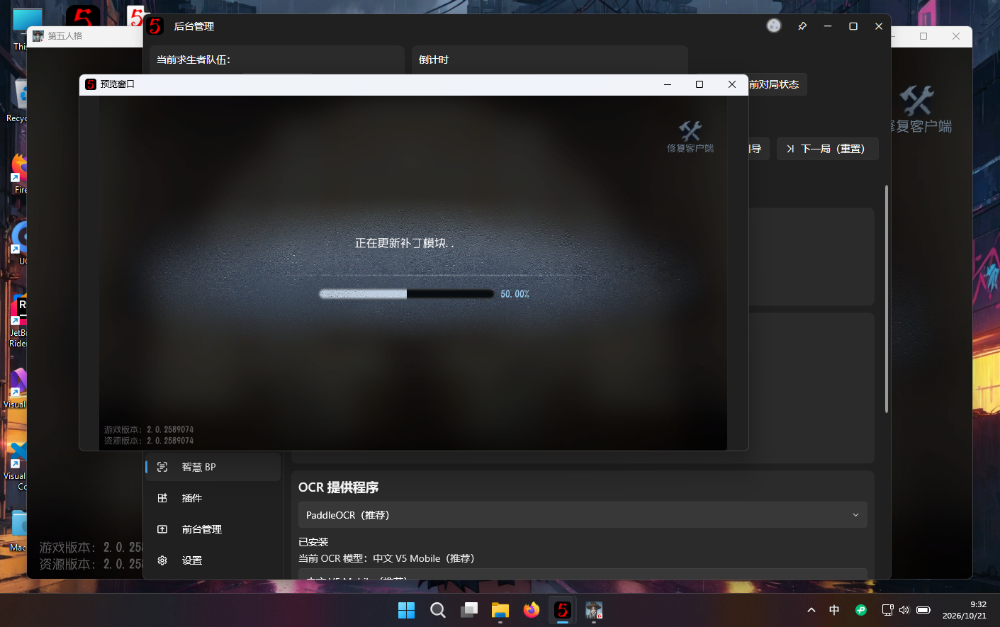

这里需要特别注意：**智慧 BP 识别的是预览中的画面，而不是你在显示器上看到的任意内容。**

如果预览画面不正确、没有显示游戏，或者游戏画面被裁切得过于严重，后续识别结果也可能出现问题。

因此，建议在正式比赛开始之前完成捕获测试。

## 四、启动自动 BP 识别

窗口捕获和 OCR 模型均准备完成后，就可以启动智慧 BP 的自动识别功能了。

在智慧 BP 页面找到【全流程 BP 自动识别】区域。

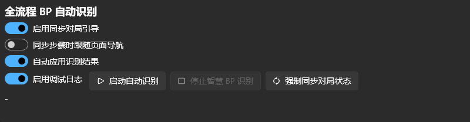

### 启动之前

在启动自动识别前，请先确认：

1. 后台已经设置好正确的双方队伍。
2. 已经设置正确的 BO3 或 BO5 赛制。
3. 当前对局进度和半场设置正确，例如第一局上半场。
4. 窗口捕获预览能够正常显示游戏 BP 画面。

关于前面的准备工作，可参阅[快速开始](quick-start.md)。

**其中，对局进度尤其重要。** 如果当前半场设置错误，自动识别的信息可能被应用到错误的对局中。

### 自动识别开关

在自动识别区域中，可以看到以下选项。

**启用同步对局引导**

开启后，智慧 BP 会根据游戏画面中识别到的阶段信息，辅助同步后台的对局引导进度。

例如，游戏从禁用角色阶段进入选择角色阶段时，软件会尝试让后台的引导步骤跟上实际比赛进度。

自动同步会遵循现有引导流程，不会为了追赶画面而无条件跳过尚未完成的 BP 步骤。

**同步步骤时跟随页面导航**

这个选项用于在引导步骤同步时，让软件后台页面跟随导航。

它只影响软件内部的页面导航，**并不意味着会自动切换 OBS 中的直播画面**。

如果你习惯手动切换后台页面，可以保持关闭。

**自动应用识别结果**

开启后，软件会将识别成功、且满足自动应用条件的角色禁用和选择结果写入后台。

如果只想先观察识别结果，而不希望智慧 BP 自动修改后台，可以关闭这个选项。

### 开始识别

确认设置正确后，点击【启动自动识别】。

软件会弹出确认提示，再次提醒你检查当前的对局进度和半场。

确认后，智慧 BP 将开始持续识别指定窗口中的游戏画面。

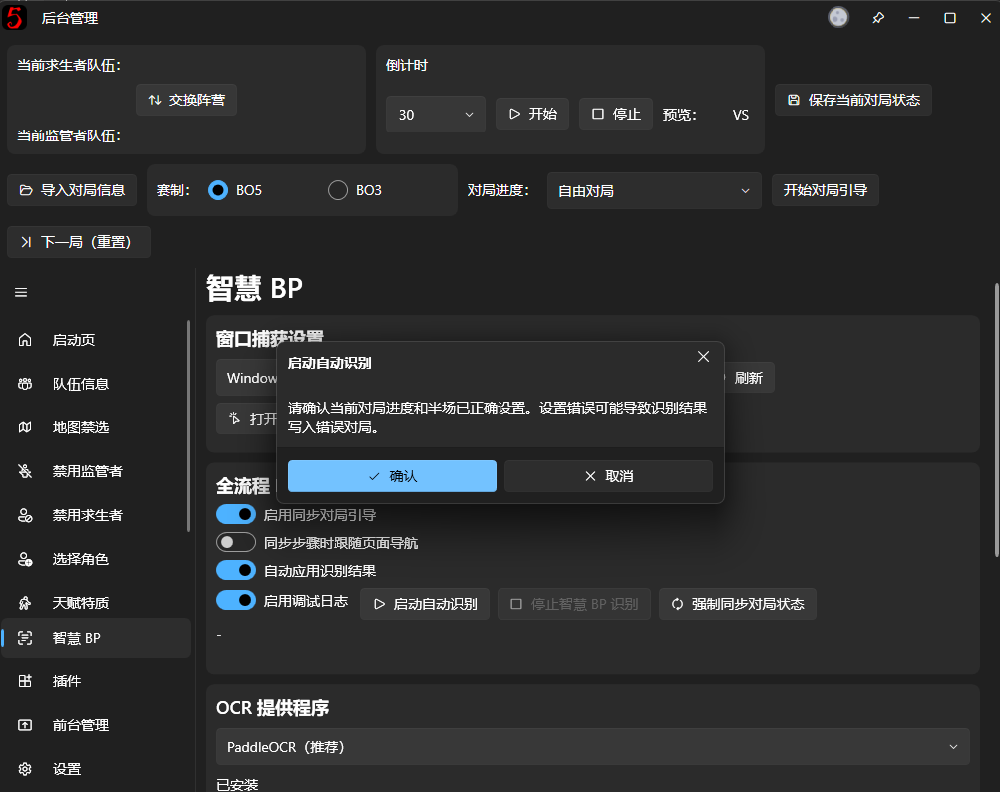

接下来，可以在游戏中正常进行角色 BP，观察后台的[禁用角色](ban-character.md)和[选择角色](pick-character.md)页面。

当软件识别到有效角色信息时，会尝试自动更新对应的后台记录。

当进入“分配角色“阶段的时候，软件会根据识别到的选手名称自动进行“角色换位“操作，若你的赛事有**特殊选手 ID** 的需求，你可以单独设置用于识别的**游戏内 ID**

具体操作为：

1. 打开队伍信息页面
2. 点击选手旁边的【更多】按钮
3. 在这里填写选手的游戏内 ID

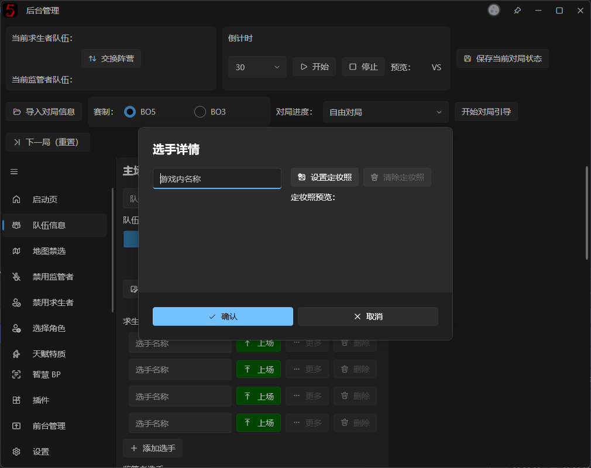

智慧 BP 在角色分配阶段所使用用于对应的 ID 将会按照如下优先级顺序进行识别：

游戏内 ID → 选手名称 → 不做任何操作

识别结果会受到画面清晰程度、角色名称显示效果以及当前 BP 阶段等因素影响。如果识别失败或无法确定对应角色，软件不会保证每一个槽位都被自动填入。

### 停止自动识别

如果需要中途停止，可以点击【停止智慧 BP 识别】。

注意，**停止自动识别和停止窗口捕获并不是同一个操作**。

自动识别运行期间，软件应会保持捕获状态。如果想完全停止窗口捕获，应先停止自动识别，再回到【窗口捕获设置】点击【停止】。

当游戏进入区域选择不再适用角色 BP 识别的画面时，自动识别可以根据当前场景自行结束。

## 五、使用智慧 BP 识别赛后数据

除了角色 BP，智慧 BP 还支持自动识别赛后的统计数据。

这一功能与角色 BP 自动识别相互独立，**不需要启动整场 BP 的自动识别循环**。

### 准备赛后画面

游戏结束后，打开包含双方选手统计数据的赛后结算画面。

确认智慧 BP 仍在捕获正确的游戏窗口，并能读取到当前画面。

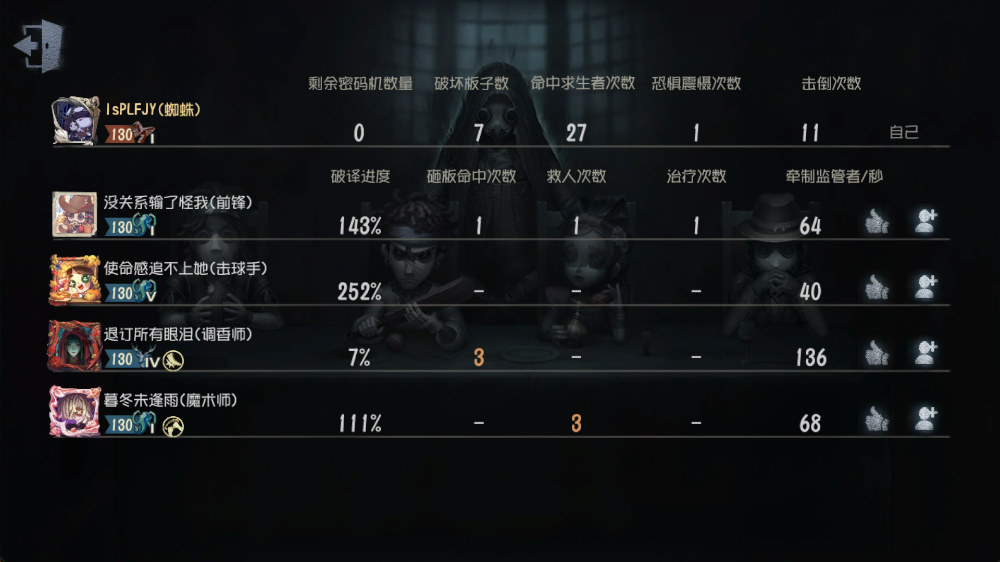

### 自动填写赛后数据

返回本软件的【赛后数据】页面。

如果智慧 BP 模块已经加载，页面中会出现【智慧 BP】相关功能区域。

点击【自动识别并填充赛后数据】，软件会读取当前捕获画面，并尝试识别其中的选手数据。

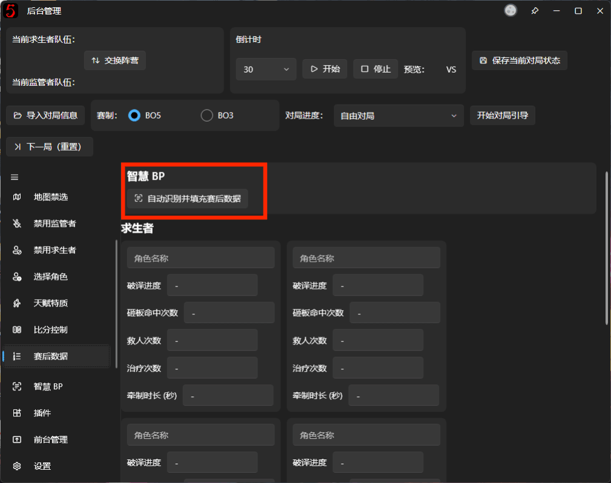

识别过程中会显示进度和当前处理阶段。

识别完成后，软件会将成功解析的数据写入当前对局，包括求生者和监管者的赛后统计信息。

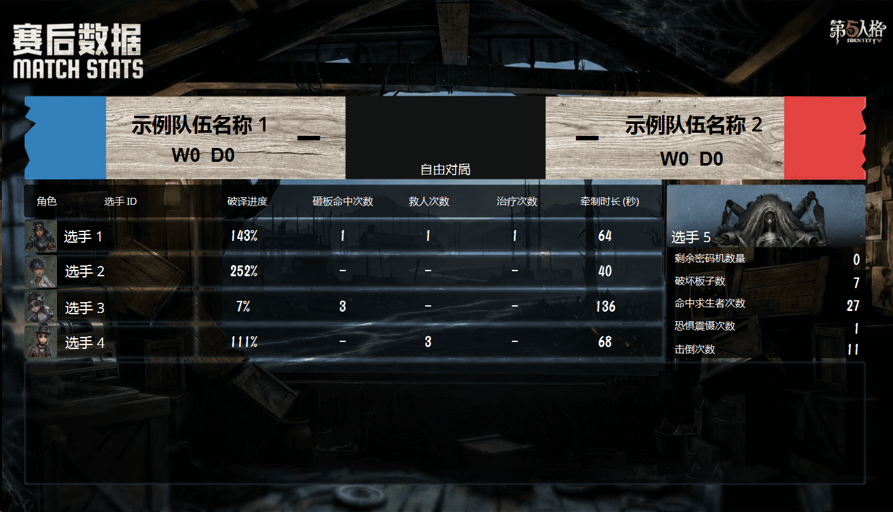

请在识别完成后检查填写结果，尤其是选手角色对应关系和数值是否正确。

虽然智慧 BP 会尝试处理 OCR 漏字、数字识别错误等问题，但自动识别仍然可能出现遗漏或误判。发现错误时，可以直接在赛后数据页面手动修改。

建议在确认数据无误后，再继续进行下一局的操作。

## 六、常见问题

### 无法启动识别，提示 OCR 未就绪

首先检查是否已经下载并切换到一个可用的 OCR 模型。

如果你刚下载完成模型，可以检查【当前 OCR 模型】显示的名称，确认它已经启用。

### 无法获取游戏画面

请检查窗口捕获是否已经启动，并通过【预览】查看当前画面。

如果捕获的窗口已经关闭，或游戏重新启动后原来的窗口不再有效，可以重新刷新窗口列表并选择游戏窗口。

### 识别到了错误的角色

请检查当前捕获的画面是否正确，尤其是游戏中的角色名称是否清晰、画面是否与预期的 BP 阶段一致。

智慧 BP 依赖画面中的文字信息，遇到画面遮挡、文字显示不完整或特殊界面布局时，可能无法正确解析。

如果自动识别持续不正确，可以先关闭【自动应用识别结果】，避免错误数据继续写入后台，并改用手动操作。

### 智慧 BP 会自动控制直播画面吗？

暂时不会。

智慧 BP 的主要用途是根据游戏画面更新软件内部的 BP 数据。OBS、直播姬等软件中的场景切换，仍需使用原有的导播操作方式。

后续会利用对局引导接入 OBS 控制的功能

## 【进阶】一、手动强制同步对局状态

正常情况下，智慧 BP 会根据连续识别到的画面逐步更新后台。

但如果在 BP 进行到一半时才启动识别，或者之前某些步骤没有被正常识别，可能出现后台状态落后于实际游戏画面的情况。

这时可以尝试使用【强制同步对局状态】。

该功能会基于**当前捕获画面**进行一次独立的完整 BP 识别，尝试将对局进度、角色禁用、角色选择以及求生者角色分配等信息同步到后台。

与普通的自动识别不同，强制同步不是等待后续连续识别逐步完成，而是直接根据当前画面进行状态同步。

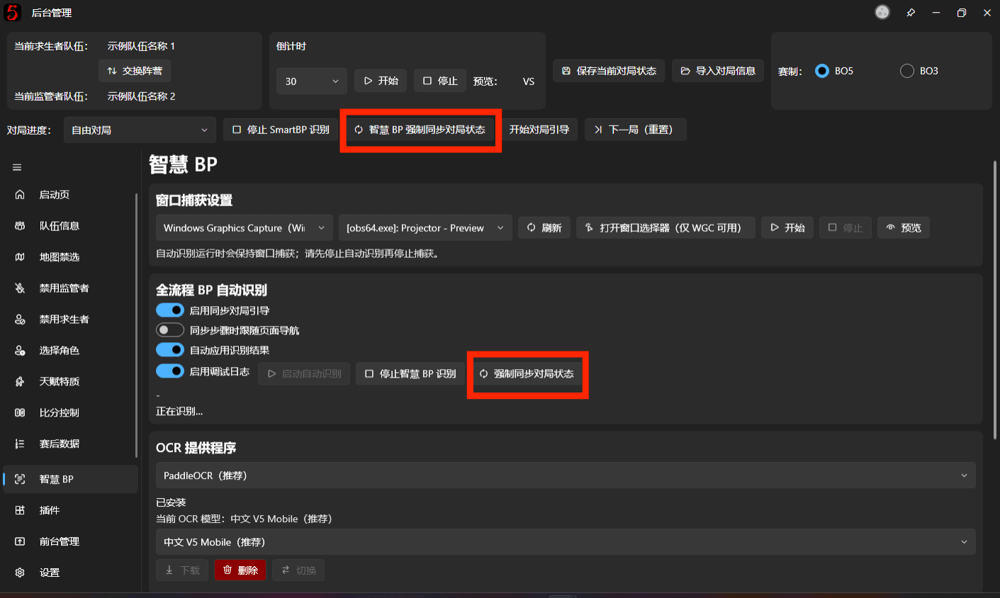

使用时需要注意：

- 请先确认当前捕获画面确实处于需要同步的角色 BP 阶段。
- 强制同步可能直接改变后台的角色记录和引导位置。
- 角色同步时不会像正常 BP 操作一样逐个播放对应的选择动画。
- 如果当前画面不足以确定完整的 BP 状态，软件可能无法完成同步。

**因为是全范围识别，单次识别耗时较长，这个功能适合处理漏识别或中途接管的情况，不建议将它当作常规 BP 操作按钮反复点击。**

## 【进阶】二、调整 BP 识别区域

智慧 BP 使用预先定义的识别区域，从完整游戏画面中提取与 BP 有关的内容。

默认配置针对常见的游戏 BP 界面制作，一般情况下无需修改。

如果你使用特殊分辨率、画面比例或经过裁剪的游戏画面，OCR 可能无法准确读取对应位置的文字。这时可以手动调整识别区域。

### 打开区域编辑器

首先启动窗口捕获，确保能够获取当前游戏画面。

然后在智慧 BP 页面找到【识别区域配置】，点击【编辑 BP 识别区域】。

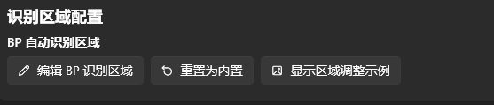

区域编辑器会使用当前捕获到的画面作为参考，展示对应的识别框。

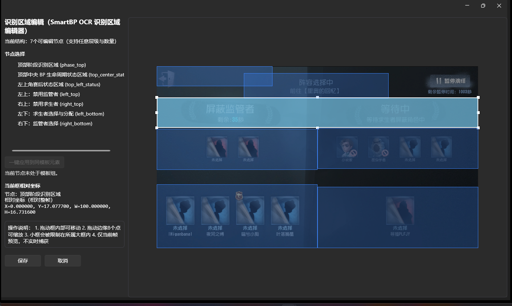

### 调整区域

BP 识别区域主要包括以下内容：

- **顶部阶段识别区域**：识别当前处于禁用、选择等哪个 BP 阶段。
- **左上区域**：识别监管者禁用信息。
- **右上区域**：识别求生者禁用信息。
- **左下区域**：识别求生者选择及分配信息。
- **右下区域**：识别监管者选择信息。
- **BP 结束状态区域**：辅助判断角色 BP 是否已经结束，以及是否进入等待或区域选择等状态，放在左上角会出现“区域选择“部分字样的位置。

编辑时，可以拖动识别框移动位置，也可以拖动边缘的控制点调整大小，不要框到多余的地方。

完成修改后保存配置即可。

注意，编辑器显示的是打开时获取的参考画面，并不是持续更新的实时预览。

如果调整之后识别效果反而变差，可以点击【重置为内置】，恢复软件自带的默认区域配置。

## 【进阶】三、切换 OCR 提供程序

除了默认的 PaddleOCR，智慧 BP 还支持其他 OCR 提供程序。

目前可使用的主要方案包括：

| 提供程序 | 特点 |
| --- | --- |
| PaddleOCR | 默认方案，提供多种语言和规格的模型 |
| RapidOCR | 可选的本地 OCR 方案，提供中文模型管理 |
| Tesseract | 可选方案，需要下载对应语言数据 |

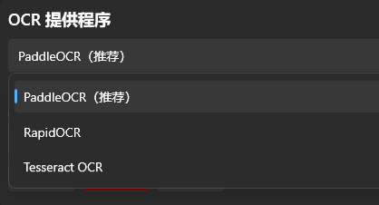

不同的提供程序使用不同的模型或语言文件，并不是下载一个 PaddleOCR 模型后就能直接切换到其他引擎。

例如，使用 Tesseract 时，可以选择简体中文、英语或日语语言数据，并通过【下载所选语言数据】完成安装。

使用 RapidOCR 时，则需要在其模型管理区域下载对应模型。

智慧 BP **不会在当前 OCR 提供程序出错时自动切换到其他提供程序**。如果切换了引擎，请确认新引擎所需的模型或语言文件已经准备完成。

对于一般用户，建议优先使用默认的 PaddleOCR，只有在特定画面识别效果不理想时再尝试其他方案（其实其余的不会更加理想只会更拉）。

## 【进阶】四、识别速度与高级参数

智慧 BP 可以调整自动识别的执行间隔，以及部分 OCR 处理选项。

这些设置位于【高级参数】中。

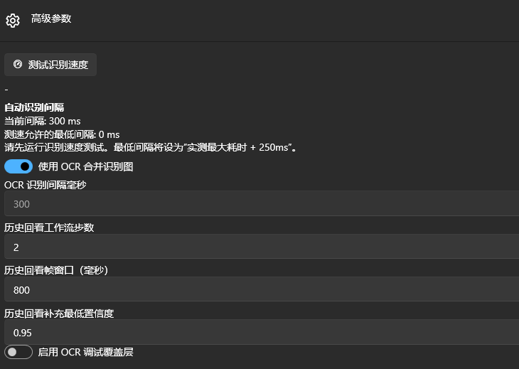

### 测试识别速度

点击【测试识别速度】，软件会使用测试画面执行 OCR 识别，测量当前配置下的处理耗时。

测速完成后，软件会据此计算允许设置的最低识别间隔。

当前最低间隔的计算方式为：

**实测最大识别耗时 + 250 毫秒**

在更换 OCR 引擎或修改相关配置后，建议重新测速，再调整识别间隔。

### 识别间隔

识别间隔用于控制自动识别循环的执行频率。

间隔较短，可以更频繁地检查画面变化，但也会增加 CPU 或 GPU 的工作量。

间隔过短并不一定能让识别更及时。如果一次 OCR 处理的耗时已经超过间隔，反而可能导致任务积压、结果滞后或界面卡顿。

因此，建议普通用户保持软件提供的默认设置。

### 合并识别图

【使用 OCR 合并识别图】可以把多个需要识别的区域合并后交给 OCR 处理，减少重复识别调用。

通常建议保持开启。

如果发现某些区域的文字被错误归入其他区域，可以临时关闭这个选项进行排查。

### 历史回看

智慧 BP 可以在部分识别步骤出现遗漏时，参考近期缓存的画面补充识别结果。

相关选项包括历史回看工作流步数、回看帧时间窗口以及最低置信度等。

这些参数主要用于处理 BP 阶段快速变化、OCR 偶发遗漏等情况。普通用户不需要修改。

## 【进阶】五、CUDA 硬件加速

部分设备可以通过 CUDA 加速 PaddleOCR 的识别过程。

如果软件检测到相关硬件环境，智慧 BP 页面会提供 CUDA 硬件加速设置与状态信息。

CUDA 是 NVIDIA 的 GPU 计算技术，因此并非所有显卡都支持。

如果所需运行组件尚未准备完成，软件可能提供下载依赖的入口。安装相关组件后，也可能需要重新启动程序。

**CUDA 并不是使用智慧 BP 的必要条件。** 不支持 CUDA 的电脑仍然可以使用 CPU 执行 OCR 识别。

如果你的电脑没有可用的 NVIDIA CUDA 环境，通常直接使用默认的 CPU 模式即可，不需要额外安装 CUDA。

## 【进阶】六、查看识别日志与调试结果

如果需要排查识别不准确、角色匹配失败或自动同步异常的问题，可以使用智慧 BP 提供的调试功能。

页面中的【调试选项】包含一些用于查看识别结果的工具。

例如：

- 对内置测试画面执行识别。
- 对当前捕获画面执行单次识别。
- 查看当前 BP 阶段、候选操作及识别结果。
- 查看最近一次赛后数据识别得到的选手、角色和数字。
- 打开独立的识别日志窗口。

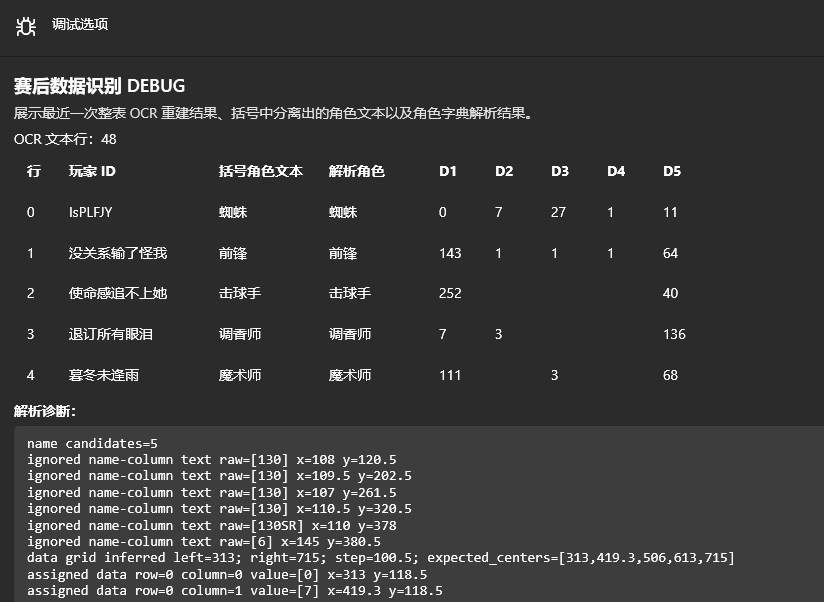

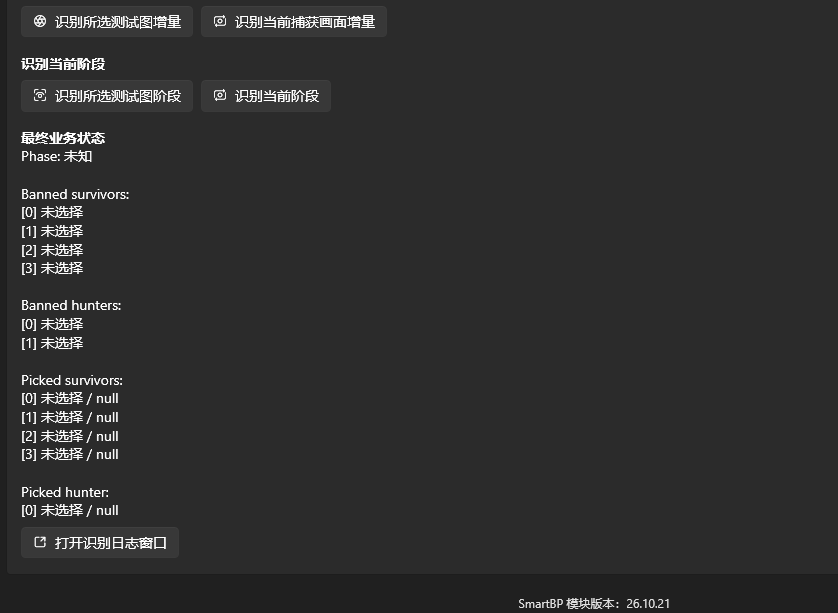

如果准备向开发者反馈识别问题，建议提供当时的游戏画面、捕获预览截图，以及对应的识别日志。

还可以在高级参数中临时启用【OCR 调试覆盖层】，帮助判断文字检测框是否偏离实际目标。

这类调试功能会增加一定的额外处理或磁盘写入开销，建议仅在排查问题时开启。

## 【进阶】七、手动管理智慧 BP 模块

智慧 BP 模块通常通过页面中的【下载并安装】按钮自动安装和管理。

如果下载出现问题，或者你已经拥有完整的模块文件，也可以在未加载模块时展开【高级选项】进行手动操作。

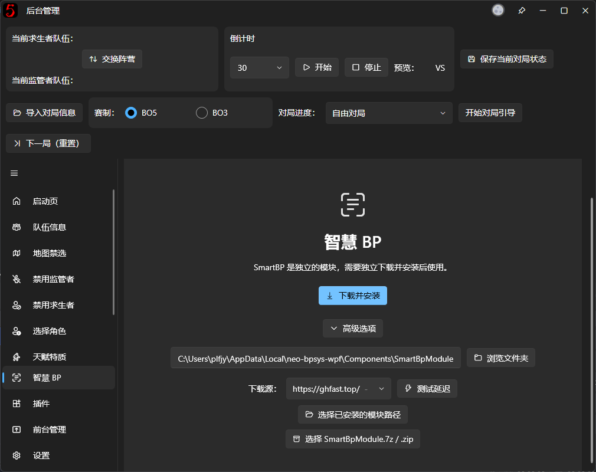

这里可以修改模块目录、选择已经安装的模块，或者导入本地的模块压缩包。

请注意，**智慧 BP 模块包与前台设计器使用的 `.bpui` 布局包不是同一种文件**，不能混用。

智慧 BP 模块需要与当前主程序的版本及运行环境兼容。随意替换 DLL 文件或者使用不完整的模块目录，可能导致模块无法加载。

如果软件提示模块文件缺失或损坏，可以优先使用页面提供的【重新下载并修复】功能。

对于大多数用户，建议保持默认安装位置，并通过软件内置的下载、修复及更新入口管理智慧 BP 模块。